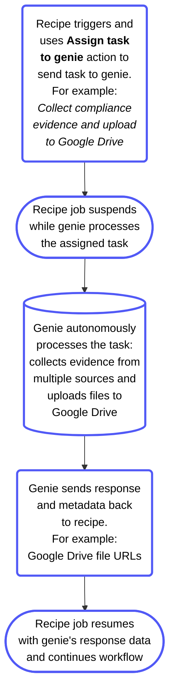
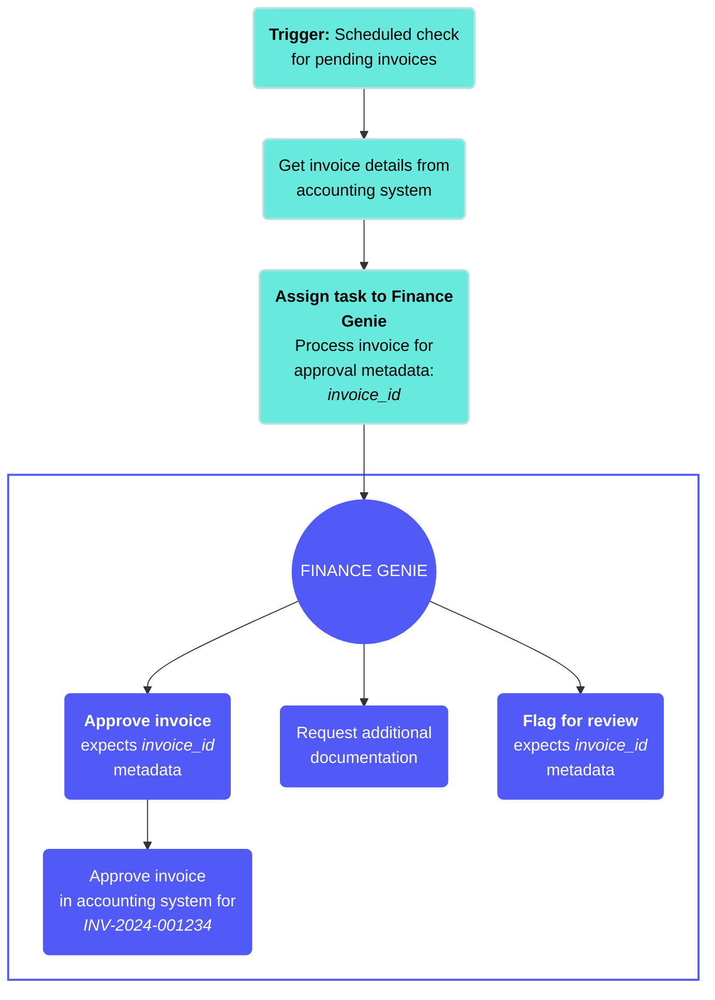

# Agent orchestration

Agent orchestration is a key capability of large action models, enabling genies to plan and execute multi-step business processes autonomously within recipes. Recipes assign tasks to genies without user input. Genies process tasks while the recipe job pauses, then return responses and metadata to the recipe. The recipe resumes with the returned data.

Watch a quick video guide: Assign a task to a genie

[Video](https://www.youtube.com/embed/ow3gbMp5QH4?rel=0&si=gDcUgV-jzvSw7Cro)

You can track Agent orchestration workflows on the [Conversations](/en/agentic/agent-studio/conversations) page. Each task assigned to a genie appears as a new conversation.

Agent orchestration uses the **Assign task to genie** action. Refer to the [Assign task to genie](/en/agentic/agent-studio/connectors/workato-genie-connector/actions/assign-task-to-genie) action reference for a field-level description of inputs and outputs.

The **Assign task to genie** action lets you assign a task to your genie. You must provide a clear task description to ensure that your genie understands how to handle the task.

> **VERIFIED USER ACCESS and USER CONFIRMATION CONNECTIONS AREN'T SUPPORTED**
> 
> The **Assign task to genie** action can't be used with genies that have [verified user access](/en/agentic/agent-studio/verified-user-access) skills or that require user confirmations with [Business approvals](/en/agentic/agent-studio/business-approvals).

Refer to [App Events vs Agent orchestration](/en/agentic/agent-studio/app-events-vs-agent-orchestration) for recommended uses for App events and Agent orchestration.

## How it works

The **Assign task to genie** action is available in any recipe as a standard action step. The following fields are required to set up your action:

- **Genie**: The genie that processes the task.
- **Task instructions**: This is the prompt the genie receives to process its assign task without human assistance. Everything the genie needs to complete the task must be in the task instructions. Refer to [Write effective task instructions](#write-effective-task-instructions) for more information.
- **Metadata**: Optional structured data passed to the genie with task instructions. Metadata fields are defined in the skill trigger of any skill the genie calls during task processing. Pass values, such as an invoice ID, an opportunity ID, or a user email, as metadata fields rather than embedding the values in the task instruction text if a skill must access specific values from the recipe context. Metadata values are accessible in the skill as datapills from the **Start workflow** trigger.
- **Conversation ID**: Optional field that enables the genie to process the task using context and conversation history from the identified conversation. The genie processes the task without conversation context and history when this field is left blank. You can leave this field blank for use cases, such as classification, summarization, or evaluation. Use cases that require continuity, such as chaining multiple **Assign task to genie** calls that build on each other must have the Conversation ID passed from the first call's output to subsequent calls to maintain context across the chain.
- **Configure genie output for use in this recipe**: An optional configuration that allows you to define custom output fields. The genie returns the response in a structured format matching the defined schema rather than as free-form text. The structured output fields become datapills available in downstream recipe steps.

The following process begins when the recipe reaches the **Assign task to genie** action step:

- The recipe pauses and the task is sent to the genie
- The genie processes the task using its job description, available skills, and knowledge bases
  - The recipe job is suspended during genie processing and doesn't consume recipe runtime while waiting. Processing time depends on the complexity of the task and whether the genie needs to call skills or search knowledge bases. Simple reasoning tasks complete in seconds. Tasks requiring multiple skill calls may take longer.
- The genie returns a response
- The recipe resumes with the genie's response available as a datapill



## Assign task to genie action

The **Assign task to genie** action sends a task from a recipe to a genie, which processes the task autonomously and returns a response to the recipe.

You can create a dedicated recipe from the genie editor, or add the action to an existing recipe.

**Create from the genie editor**

1. Go to the genie's **Triggers** section and click **\+ Add**.
   
2. Select **Receive a task**.
   
   _Triggers section menu_
   
   Workato creates a recipe with the **Assign task to genie** action already added and configured to send tasks to this genie, and opens the recipe editor.
   
   _**Assign task to genie** action in the recipe editor_
   
3. Optional. Rename the recipe.
   
4. Click **Select an app and trigger event** and configure the trigger that should start the task.
   

**Add to an existing recipe**

1. Go to the recipe where you plan to assign a task to a genie.
   
2. Click the **Select an app and action** step.
   
3. Search for and select `Workato Genie`.
   
4. Select the **Assign task to genie** action.
   
   _**Assign task to genie** action_
   

### Configure the action

Complete the following steps to configure the **Assign task to genie** action:

1. Click the **Assign task to genie** action.
   
2. Use the **Genie** drop-down menu to select the genie you plan to use. This field is already set if you created the recipe from the genie's **Triggers** section.
   
   _Set up the **Assign task to genie** action_
   
3. Enter detailed instructions in the **Task description to genie** field. Write clear, self-contained tasks to ensure your genie handles them correctly. Include all required data.
   
   > **BEST PRACTICES FOR TASK DATA**
   > 
   > Write clear task instructions and include all required data you plan for your genie to process to design reliable and autonomous orchestration workflows.
   > 
   > - Keep tasks self-contained and use Conversation ID for continuity.
   > - Use structured output for downstream mapping with predictable fields, such as status, result, and URLs.
   > - Delegate across genies by splitting large or multi-domain tasks.
   > - Monitor and evaluate by reviewing tasks on the **Conversations** page.
   
   For example:
   
   ```plaintext
   Review the customer onboarding form and extract the following:
   - Company name and size
   - Industry category
   - Required integrations
   
   Also retrieve their enterprise compliance requirements from Salesforce if the company size is over 500 employees. Return all data in JSON format with fields: company_name, company_size, industry, integrations (array), enterprise_requirements (object or null).
   ```
   
   Alternatively, you can provide a structured description format to improve outcomes. For example:
   
   ```plaintext
   
   <instructions>
   Perform the following steps for the following task data
   - [Step 1]
   - [Step 2]
   
   If you hit errors or need clarification
   - [Error handling instructions]
   </instructions>
   
   Use the following context to handle the task
   <data>
   [Map any datapills or provide the task data so your genie can handle it]
   </data>
   ```
   
4. Optional. Expand the **Additional context for genie** section and provide up to ten files as context for the task.
   
5. Optional. Provide the conversation ID in the **Conversation ID** field to pass context from a previous task. This allows a task to build on the earlier conversation.
   
6. Optional. Expand the **Task metadata** section and click **Add parameter** to provide custom key and value pairs for your metadata, such as `invoice_id` for an invoice processing genie or `user_email` for an IT reset password genie. Any skill your genie uses can access the metadata you add here.
   
   > **METADATA MUST BE CONFIGURED IN SKILL TRIGGER**
   > 
   > You must define matching metadata in your skill trigger for the skill to access the metadata.
   
   _Define custom metadata_
   
7. Optional. Go to the **Configure genie output for usage in this recipe** section and provide custom output fields to enable your genie to respond with a structured output rather than a plain text response. This allows you to use the output datapills in downstream steps in your recipe.
   
8. Click **Save**.
   
9. Click **Start recipe** to activate it.
   

## Agent orchestration example use cases

Agent orchestration lets genies run multi-step tasks autonomously within recipes. This enables workflows that require decision-making, data gathering, or document handling to run without user input. Refer to the following example use cases to determine how Agent orchestration can be applied to your workflows:

- **Autonomous task processing**: Genies perform complete tasks while the recipe job is suspended. For example:
  - **Invoice reconciliation**: Compare invoices and POs, and then return JSON summary of matches and discrepancies.
  - **Contract summarization**: Extract key clauses, such as termination, renewal, and payment from contracts.
  - **Support triage**: Categorize tickets and suggest priority level or assignee.
- **Knowledge-based decision-making**: Genies use internal knowledge bases to guide deterministic workflows. For example:
  - **Policy Q&A**: Genies answer questions within a recipe using internal SOPs or wikis.
  - **Documentation lookup**: A support genie retrieves relevant product documents and URLs.
- **File and data processing**: Genies parse, validate, or enrich structured and unstructured data. For example:
  - **Document classification**: Identify document type and metadata.
  - **Data extraction**: Parse spreadsheets or CSVs and enrich data through API interaction.
  - **Evidence upload**: Collect and upload audit files to Google Drive or SharePoint.
- **Testing and evaluation**: Genies autonomously test workflows or other genies. For example:
  - **Response testing**: Compare genie outputs against expected answers.
- **Genies in channels**: Genies process background tasks while keeping conversational context in combination with Workbot for Slack or Teams. For example:
  - **Persistent Conversation ID**: Maintains multi-turn conversations using the same Conversation ID.
- **Cross-agent collaboration**: Genies delegate subtasks to each other with the **Assign task to genie** action to form multi-agent workflows. For example:
  - **Compliance audit**: Audit Genie delegates evidence collection to another genie to compile results.
  - **Procurement**: Finance genie validates a budget, and then Procurement genie proceeds to onboarding.
  - **Project updates**: Product Manager genie summarizes Jira issues, and then Communications genie drafts updates.

### Defined task metadata example use cases

The following example use cases provide an overview of how to define and use metadata in the **Assign task to genie** action:

#### Invoice processing

An invoice is automatically created in your accounting system, and the Finance Genie autonomously processes it for approval. Your scheduled trigger runs and detects new pending invoices. The trigger retrieves the invoice details from the accounting system and assigns the task to the Finance Genie with the `invoice_id` metadata defined. This method is stable and allows the genie to process the request without directly handling the metadata, which eliminates the chance of a hallucination.

The Finance Genie autonomously determines the appropriate action, such as approve invoice, request additional documentation, or flag for review, and executes the invoice approval in your accounting system using the verified `invoice_id` metadata to ensure that the request can't be spoofed.

**Workflow outline**

- **Scheduled trigger**: The recipe runs on a schedule to check for new pending invoices in your accounting system.
- **Get invoice context**: The recipe retrieves the invoice details and extracts the invoice ID from the accounting system. **Assign task to genie**: The recipe uses the **Assign task to genie** action to send the invoice processing task to the Finance Genie with `invoice_id` metadata, for example, `INV-2026-001234`, and suspends the recipe job.
- **Autonomous task processing**: The Finance Genie references the task instructions and available skills to determine the appropriate action, such as approve invoice, request additional documentation, or flag for review.
- **Execute action**: The genie uses the approve invoice skill to approve the invoice in your accounting system for the invoice specified in the `invoice_id` metadata.
- **Complete workflow**: The genie confirms the invoice approval was successful and returns the completion status to the original recipe.

The following diagram illustrates this workflow:



#### Password reset

A user requests a password reset in Slack, and the ITSM Genie autonomously processes the request. Your Workbot trigger detects a new message in a Slack thread and runs. It retrieves the user's email and assigns the task to the ITSM Genie with the `user_email` metadata. This method is stable and allows the genie to process the request without directly handling the metadata, which eliminates the chance of a hallucination.

The ITSM Genie autonomously determines the appropriate action, such as reset password, link with policy, or unlock account, and executes the password reset in Okta using the verified `user_email` metadata to ensure that the request can't be spoofed.

**Workflow outline**

- **Workbot connector trigger**: Workbot detects a new message in a Slack thread requesting a password reset.
- **Get user context**: The recipe retrieves the user's email address from Slack using their Slack ID.
- **Assign task to genie**: The recipe uses the **Assign task to genie** action to send the password reset task to the ITSM Genie with `user_email` metadata, for example, `jade.anderson@acme.com`, and suspends the recipe job.
- **Autonomous task processing**: The ITSM Genie references the task instructions and available skills to determine the appropriate action, such as reset password, unlock account, or link with policy.
- **Execute action**: The genie uses the reset password skill to reset the password in Okta for the user specified in the `user_email` metadata.
- **Complete workflow**: The genie confirms the password reset was successful and returns the completion status to the original recipe.

### Compliance audit example use case

A compliance audit triggers on a schedule and the Audit genie autonomously initiates evidence collection. The Audit genie uses an API endpoint skill to call a recipe that assigns the evidence collection task to the Evidence Collection genie.

The Evidence Collection genie autonomously collects required compliance documentation from multiple systems and uploads the files to Google Drive and returns the file URLs to the Audit genie, which then uploads the evidence to the governance, risk, and compliance tool.

**Workflow outline**

- **Trigger**: Scheduled recipe triggers the Audit genie to begin compliance evidence collection.
  
- **API call**: The Audit genie uses a skill to call an API endpoint recipe.
  
- **Assign task to genie**: The API endpoint recipe uses the **Assign task to genie** action to send the evidence collection task to the Evidence Collection genie and suspends the recipe job.
  
- **Autonomous task processing**: The genie references the task instructions to understand how to process the task.
  
- **Sends response**: The genie sends the response and metadata back to the recipe when the task is complete.
  
- **Resume recipe**: The API endpoint recipe resumes and returns the genie's response to the Audit genie.
  
- **Complete workflow**: The Audit genie uses the Google Drive URLs to access and upload the files to the governance, risk, and compliance tool using another skill.

---

---
url: >-
  https://docs.workato.com/en/agentic/agent-studio/agent-orchestration/task-instructions.md
description: Learn best practices for Assign task to genie instructions.
---

# Task instructions

Task instructions for the **Assign task to genie** action have different requirements than conversational genie prompts. The genie is completing a defined task and returning a result rather than having a conversation.

## Be specific about the goal

State the goal of the task in the first sentence. The genie should know immediately what it's being asked to produce. A task instruction produces a conversational response rather than a structured classification.

| ❌ Not recommended | ✅ Recommended |
| --- | --- |
| `help with this ticket` | `Evaluate the following support ticket and return a classification including category, priority, and a one-sentence reasoning.` |

## Pass required context in the instructions or metadata

The genie can't ask a user for missing information. You must add required data, such as a ticket description, account name, or a document to summarize, to the task instructions or in the metadata fields. Pass structured values as metadata. Pass unstructured content, such as document text, transcript content, or description fields, directly in the task instructions as labeled fields.

For example:

```plaintext
Ticket details:
- Subject: [Subject datapill]
- Description: [Description datapill]
- Priority: [Priority datapill]
- Submitter: [Submitter Email datapill]
- Category (current): [Category datapill]
```

## Specify the output format

Provide an exact format for the genie to use in its response. The genie follows the schema automatically for tasks with configured custom output fields. You must specify the format in the instructions for tasks that don't have custom output field configuration. Explicit output format instructions are essential for tasks where the recipe must parse and use the genie's response. A genie that returns `I think this should be categorized as Hardware with P2 priority because...` requires regex parsing. A genie that returns a clean JSON object doesn't require parsing.

For example:

```plaintext
Return your response as a JSON object with
the following fields only:
{
  "category": "one of: Hardware, Software,
               Access, Network, Other",
  "priority": "one of: P1, P2, P3, P4",
  "reasoning": "one sentence explanation",
  "confidence": "one of: high, medium, low"
}

Do not include any text outside the JSON
object. Do not add fields not listed above.
```

## Provide evaluation criteria for judgment tasks

Provide explicit criteria for tasks that require the genie to make a judgment, such as classification, scoring, or evaluations. Vague criteria produce inconsistent results across runs, while anchored criteria produce consistent, reliable outputs.

For example:

```plaintext
Classification criteria:

Hardware: issues involving physical devices,
peripherals, or hardware failures

Software: issues involving application errors,
software installation, or software access

Access: issues involving login failures,
password resets, or permission requests

Network: issues involving connectivity, VPN,
or network performance

Priority criteria:
P1: business-critical system down, affecting
    multiple users, no workaround available
P2: significant impact, workaround available
    but inconvenient
P3: moderate impact, reasonable workaround
    available
P4: minor issue, minimal business impact
```

## Instruct the genie to use only the data you provide

The genie may supplement the data you provide with its own reasoning or general knowledge without this instruction. The genie should base its output only on what was provided for classification and evaluation tasks where accuracy and consistency matter.

For example:

```plaintext
Base your classification only on the ticket
details provided above. Do not use assumptions
or general knowledge about typical ticket
patterns. If the provided information is
insufficient to make a confident classification,
set confidence to "low" and explain why in
the reasoning field.
```

The following example provides a complete set of task instructions for a support ticket classification task:

```plaintext
Classify the following support ticket and
return a structured classification result.

Ticket details:
- Subject: [Subject datapill]
- Description: [Description datapill]
- Current priority: [Priority datapill]
- Submitter: [Submitter Email datapill]

Classification criteria:

Category:
- Hardware: physical devices, peripherals,
  hardware failures
- Software: application errors, installation,
  software access
- Access: login failures, password resets,
  permission requests
- Network: connectivity, VPN, network performance
- Other: does not fit the above categories
Priority:
- P1: business-critical system down,
  multiple users affected, no workaround
- P2: significant impact, workaround
  available but inconvenient
- P3: moderate impact, reasonable
  workaround available
- P4: minor issue, minimal business impact

Return your response as a JSON object:
{
  "category": "Hardware|Software|Access|
               Network|Other",
  "recommended_priority": "P1|P2|P3|P4",
  "priority_change_needed": true|false,
  "reasoning": "one sentence",
  "confidence": "high|medium|low"
}

Base your classification only on the ticket
details above. Set confidence to "low" if
the information is insufficient for a
confident classification.
```

---

---
url: >-
  https://docs.workato.com/en/agentic/agent-studio/agent-orchestration/chain-multiple-calls.md
description: Use multiple Assign task to genie calls in the same recipe.
---

# Chain multiple calls

You can use multiple **Assign task to genie** calls in the same recipe, for example, a validation genie, followed by a summarization genie, followed by a routing genie. Chaining these correctly requires attention to context continuity and error handling.

## Pass context between calls

Each **Assign task to genie** call is discrete. The second genie call doesn't automatically have access to the first genie's context unless you pass it explicitly.

There are two approaches to handle how context is passed between genies:

- **Pass the Conversation ID**: Use the Conversation ID from the first **Assign task to genie** output as the Conversation ID input for the second call. This gives the second genie access to the conversation history from the first call. Use this approach when the second task must reference what the first genie said.
  
- **Pass structured output as task context**: Use the custom output fields from the first **Assign task to genie** call as labeled context in the second call's task instructions. This provides clean and reliable conversation history for structured data and enables the second genie to receive specific field values rather than a full conversation thread to parse.
  

For example:

```plaintext
Task: Draft a customer notification based
on the following ticket resolution details.

Resolution details from previous step:
- Ticket key: [ticket_key datapill]
- Category: [category datapill from Step 3]
- Resolution summary: [resolution datapill
  from Step 3]
- Time to resolve: [duration datapill]
```

## Error handling for chained calls

A chain of **Assign task to genie** calls can fail if the genie times out, a skill returns an error, or the output doesn't match the expected format causing downstream calls to receive incorrect or missing inputs.

You must add error handling after each **Assign task to genie** step in a chain:

- **Check the output fields**: Output fields must be populated and in the expected format before passing the values to the next step.
- **Handle low-confidence outputs**: Route to a human review step rather than continuing the automated chain if the genie returns a low-confidence output.
- **Log failures with enough context to diagnose the issue**: Include the task instructions, the genie's raw response, and the recipe job ID.

## Delegate subtasks between genies

The **Assign task to genie** action supports multi-agent architectures where a primary genie delegates subtasks to specialist genies. This allows the user to interact with the primary genie, which calls specialist genies headlessly through the **Assign task to genie** action to complete tasks.

The skills available to the primary genie must include a skill that calls the **Assign task to genie** action. This effectively makes the **Assign task to genie** action a callable skill. The primary genie calls this skill when it needs to delegate work.

---
