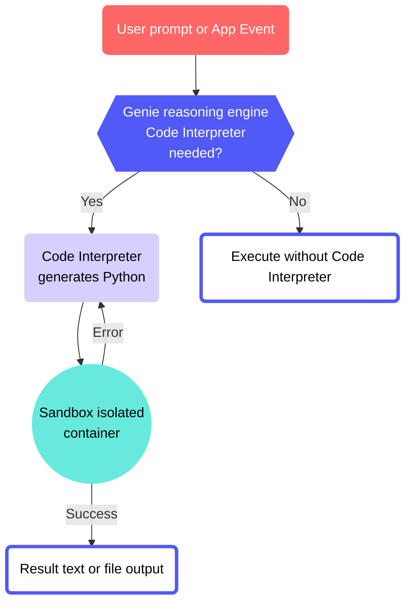

# Code Interpreter

Code Interpreter allows genies to upload csv, xlsx, json, and xml files and process large data outputs for accurate results using secure, isolated code sandboxes when enabled. Code Interpreter writes and runs code to process data from files you upload and large results pulled from a skill or knowledge base. You can perform following tasks:

- Provide structured data files for calculations or transformations through users
- Process structured data files provided within the [**Assign task to genie** action](/en/agentic/agent-studio/agent-orchestration#assign-task-action)
- Analyze large outputs from enterprise skills and skills from MCP servers
- Analyze files in a knowledge base, including uploaded files and connected sources, such as SharePoint

This expands a genie's computational abilities beyond what AI models can reliably handle natively. Code Interpreter enables genies to analyze data accurately, perform precise calculations, and process large files.

## When to use Code Interpreter

Use Code Interpreter in the following scenarios:

- **Accurate math and computation**: Perform calculations, aggregations, and statistical analyses that AI models often perform inaccurately when operating without Code Interpreter.
- **Large file processing**: Parse and analyze CSV, XLSX, and JSON files uploaded by users or passed through Agent orchestration, even when files exceed LLM context quotas.
- **Large skill output analysis**: Ask questions about the full output of a skill or MCP tool, such as thousands of Salesforce records, instead of a truncated sample.
- **Large knowledge base output analysis**: Ask questions about the full output of a knowledge base, such as thousands of expense records, instead of a truncated sample.
- **Workflow-triggered analysis**: Use App Events and recipes to pass files or data to the genie for computation. Return results as text or files in the conversation or a downstream workflow.
- **Generated file output**: Transform or enrich data, and save the resulting file to [Workato FileStorage](/en/features/workato-filestorage) for use in other recipes and workflows.

## How Code Interpreter works

A genie with Code Interpreter enabled determines when a user prompt or incoming [App Event](/en/agentic/agent-studio/app-events) requires computation. A genie completes the following workflow if computation is needed:

- Generates a Python script to solve the problem for the large data size.
- Executes the script in an isolated, secure container scoped to that conversation.
- Returns text or a file URL as results or error logs, which allows the genie to self-correct and retry before surfacing a response.

Containers are destroyed at the end of each conversation. Data doesn't persist across sessions.



## Enable Code Interpreter

You can enable Code Interpreter for any genie in Agent Studio. The steps in this section assume that you're signed in to Workato and have already created the genie where you plan to enable Code Interpreter.

Complete the following steps to add Code Interpreter to your genie:

1. Click **Edit**.
   
2. Go to the **Genie settings** card that includes the **Code Interpreter** field and click the cog (edit) icon to open the **settings** page.
   
   _Click the cog (edit) icon_
   
3. Click **Code Interpreter** in the sidebar.
   
4. Click the **Enable Code Interpreter** toggle to begin using Code Interpreter with your genie.
   
   _Click the **Enable Code Interpreter** toggle_
   
5. Click **Save**.
   

## Example Code Interpreter use cases

The following sections demonstrate use cases for Code Interpreter:

### Weekly finance pipeline analysis

A finance team schedules a weekly pipeline analysis. Every Monday morning, a scheduled recipe retrieves deal data from Salesforce, converts it to a file, and assigns the task to a genie using the **Assign task to genie** action with the file attached. The genie invokes Code Interpreter to analyze the data and returns a summary directly in Slack without manual exports or spreadsheet work.

> **FILE ATTACHMENT REQUIREMENT**
> 
> You must attach a file to the **Assign task to genie** action for Code Interpreter to work.

#### Workflow outline

- **Trigger**: A scheduled recipe runs every Monday and retrieves open deal data from Salesforce.
- **Assign task to genie**: The recipe uses the **Assign task to genie** action to pass the deal data file and task instructions to the genie. The recipe job suspends while the genie processes the task.
- **Genie reasoning**: The genie determines that the request requires computation and invokes Code Interpreter analysis.
- **Code generation**: Code Interpreter analysis generates a Python script to calculate totals, group deals by stage, and identify the top five deals by value.
- **Sandboxed execution**: The script runs in an isolated container scoped to that conversation.
- **Self-correction**: Code Interpreter analysis catches the error, revises the script, and retries automatically if the script fails.
- **Result**: The genie returns a text summary to the recipe. The recipe resumes and posts the summary to the designated user in Slack.

#### Sample output

```plaintext
📊 Weekly Pipeline Summary: March Closings

Total open pipeline: $1.09M across 16 deals

Stage            Deals   Value     % of Pipeline
Closed Won         2     $95K        8.7%
Negotiation        4     $380K      34.9%
Proposal           5     $310K      28.4%
Qualification      5     $305K      28.0%

🏆 Top 5 Deals by Value

Rank  Deal                  Value   Stage          Close Date
1     Acme Corp             $210K   Negotiation    Mar 28
2     Globex Inc            $145K   Negotiation    Mar 31
3     Initech               $120K   Proposal       Mar 25
4     Stark Industries      $110K   Qualification  Mar 30
5     Wayne Enterprises     $90K    Proposal       Mar 27

Key findings:
- $95K (8.7%) is already closed. $995K is still open.
- Negotiation is your most actionable bucket at $380K, and Acme Corp and Globex Inc make up $355K of it.
- The top 5 deals total $675K, or 62% of the pipeline.
- Stark Industries is the only top 5 deal still in Qualification with a close date this month, so it's the biggest slip risk.
```

### Chat file upload analysis

A sales manager uploads two quarterly revenue CSV files directly in the genie chat interface and asks the genie to merge the files, calculate total revenue and quarter-over-quarter growth for each customer, and save the result as a new file. The genie invokes Code Interpreter to merge the files, generates a downloadable CSV file, and returns an analysis summary in the chat, all without requiring any recipe configuration.

#### Workflow outline

- **File upload**: The user uploads two CSV files, for example: `q1_revenue.csv` and `q2_revenue.csv`, directly in the genie chat interface and submits a prompt. For example: `Merge these two files by customer. Add a Total_Revenue column (Q1 + Q2) and a QoQ_Growth_% column ((Q2 - Q1) / Q1). Save the result as a new CSV sorted by Total_Revenue, and summarize the top 5 customers.`
- **Genie reasoning**: The genie determines that the request requires joining and computing across the uploaded files and invokes Code Interpreter.
- **Code generation**: Code Interpreter generates a Python script that loads both files, merges the files on customer name, calculates the new columns, sorts the results, and writes a new CSV file.
- **Sandboxed execution**: The script runs in an isolated container scoped to that conversation.
- **Self-correction**: Code Interpreter checks if the script fails, for example because of a column mismatch between the files, reads the error, revises the script, and retries automatically.
- **Result**: The genie returns a generated file, `customer_revenue_growth.csv`, that the user can download, along with an analysis summary in the chat that includes a ranked table, key findings, and a data quality note.

#### Sample output

```plaintext
I merged both files and saved the result.

📎 customer_revenue_growth.csv  (55 rows, 6 columns)  [Download]

📊 Merge Summary
Customers matched in both files: 50
Only in Q1 (no Q2 revenue):      2
Only in Q2 (new customers):      3

Columns: Customer, Industry, Region, Total_Revenue, QoQ_Growth_%, Status

🏆 Top 5 Customers by Total Revenue (Q1 + Q2)

Rank  Customer           Q1 Revenue  Q2 Revenue  Total Revenue  QoQ Growth
1     Everstone Group    $112,400    $126,479    $238,879       +12.5%
2     Silver Oak LLC     $104,200    $95,193     $199,393       -8.6%
3     Nimbus Analytics   $82,300     $116,861    $199,161       +42.0%
4     Golden Horizon     $98,500     $99,561     $198,061       +1.1%
5     Red Maple Co       $91,100     $91,292     $182,392       +0.2%

Key findings:
- The top 5 customers generated $1,017,886 in combined revenue.
- Nimbus Analytics grew fastest at +42.0% and moved into the top 3.
- Silver Oak LLC is the only top 5 customer with declining revenue (-8.6%).
- The 2 customers present only in Q1 are flagged as "Churned" in the output file.

Let me know if you'd like to break this down by industry or region.
```

### Ask questions about large skill outputs

A sales leader asks a genie which accounts had the highest sales over the past six months. The genie calls a Salesforce skill, which returns thousands of account and opportunity records. A genie can only reason over the portion of the output that fits in the AI model's context without Code Interpreter. A genie with Code Interpreter enabled analyzes the entire output, so rankings and totals reflect all records rather than a sample.

This pattern also works with skills from MCP servers and with large files retrieved from a knowledge base.

#### Workflow outline

- **User prompt**: The user asks a question in chat. For example: `Which Salesforce accounts had the highest sales in the last 6 months?`
- **Skill call**: The genie determines that it needs Salesforce data and calls the relevant skill. The skill returns a large output.
- **Genie reasoning**: The genie determines that answering the question requires computation across the full output and invokes Code Interpreter.
- **Code generation**: Code Interpreter generates a Python script to load the skill output, aggregate sales by account, and rank the results.
- **Sandboxed execution**: The script runs in an isolated container scoped to that conversation.
- **Self-correction**: Code Interpreter checks for errors, revises the script if necessary, and retries automatically if the script fails.
- **Result**: The genie returns a text answer in the chat interface. The user can ask follow-up questions about the same data in the same conversation.

#### Sample output

```plaintext
Top 5 accounts by closed-won sales, last 6 months
(analyzed 4,812 opportunity records):

Rank  Account             Sales
1     Everstone Group     $1,204,500
2     Nimbus Analytics    $982,300
3     Silver Oak LLC      $871,000
4     Golden Horizon      $764,250
5     Red Maple Co        $690,900

These five accounts represent 31% of total closed-won sales in the period.
```

### Save generated files to Workato FileStorage

Code Interpreter containers are destroyed at the end of each conversation, so files generated in the sandbox don't persist individually. Keep a generated file by having your genie pass it to a skill that stores it in Workato FileStorage. Other recipes and workflows can then access the file.

A finance analyst uploads a sales file that includes revenue and cost columns. The analyst asks the genie to add a profit margin column and save the updated file using an `Update sales profit margin` skill. The genie invokes Code Interpreter to generate the updated file, then calls the skill with the file as input. The skill saves the file to Workato FileStorage.

This pattern works with data from any source that Code Interpreter supports, including chat uploads, files passed through **Assign task to genie**, skill outputs, and knowledge base files.

> **WORKATO FILESTORAGE REQUIREMENT**
> 
> Workato FileStorage must be configured in your workspace to save generated files. The skill that receives the generated file must include steps to store it in Workato FileStorage.

#### Workflow outline

- **File upload and prompt**: The user uploads a sales file in the chat interface and submits a prompt. For example: `Analyze this sales file, add a profit margin column, and save it with the Update sales profit margin skill.`
- **Genie reasoning**: The genie determines that the request requires computation and file generation, and invokes Code Interpreter.
- **Code generation**: Code Interpreter generates a Python script to calculate profit margin from the revenue and cost columns, and write an updated file.
- **Sandboxed execution**: The script runs in an isolated container scoped to that conversation.
- **Self-correction**: Code Interpreter checks for errors, revises the script if necessary, and retries automatically if the script fails.
- **Skill call**: The genie calls the `Update sales profit margin` skill and passes the generated file as an input.
- **File storage**: The skill saves the file to Workato FileStorage.
- **Result**: The genie confirms in the chat interface that the file was saved.

#### Sample output

```plaintext
I added a Profit Margin (%) column to your sales file and saved the
updated file using the Update sales profit margin skill.

Rows processed: 1,240
Average profit margin: 27.4%
```

## Limitations

Code Interpreter has the following limitations:

| Surface | Limitation |
| --- | --- |
| Skill | 25 MB for the file datatype |
| Enterprise MCP | 25 MB for the file datatype |
| External (proxy) MCP server | 5 MB in total across all tool results in the genie action. Larger files, or several files downloaded in the same genie action, may stop the conversation with an error. |
| Knowledge Base | 25 MB for Sharepoint and custom uploads |

### Considerations

Refer to the following considerations when using Code Interpreter:

- Files uploaded to the conversation are only available for 7 days
- Containers are destroyed at the end of each conversation.
- Files generated by Code Interpreter aren't retained beyond one hour unless saved to Workato FileStorage using a skill.
- Code Interpreter can only run on knowledge base files retrieved as part of a knowledge search.
- Google Drive knowledge bases aren't supported.

## More resources

- [Arithmetic errors](/en/agentic/agent-studio/troubleshooting/troubleshooting#arithmetic-errors)

---
