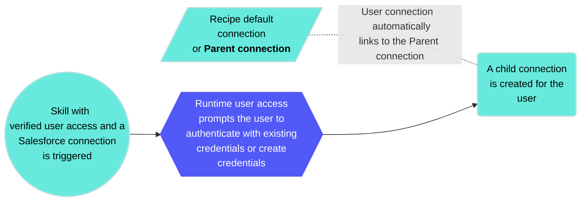
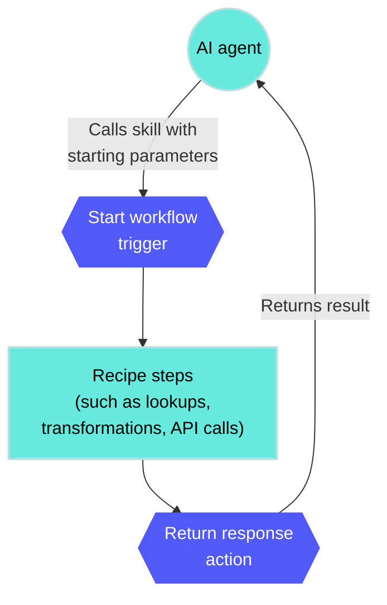

# Verified user access

Verified user access works through [runtime user connections](/en/features/runtime-user-connections) and allows each end user to authenticate with their own credentials when a skill runs. This ensures that the skill performs actions using the identity and permissions of the individual user.

Verified user access establishes the authentication identity for the external system. It doesn't establish the user's identity within the genie conversation for access control purposes. User identity is established by [Workato Identity](/en/workato-identity) and the end-user groups configured for the genie.

Workato Identity determines who can access the genie. Users must be in the end-user groups assigned to the genie before they can initiate a conversation.

Verified user access determines what users can do through skills. This is determined by their permissions in the target system, and enforced at the moment the skill executes.

This two-layer model means a user who has been granted access to a genie but has limited permissions in Salesforce can use the genie but can't take actions in Salesforce that exceed their Salesforce permissions. The genie is the front end and verified user access enforces the back-end permissions that already exist.

## Parent connections

Parent connections act as templates that runtime user connections inherit. The system checks for an existing runtime connection linked to the parent when a user triggers a skill. Users are prompted to authenticate if no runtime connections are found.

User connections link to the parent connection, environment, and user ID in Workato Identity when you use verified user access to create connections at runtime. The genie calls a skill that uses the parent connection when an end-user talks to a genie and triggers a recipe. The genie responds in one of the following ways:

- **Connection prompt**: The chat interface prompts the user to click **Connect** if they've already created a runtime user connection. The skill executes using this child connection.
- **Create a runtime connection prompt**: The chat interface prompts the user to create a runtime user connection if they haven't already created a runtime user connection. The skill executes using this child connection.

_Connect prompt in the chat interface_

For example, when you run a skill with a Salesforce connection that requires verified user access, it creates a child connection for the user. This new connection links to the skill's default Salesforce connection as its parent.



## Keyword management in genie chat

You can manage your runtime user connections through the Slack and Microsoft Teams chat interfaces by typing the `! list_connections` keyword directly into the chat.

> **KEYWORD FORMAT**
> 
> You must include a space between `!` and `list_connections` to correctly use the keyword.

The `! list_connections` keyword allows you to:

- View a list of your current runtime connections
- Disconnect an active connection
- Delete a saved connection

> **WORKATO GO KEYWORD MANAGEMENT NOT SUPPORTED**
> 
> Workato GO doesn't support keyword management. You can manage Workato GO runtime user connections by going to **[Data sources](/en/agentic/workato-go/data-sources) > Genie Data Sources > Check Connection**.

Complete the following steps to use keyword management:

1. Go to the genie where you plan to manage your connections.
   
2. Enter `! list_connections` in the Slack or Microsoft Teams chat. The genie responds with a list of your current connections.
   
   _Keyword management_
   
3. Use the option drop-down menu to disconnect or delete a connection.
   

## When to use verified user access

Use verified user access in skills where one or more of the following is true:

- **The action should be taken as the user, not as a service account**: Any write operation where the `created by` identity matters for audit, compliance, or downstream workflow purposes. For example, creating records, updating records, or submitting requests.
  
- **The data returned should be scoped to the user**: Any read operation where the data visible to the user in the native application should also be the data visible in the genie. For example, leave balances, assigned tickets, or owned opportunities.
  
- **The target system's own permission model should be enforced**: If a user shouldn't be able to access a specific Jira project, a specific Salesforce record, or a specific HR system function through the native application, they should not be able to access it through the genie either. Verified user access ensures the target system's access controls apply.
  
- **The use case is in a regulated industry or requires audit trail compliance**: Any context where regulations require that actions be attributable to specific individuals rather than service accounts, such as healthcare, financial services, or government agencies.
  

## Add verified user access to skills

You can add verified user access to your skills during the recipe building process.

> **VERIFIED USER ACCESS AUTHENTICATION REQUIREMENTS**
> 
> Verified user access requires OAuth 2.0 authorization code grant. Other OAuth 2.0 grant types, such as client credentials, password grant, and refresh token grant, are not currently supported.

Complete the following steps to add verified user access to a skill:

1. Go to the skill where you plan to add verified user access.
   
2. Click **Select an app and action** step in the recipe.
   
3. Search for and select the app you plan to use. A list of available actions for the app displays.
   
4. Select the action you plan to use.
   
5. Select the connection type you plan to use for the skill.
   
   - **End user's connection**: Skills perform actions based on the identity and permissions of the user who connects to the application. Users authenticate with their own credentials to execute the skill.
   - **This recipe's connection**: This option uses the connection established by the recipe builder and follows the same principles as normal app connections.
   
   _Select **End user's connection** to enable verified user access_
   

Refer to the [Add skills](/en/agentic/agent-studio/create-a-genie#add-skills) section of the Agent Studio documentation for more information.

## Limitations

Verified user access may not be available, or if available, shouldn't be applied in the following cases:

- **The target system doesn't support OAuth 2.0**: Verified user access requires the target system to support OAuth 2.0 authentication. Systems that only support API key, basic authentication, or other non-OAuth mechanisms can't use verified user access. A shared service account is the only option for these systems.
  
- **Some users don't have direct access to the target system**: Verified user access can't be used if some, but not all users who interact with the genie have accounts in the target system. In this case, check whether the target system's API supports taking action on behalf of a user without requiring that user to authenticate directly. Some APIs, such as Jira, support a reporter field that records the user on whose behalf the action was taken, allowing the service account to create tickets attributed to a specific user without requiring that user to authenticate.
  
- **The skill is called through Assign Task to Genie**: A recipe that invokes a genie using the **Assign Task to Genie** action uses a headless invocation in which there is no user present in the conversation. Verified user access doesn't work without a user to authenticate. Any skill that uses verified user access and is called in an **Assign Task to Genie** action fails.
  
- **The genie is exposed as an MCP server**: Genies exposed as MCP servers use invocations through the **Assign Task to Genie** action. Authentication at the MCP layer establishes who can call the genie and doesn't allow verified user access within skill executions.
  

## Quotas

Your workspace has a combined runtime user connection (RUC) and verified user access (VUA) quota of 100,000 per workspace. The parent connection quota is 500 per workspace.

## Troubleshooting

This section provides common issues and solutions when working with verified user access.

- **Connection prompt doesn't appear**: The user triggers a skill using verified user access, but isn't prompted to authenticate. This usually means the skill's verified user access toggle is enabled, but the parent connection isn't configured correctly. Verify that the parent connection uses OAuth 2.0 authorization code grant authentication and that the connection is active in the workspace.
  
- **Skill fails after the user authenticates**: The user completes the OAuth flow but the skill returns an error. Common causes for this include:
  
  - The user doesn't have the required permissions in the target system. This is correct behavior and means that verified user access is working as intended.
  - The child connection was created successfully but the recipe isn't using the user context datapill correctly. Verify that the recipe is referencing the **Start workflow** trigger's user context output where needed.
- **User is prompted to authenticate every time**: The child connection should persist after the first authentication. The child connection may be expiring or being revoked if the user is being prompted repeatedly. Check the OAuth token lifetime configured in the parent connection and whether the target system is revoking tokens after a period of inactivity.
  
- **Verified user access works in Slack but not in Workato GO, or vice versa**: Verified user access behavior can differ slightly across Chat Interfaces due to how each interface handles the OAuth redirect flow. Test verified user access on each Chat Interface you deploy to. Don't assume that behavior on one interface replicates exactly on another.

---

---
url: >-
  https://docs.workato.com/en/agentic/agent-studio/connectors/knowledge-base-connector/knowledge-base-connector.md
description: Manage documents stored within knowledge bases directly within your recipe.
---

# Knowledge base by Workato connector

The Knowledge base by Workato connector lets you manage knowledge base documents directly within a recipe stored in a Workato [knowledge base](/en/agentic/agent-studio/knowledge-bases/knowledge-bases). This enables you to sync documents from any source into a knowledge base so genies can retrieve them.

Use it to programmatically insert, update, delete, list, and search documents so the context your genies retrieve stays current with your source systems.

The connector manages the **content within** knowledge bases. It doesn't create, delete, or configure the knowledge bases themselves. Refer to [Knowledge base management](/en/agentic/agent-studio/knowledge-bases/knowledge-base-management) for more information.

> **CONNECTOR ACCESS**
> 
> The Knowledge base by Workato connector is available to customers on plans with [Agent Studio](/en/agentic/agent-studio) enabled.

## Connection setup

The Knowledge base by Workato connector is a built-in connector. It doesn't require authentication or connection setup. The connector automatically scoped to your workspace when you add it to a recipe.

> **MIGRATION FROM THE STORE KNOWLEDGE ACTION**
> 
> Knowledge base by Workato replaces the Workato Genie connector's [Store knowledge](/en/agentic/agent-studio/connectors/workato-genie-connector/actions/store-knowledge) action. The Store knowledge action is deprecated but continues to run in existing recipes. No immediate action is required for recipes running this action. Refer to [Migrate from the Store knowledge action](#migrate-from-the-store-knowledge-action) for more information.

## Supported knowledge bases

Knowledge base by Workato actions runs in knowledge bases with content sourced from recipes or direct uploads.

Knowledge bases populated by [Workato GO data sources](/en/agentic/agent-studio/knowledge-bases/data-ingestion#two-ingestion-paths), such as, Google Drive, Confluence, SharePoint, and Notion, are managed separately and can't be modified with this connector. This preserves the permission-aware retrieval those data sources provide.

Each action identifies a knowledge base by its handle, which appears in the knowledge base URL.

## Documents

A document is the unit of content stored in a knowledge base. Each document includes the following fields:

| Field | Description |
| --- | --- |
| Document ID | A unique identifier from your source system. Knowledge base by Workato uses this ID to match documents on upsert. This lets the action update an existing document instead of creating a duplicate. |
| Title | The document title. |
| Body | The document content. For binary file types, provide the file content. |
| Content type | The MIME type of the document, such as `text/plain` or `application/pdf`. The service detects the type from the content if you leave this blank. |
| Source URL | The source URL. Genies use this URL to cite the document when presenting information to users. |
| Metadata | Free-form key-value metadata. Include `lang: en` to improve text extraction accuracy for English-language documents. Use Metadata to filter results in the **List documents** and **Search documents** actions. |
| Created date | The creation timestamp from your source system. |
| Updated date | The last-updated timestamp from your source system. |

### Supported file types

The Knowledge base by Workato supports plaintext and accepts the following binary file types and extracts their text content server-side before indexing:

- PDF: `application/pdf`
- Microsoft Word: `.docx`
- Microsoft PowerPoint: `.pptx`

The service respects the `Content type` you provide. The service inspects the content to detect the correct content type if you leave it blank. Template and macro-enabled Office formats, such as `.dotx`, `.pptm`, `.xlsm`, and legacy binary Office formats, such as , `.doc`, `.xls`, aren't supported and are rejected.

## Actions

The Knowledge base by Workato connector supports the following recipe actions:

- [Delete document](/en/agentic/agent-studio/connectors/knowledge-base-connector/actions/delete-document)
- [List documents](/en/agentic/agent-studio/connectors/knowledge-base-connector/actions/list-documents)
- [Search documents](/en/agentic/agent-studio/connectors/knowledge-base-connector/actions/search-documents)
- [Upsert documents](/en/agentic/agent-studio/connectors/knowledge-base-connector/actions/upsert-documents)

## Migrate from the Store knowledge action

Knowledge base by Workato breaks down the Workato Genie connector's [Store knowledge](/en/agentic/agent-studio/connectors/workato-genie-connector/actions/store-knowledge) action into a dedicated set of document actions. The mapping is one-to-one for document storage:

| Workato Genie connector | Knowledge base by Workato |
| --- | --- |
| Store knowledge | [Upsert documents](/en/agentic/agent-studio/connectors/knowledge-base-connector/actions/upsert-documents) |

The following workflows apply when you migrate:

- **Existing recipes are unaffected**: The **Store knowledge** action is deprecated, not removed. Recipes that already use this recipe continue to run unchanged.
- **New knowledge base recipes use this connector**: The [Upsert documents](/en/agentic/agent-studio/connectors/knowledge-base-connector/actions/upsert-documents) action is selected automatically when you create a recipe from the knowledge base view.
- **The input fields map directly**: The document fields in the **Store knowledge** action, including document ID, title, body, content type, URL, metadata, created at, and updated at, correspond to the same fields in the **Upsert documents** action.
- **Dependencies are visible in the knowledge base view**: After you migrate, the knowledge base view surfaces the recipes that manage its documents through Knowledge base by Workato.

## Quotas

| Limit | Value |
| --- | --- |
| Documents per Upsert documents call | 100 |
| Default page size (List and Search documents) | 50 |
| Maximum page size (List and Search documents) | 100 |
| Rate limit | 100 requests per action, per environment, per minute |

The connector applies backoff and retries when you exceed the rate limit. Each knowledge base selected in the [Search documents](/en/agentic/agent-studio/connectors/knowledge-base-connector/actions/search-documents) action call is queried as a separate request. This means that searching multiple knowledge bases at once consumes more of your rate-limit budget.

---

---
url: >-
  https://docs.workato.com/en/agentic/agent-studio/connectors/knowledge-base-connector/actions/delete-document.md
description: Delete a document from a knowledge base programmatically.
---

# Knowledge base by Workato connector - Delete document

The **Delete document** action deletes a document from a knowledge base by document ID.

Use this action in [knowledge base recipes](/en/agentic/agent-studio/knowledge-bases/knowledge-base-recipes) to keep a knowledge base aligned with its source system, such as, removing a document when the corresponding record is deleted or archived in the source application.

## Input

| Input field | Description |
| --- | --- |
| Knowledge base | Select the knowledge base where you plan to delete the document. Only recipe-type knowledge bases can be selected. Workato GO sources aren't supported. The handle appears in the URL. |
| Document ID | The ID of the document you plan to delete. For example:`9347x04a6d176x4ebe50xxa42x6521c0` |

## Output

| Output field | Description |
| --- | --- |
| Success | Indicates whether the document was deleted successfully. |
| Document ID | The ID of the document that was deleted. |

---

---
url: >-
  https://docs.workato.com/en/agentic/agent-studio/connectors/knowledge-base-connector/actions/list-documents-advanced-filters.md
description: List documents with advanced filters in a knowledge base programmatically.
---

# Knowledge base by Workato connector - List documents advanced filters

The **List documents (advanced filters)** batch action returns documents from a recipe or direct-upload [knowledge base](/en/agentic/agent-studio/knowledge-bases/knowledge-bases) you specify with optional filtering and pagination. Use the filters to narrow the list by content type, metadata, or date, and page through large result sets with the page number. Filter metadata with a **data\_filters** JSON object to retrieve data that dedicated fields can't express, such as matching against a list of values, OR groups of conditions, or combining several conditions at once.

Refer to [Metadata filters](/en/agentic/agent-studio/connectors/knowledge-base-connector/actions/metadata-filters) for more information on advanced filters.

## Input

| Input field | Description |
| --- | --- |
| Knowledge base | Select the ID of the knowledge base. Only recipe-type knowledge bases can be selected. Workato GO sources aren't supported. The handle appears in the URL. |
| Page | The page number to retrieve. Starts at `1`. Defaults to `1`. |
| Page size | Results per page (1–100). Defaults to `50`. |
| Sort by | Add one row per sort field. Multiple rows are applied in order. |
| Include metadata | Use the option drop-down menu to determine whether metadata is included or not. |
| Data filters | Filter by document metadata using JSON. For example: exact match: `{"status":"active"}`. |

## Output

| Output field | Description |
| --- | --- |
| Documents | The list of documents that match the request. |
| Document ID (Documents) | The unique identifier of the document. |
| Title (Documents) | The document title. |
| Source URL (Documents) | The source URL of the document. |
| Content type (Documents) | The MIME type of the document. |
| Workspace email (Documents) | The email of the document owner, when available. |
| Created date (Documents) | The creation timestamp of the document. |
| Updated date (Documents) | The last-updated timestamp of the document. |
| Document content (Documents) | The document content. |
| Metadata (Documents) | The key-value metadata stored with the document. |
| List size (Documents) | The total number of documents returned on this page. |
| List index (Documents) | The index of the current item in the documents list. |
| Total count | The total number of documents that match the request, across all pages. |
| Current page | The page number of the returned results. |
| Page size | The page size used for the request. |

---

---
url: >-
  https://docs.workato.com/en/agentic/agent-studio/connectors/knowledge-base-connector/actions/list-documents.md
description: List documents in a knowledge base programmatically.
---

# Knowledge base by Workato connector - List documents

The **List documents** action returns documents from a recipe or direct-upload [knowledge base](/en/agentic/agent-studio/knowledge-bases/knowledge-bases) you specify with optional filtering and pagination. Use the filters to narrow the list by content type, metadata, or date, and page through large result sets with the page number.

Use this action to audit, reconcile, or report on the documents in a knowledge base from within a recipe.

## Input

| Input field | Description |
| --- | --- |
| Knowledge base ID | Select the ID of the knowledge base. Only recipe-type knowledge bases can be selected. Workato GO sources aren't supported. The handle appears in the URL. |
| Page | The page number to retrieve. Starts at `1`. Defaults to `1`. |
| Page size | Results per page (1–100). Defaults to `50`. |
| Content type | Filter by MIME type (stored in document metadata as `mime_type`). |
| Metadata filters | Optional key-value pairs stored with the document. For example, `lang` or source-system fields. |
| Created after | Return only documents created after this date. |
| Created before | Return only documents created before this date. |
| Updated after | Return only documents updated after this date. |
| Updated before | Return only documents updated before this date. |

## Output

| Output field | Description |
| --- | --- |
| Documents | The list of documents that match the request. |
| Document ID (Documents) | The unique identifier of the document. |
| Title (Documents) | The document title. |
| Source URL (Documents) | The source URL of the document. |
| Content type (Documents) | The MIME type of the document. |
| Owner email (Documents) | The email of the document owner, when available. |
| Created date (Documents) | The creation timestamp of the document. |
| Updated date (Documents) | The last-updated timestamp of the document. |
| Document content (Documents) | The document content. |
| Metadata (Documents) | The key-value metadata stored with the document. |
| List size (Documents) | The total number of documents returned on this page. |
| List index (Documents) | The index of the current item in the documents list. |
| Total count | The total number of documents that match the request, across all pages. |
| Current page | The page number of the returned results. |
| Page size | The page size used for the request. |

---

---
url: >-
  https://docs.workato.com/en/agentic/agent-studio/connectors/knowledge-base-connector/actions/search-documents-advanced-filters.md
description: Search documents with advanced filters in a knowledge base programmatically.
---

# Knowledge base by Workato connector - Search documents advanced filters

The **Search documents (advanced filters)** batch action searches the knowledge base you specify by natural language or keyword search query.

The **Search documents (advanced filters)** batch action runs a natural-language or keyword search across one or more [knowledge bases](/en/agentic/agent-studio/knowledge-bases/knowledge-bases) and returns the matching documents. Use the filters to narrow results by content type, metadata, or date. Filter metadata with a **data\_filters** JSON object to retrieve data that dedicated fields can't express, such as matching against a list of values, OR groups of conditions, or combining several conditions at once.

Refer to [Metadata filters](/en/agentic/agent-studio/connectors/knowledge-base-connector/actions/metadata-filters) for more information on advanced filters.

You can select multiple knowledge bases in a single call. Each selected knowledge base is queried as a separate request. The request volume counted against your [rate limit](/en/connectors/knowledge-base-by-workato#limits) increases when you select more knowledge bases.

## Input

| Input field | Description |
| --- | --- |
| Knowledge base | Select the knowledge base you plan to search. Only recipe-type knowledge bases can be selected. Workato GO sources aren't supported. The handle appears in the URL. |
| Search query | The search query, as natural language or keywords. |
| Page | The page number to retrieve. Starts at `1`. Defaults to `1`. |
| Page size | Results per page (1–100). Defaults to `50`. |
| Enable LLM reranking | Re-rank search results using an LLM for higher relevance. May increase latency. |
| Data filters | Filter by document metadata using JSON. For example: exact matches`{"status":"active"}`. |

## Output

| Output field | Description |
| --- | --- |
| Documents | The list of documents that match the search. |
| Document ID | The ID of the document that contained the natural language search query or keyword you provided. For example: `br689aec2ie03218te706l76y157nn12`. |
| Title | The title of the document returned in the search. |
| Source URL (Documents) | The source URL of the document. |
| Content type | The content type of the document returned in the search. For example: `application/vnd.openxmlformats-officedocument.presentationml.presentation`. |
| Workspace email | The email address of the user who owns each document returned in the search. |
| Created date | The date each document returned in the search was created. |
| Updated date | The date each document returned in the search was updated, if any. |
| Document content | The content that matches the search query. |
| Relevance score | The relevance score of the data returned. For example: `0.87`. |
| Metadata (Documents) | The key-value metadata stored with the document. |
| Document type (Documents) | The type of the returned item, for example `document`. |
| List size (Documents) | The total number of documents returned on this page. |
| List index (Documents) | The index of the current item in the documents list. |
| Total count | The total number of documents that match the search, across all pages. |
| Current page | The page number of the returned results. |
| Page size | The page size used for the request. |

---

---
url: >-
  https://docs.workato.com/en/agentic/agent-studio/connectors/knowledge-base-connector/actions/search-documents.md
description: Search documents in a knowledge base programmatically.
---

# Knowledge base by Workato connector - Search documents

The **Search documents** action searches the knowledge base you specify by natural language or keyword search query.

The **Search documents** action runs a natural-language or keyword search across one or more [knowledge bases](/en/agentic/agent-studio/knowledge-bases/knowledge-bases) and returns the matching documents. Use the filters to narrow results by content type, metadata, or date.

You can select multiple knowledge bases in a single call. Each selected knowledge base is queried as a separate request. The request volume counted against your [rate limit](/en/connectors/knowledge-base-by-workato#limits) increases when you select more knowledge bases.

## Input

| Input field | Description |
| --- | --- |
| Knowledge base | Select the knowledge base you plan to search. Only recipe-type knowledge bases can be selected. Workato GO sources aren't supported. The handle appears in the URL. |
| Query | The search query, as natural language or keywords. |
| Page | The page number to retrieve. Starts at `1`. Defaults to `1`. |
| Page size | Results per page (1–100). Defaults to `50`. |
| Content type | Filter by MIME type (stored in document metadata as `mime_type`). |
| Metadata filters | Optional key-value pairs stored with the document. For example, `lang` or source-system fields. Applied to all selected knowledge bases. |
| Created after | Return only documents created after this date. |
| Created before | Return only documents created before this date. |
| Updated after | Return only documents updated after this date. |
| Updated before | Return only documents updated before this date. |

## Output

| Output field | Description |
| --- | --- |
| Documents | The list of documents that match the search. |
| Document ID | The ID of the document that contained the natural language search query or keyword you provided. For example: `br689aec2ie03218te706l76y157nn12` |
| Title | The title of the document returned in the search. |
| Source URL (Documents) | The source URL of the document. |
| Content type | The content type of the document returned in the search. For example: `application/vnd.openxmlformats-officedocument.presentationml.presentation` |
| Workspace email | The email address of the user who owns each document returned in the search. |
| Created date | The date each document returned in the search was created. |
| Updated date | The date each document returned in the search was updated, if any. |
| Document content | The content that matches the search query. |
| Relevance score | The relevance score of the data returned. For example: `0.87`. |
| Metadata (Documents) | The key-value metadata stored with the document. |
| Document type (Documents) | The type of the returned item, for example `document`. |
| List size (Documents) | The total number of documents returned on this page. |
| List index (Documents) | The index of the current item in the documents list. |
| Total count | The total number of documents that match the search, across all pages. |
| Current page | The page number of the returned results. |
| Page size | The page size. |

---

---
url: >-
  https://docs.workato.com/en/agentic/agent-studio/connectors/knowledge-base-connector/actions/upsert-documents.md
description: Upsert documents in a knowledge base programmatically.
---

# Knowledge base by Workato connector - Upsert documents

The **Upsert documents** action inserts or updates documents in a [knowledge base](/en/agentic/agent-studio/knowledge-bases/knowledge-bases). It runs as a batch action, processing up to 100 documents per run.

> The maximum supported file size is 100MB, including batch files. An additional 16MB limit is applied to each file's raw text as files pass through the Workato indexing and extraction engine.

The action matches documents by **Document ID**. The action updates an existing document with the same ID or creates a new document if an existing document ID isn't found. Reusing an ID updates the existing document, so re-running the action overwrites the previous version rather than creating duplicates.

Use this action to build [knowledge base recipes](/en/agentic/agent-studio/knowledge-bases/knowledge-base-recipes) that sync and update information from your connected applications. Refer to [Knowledge base data ingestion](/en/agentic/agent-studio/knowledge-bases/data-ingestion) for ingestion best practices.

## Input

| Input field | Description |
| --- | --- |
| Knowledge base | Select the knowledge base to store the documents in. Only recipe-type knowledge bases are supported. Workato GO sources aren't supported. The handle appears in the URL. |
| Documents source list | Specify a list datapill. Each item in the list represents one document to upsert. Up to 100 documents per run. |
| Document ID (Documents) | Unique ID in the source system. Reusing an ID updates the existing document. |
| Title (Documents) | The document title. |
| Body (Documents) | The document content. Required unless you provide binary file content with a binary content type. |
| Source URL (Documents) | The URL of the document in the source system. Genies use this URL to cite sources when presenting information to users. |
| Content type (Documents) | The MIME type of the document, such as `text/plain` or `application/pdf`. For binary formats (PDF, `.docx`, `.pptx`), the service extracts text server-side. Leave blank to let the service detect the type from the content. |
| Metadata (Documents) | Additional key-value metadata for the document. Include `lang: en` to improve text extraction accuracy for English-language documents. |
| Created date (Documents) | The creation timestamp of the document in the source system. |
| Updated date (Documents) | The last-updated timestamp of the document in the source system. |

## Output

| Output field | Description |
| --- | --- |
| Success | Indicates whether all documents were sent to the ingestion pipeline successfully. |
| Failed documents | A list of documents that couldn't be sent to the ingestion pipeline. Empty when all documents succeed. Common reasons a document fails include an undetectable or invalid content type (MIME) and a blank body on a text-based document. |
| Document ID (Failed documents) | The ID of the document that failed. |
| Title (Failed documents) | The title of the document that failed. |
| List size (Failed documents) | The total number of failed documents. |
| List index (Failed documents) | The index of the current item in the failed documents list. |

---

---
url: >-
  https://docs.workato.com/en/agentic/agent-studio/connectors/knowledge-base-connector/actions/metadata-filters.md
description: >-
  Use metadata filters for List documents (advanced filters) and Search
  documents (advanced filters) batch actions.
---

# Metadata filters

Use metadata filters for **[List documents (advanced filters)](/en/agentic/agent-studio/connectors/knowledge-base-connector/actions/list-documents-advanced-filters)** and **[Search documents (advanced filters)](/en/agentic/agent-studio/connectors/knowledge-base-connector/actions/search-documents-advanced-filters)** batch actions.

Filter metadata with a **data\_filters** JSON object to retrieve data that dedicated fields can't express, such as matching against a list of values, OR groups of conditions, or combining several conditions at once.

## When to use advanced filters

The standard **[Search documents](/en/agentic/agent-studio/connectors/knowledge-base-connector/actions/search-documents)** and **[List documents](/en/agentic/agent-studio/connectors/knowledge-base-connector/actions/list-documents)** actions use static filtering for dedicated fields like content type, Created after, Created before, Updated after, Updated before, and a key-value Metadata filters list.

**List documents (advanced filters)** and **Search documents (advanced filters)** use `data_filters` to enable dynamic, advanced filtering when static filtering can't parse data.

> **DON'T MIX FILTERING STYLES ON THE SAME FIELD**
> 
> Static filtering and `data_filters` write to the same query. Targeting one field with both filtering types is unsupported. For example, don't use Created after and `data_filters: {"created_at": ...}`.

## How to use advanced filters

Use the following examples to determine how advanced filtering can be applied to your workflow:

### Exact match

The following example returns only documents whose `status` metadata equals `active`. Use this example when a field equals a single value.

```json
{ "status": "active" }
```

### Match multiple values (OR)

The following example returns any value that matches the list you provide. Use this example when you need to check whether a value appears inside an array.

```json
{ "owner": ["abby", "jaime"] }
```

This returns documents owned by `abby` or `jaime`.

### OR groups

The following example returns documents that match any whole condition in the list you provide, rather than values for a single field. Use this example when you need to combine conditions with OR on different fields:

```json
{ "or": [ { "category": "finance" }, { "category": "legal" } ] }
```

This returns documents where `category` equals `finance` or `legal`.

#### OR group where each branch has more than one condition

Use the following example when there's more than one condition on a branch. Each object inside `or` can combine keys with `AND`, so you can OR together two different multi-field conditions:

```json
{
  "or": [
    { "category": "finance", "region": "US" },
    { "category": "legal", "region": "EU" }
  ]
}
```

Returns `(category = finance AND region = US)` OR `(category = legal AND region = EU)`.

#### OR group combined with a top-level AND condition

Use the following example when a top-level key next to `or` applies to every result to combine it with AND to the matching OR branch:

```json
{
  "status": "active",
  "or": [
    { "owner": "abby" },
    { "owner": "jaime" }
  ]
}
```

Returns documents with an `active` status and the owner is `abby` or `jaime`.

### Date range

The following example returns documents that fall within the range you provide. Use this example when you need to filter `created_at` or `updated_at` before, after, or between dates.

```json
{ "created_at": { "start": "2024-01-01", "end": "2024-12-31" } }
```

This returns documents where `created_at` falls between January 1, 2024 and December 31, 2024. Both `start` and `end` are optional. Dates use ISO 8601 format, either `YYYY-MM-DD` or a full timestamp. This range shape applies only to `created_at` and `updated_at`. Refer to [Field operators](#field-operators) to compare values on other fields.

Provide only `start` and omit `end` to retrieve documents from this date onward. For example:

```json
{ "updated_at": { "start": "2024-06-01" } }
```

Provide only `end` and omit `start` to retrieve documents before the date you provide. For example:

```json
{ "created_at": { "end": "2024-06-30" } }
```

### Field operators

Provide a field with an object containing one or more of the following operators instead of a plain value:

| Operator | Meaning | Accepts | Resulting query |
| --- | --- | --- | --- |
| `ne` | Not equals, or excludes | A single value, or a list to exclude several values at once | `must_not` term or terms match on the field |
| `gt` | Strictly greater than | Number or date string | Exclusive lower-bound range |
| `gte` | Greater than or equal to | Number or date string | Inclusive lower-bound range |
| `lt` | Strictly less than | Number or date string | Exclusive upper-bound range |
| `lte` | Less than or equal to | Number or date string | Inclusive upper-bound range |
| `like` | Partial or wildcard match | A string containing `*` for any characters, `?` for a single character, or both | Wildcard match against the exact stored value |

Use these operators when you need to exclude values, compare values, or match part of a value. Operators work in all metadata fields, not only `created_at` and `updated_at`.

Listing more than one operator on the same field chains the operators together using AND. For example, `gte` with `lt` produces a half-open range:

```json
{ "page_count": { "gte": 10, "lt": 100 } }
```

This returns documents where `page_count` is 10 or greater and less than 100. The lower bound is included and the upper bound is excluded.

#### Exclude a value

The following example returns documents whose `author` metadata is anything other than `bot`.

```json
{ "author": { "ne": "bot" } }
```

Provide a list to exclude several values at once. For example:

```json
{ "status": { "ne": ["spam", "deleted"] } }
```

This returns documents where `status` equals neither `spam` nor `deleted`.

#### Numeric range

The following example returns documents with a `page_count` that falls between 10 and 100. Use this example when you need an inclusive range on a field that holds numbers.

```json
{ "page_count": { "gte": 10, "lte": 100 } }
```

Use `gt` and `lt` when you need to exclude the bounds. For example:

```json
{ "page_count": { "gt": 10, "lt": 100 } }
```

This returns documents where `page_count` is greater than 10 and less than 100.

#### Partial match

The following example returns documents with a `title` that contains `quarterly` anywhere in the value. Use this example when you need to match part of a value rather than the whole value.

```json
{ "title": { "like": "*quarterly*" } }
```

> **TEST RANGE OPERATORS AGAINST REAL DATA**
> 
> `gt`, `gte`, `lt`, and `lte` build a native OpenSearch range query against the raw `metadata.<field>` value rather than the `.keyword` subfield. These operators behave as true numeric or date comparisons only when the underlying field is indexed with a numeric or date type. The filter model doesn't validate or coerce types. Test range operators against real data for your connector and datasource before you rely on them in production.

Empty or missing operator values, such as `""`, `null`, or `[]`, are ignored rather than returning an error. This aligns with the behavior in the other building blocks.

### AND across keys

The following example returns documents that match every key you provide. Use this example when you need to apply more than one condition at the same time. Listing more than one key ANDs the keys together automatically.

```json
{ "lang": "en", "status": "published" }
```

This returns documents where `lang` equals `en` and `status` equals `published`.

### Combine filters

You can combine the previous building blocks in one object. Combined keys AND together.

```json
{
  "status": "active",
  "owner": ["abby", "jaime"],
  "created_at": { "start": "2024-01-01", "end": "2024-12-31" }
}
```

This returns documents where `status` equals `active`, `owner` is `abby` or `jaime`, and `created_at` falls in 2024.

### List containment on an array-valued metadata field

Use the following example when you need an exact-match filter in a document metadata field array:

```json
{ "participant_email": "sam@example.com" }
```

This returns every document where `sam@example.com` appears among the values in the `participant_email` array.

### Narrow a bulk operation

Use the following example when you need to identify stale, unpublished documents:

```json

{
  "status": "draft",
  "updated_at": { "end": "2024-01-01" }
}
```

Returns a list of documents in `draft` status that were last updated before `2024-01-01`.

## Other data types

Exact match, the OR-list, `ne`, and `like` don't use integer, boolean, or numeric types. The Knowledge base by Workato stores and matches every metadata value as text.

- Exact match and the OR-list both check for an exact text match. A filter like `{"count": 5}` checks whether the stored text equals `5`. It doesn't perform numeric comparison.
- `like` matches wildcards against the exact stored value as text.
- The `{start, end}` range shape applies only to `created_at` and `updated_at`. Use [Field operators](#field-operators) to compare values on other fields.

You can list both values with an OR-list to match documents where `priority` is `4` or `5`:

```json
{ "priority": ["4", "5"] }
```

Alternatively, use `gte` when the field is numerically mapped:

```json
{ "priority": { "gte": 4 } }
```

---

---
url: >-
  https://docs.workato.com/en/agentic/agent-studio/connectors/workato-genie-connector/workato-genie-connector.md
description: >-
  Use the Workato Genie connector to assign tasks, send business events, manage
  approvals, and store knowledge from within a recipe.
---

# Workato Genie connector

The Workato Genie connector provides actions to interact with genies and their supporting systems from within a recipe.

> **CONNECTOR ACCESS**
> 
> The Workato Genie connector is available to customers on plans with [Agent Studio](/en/agentic/agent-studio) enabled.

## Connection setup

The Workato Genie connector is a built-in connector. It doesn't require authentication or connection setup.

## Actions

The Workato Genie connector supports the following recipe actions:

- [Assign task to genie](/en/agentic/agent-studio/connectors/workato-genie-connector/actions/assign-task-to-genie)
- [Assign task to user](/en/agentic/agent-studio/connectors/workato-genie-connector/actions/assign-task-to-user)
- [Create approval request](/en/agentic/agent-studio/connectors/workato-genie-connector/actions/create-approval-request)
- [Send business event](/en/agentic/agent-studio/connectors/workato-genie-connector/actions/send-business-event)
- [Store knowledge](/en/agentic/agent-studio/connectors/workato-genie-connector/actions/store-knowledge) Deprecated. Refer to [Deprecated features](#deprecated-features) for more information.

## Deprecated features

The following Workato Genie connector features are deprecated. These features continue to function in existing recipes but don't receive new enhancements:

- **Start workflow trigger**: The trigger used to define skills. Replaced by the [Workato Skill connector](/en/agentic/agent-studio/connectors/workato-skill-connector/workato-skill-connector), which provides the same functionality without requiring access to genies. You can't add this trigger to new skills.
- **Return response action**: The action used to return a result from a skill. Replaced by the **Return response** action in the [Workato Skill connector](/en/agentic/agent-studio/connectors/workato-skill-connector/workato-skill-connector).
- **Store knowledge action**: The action used to store documents in a knowledge base. Replaced by the [Upsert documents](/en/agentic/agent-studio/connectors/knowledge-base-connector/actions/upsert-documents) action in [Knowledge base by Workato](/en/agentic/agent-studio/connectors/knowledge-base-connector/knowledge-base-connector). Existing recipes continue to run unchanged. Refer to [Migrate from the Store knowledge action](/en/agentic/agent-studio/connectors/knowledge-base-connector/knowledge-base-connector#migrate-from-the-store-knowledge-action) for the field mapping.

Refer to [Transition from the Workato Genie connector](/en/agentic/agent-studio/connectors/workato-skill-connector/transition-from-genie-connector) for migration steps.

---

---
url: >-
  https://docs.workato.com/en/agentic/agent-studio/connectors/workato-genie-connector/actions/assign-task-to-genie.md
description: >-
  Assign a task to a genie and wait for it to complete before the recipe
  continues.
---

# Workato Genie connector - Assign task to genie action

The **Assign task to genie** action assigns a task to a genie and waits for it to complete before proceeding to the next step. The recipe job suspends during processing and resumes with the genie's response available as a datapill. The output includes the genie's final response and a log of all actions performed.

Use this action for automated tasks that don't require a user. Use the [Send business event](/en/agentic/agent-studio/connectors/workato-genie-connector/actions/send-business-event) action for use cases where a user needs to receive a message or take action. Refer to [App Events vs Agent orchestration](/en/agentic/agent-studio/app-events-vs-agent-orchestration) for a full comparison.

Refer to [Agent orchestration](/en/agentic/agent-studio/agent-orchestration) for setup steps, chaining patterns, and task instruction best practices.

> **LIMITATIONS**
> 
> This action doesn't support [Verified User Access](/en/agentic/agent-studio/verified-user-access), [Business Approvals](/en/agentic/agent-studio/business-approvals), or permission-aware knowledge bases, because no user is present when this action runs. Knowledge base retrieval is limited to public documents.

## Input

| Input field | Description |
| --- | --- |
| Genie | Select the genie to assign the task to. Supported only for genies whose skills don't require runtime user connections or confirmations. |
| Task description to genie | Enter a prompt describing what the genie should do. Include all context the genie needs to complete the task. Refer to [Write effective task instructions](/en/agentic/agent-studio/agent-orchestration#write-effective-task-instructions) for guidance. |
| Additional context for genie | Add up to ten files the genie can access when handling the task, in addition to public documents in its knowledge bases. |
| Additional context for genie source list | Specify a list datapill. |
| File name (Additional context for genie source list) | Map the name of the file. |
| File contents (Additional context for genie source list) | Map the contents of the file. |
| Conversation ID | Enter the ID of an existing conversation. When provided, the genie processes the task using context and history from that conversation. Leave blank for self-contained tasks like classification or summarization. Pass the Conversation ID output from a previous **Assign task to genie** step when chaining calls that must build on each other. |
| Task metadata | Specify custom key-value pairs to pass to the genie alongside task instructions. Use metadata for structured values a skill must access, such as `invoice_id` or `user_email`, rather than including these values directly in the task instructions. Any skill the genie calls can access these values as datapills, but you must define matching fields in the [Start workflow](/en/agentic/agent-studio/connectors/workato-skill-connector/start-workflow) trigger first. |
| Configure genie output for usage in this recipe | Select to allow the genie to output structured data rather than plain text. The defined fields become datapills available in downstream recipe steps. |

## Output

| Output field | Description |
| --- | --- |
| Response | The genie's final response. Returns as free-form text unless custom output fields are configured, in which case the response matches the defined schema. |
| Conversation ID | The ID of the conversation created for this task. Pass the Conversation ID datapill to subsequent **Assign task to genie** steps to maintain context across a chain of calls. |
| Tool calls | A list of all actions the genie performed to complete the task. |
| Index (Tool calls) | The position of the action in the sequence. |
| Type (Tool calls) | The type of action performed, such as a skill call or knowledge base lookup. |
| Name (Tool calls) | The name of the skill or tool that was called. |
| Timestamp (Tool calls) | The time the action was performed. |
| Status (Tool calls) | The outcome of the action. |
| Skill/RAG Tool Input (Tool calls) | The input passed to the skill or knowledge base tool. |
| Skill/RAG Tool Output (Tool calls) | The output returned by the skill or knowledge base tool. |
| List size (Tool calls) | The total number of actions in the list. |
| List index (Tool calls) | The index of the current item in the list. |

---

---
url: >-
  https://docs.workato.com/en/agentic/agent-studio/connectors/workato-genie-connector/actions/assign-task-to-user.md
description: >-
  Assign a task to a user and wait for them to complete it before the recipe
  continues.
---

# Workato Genie connector - Assign task to user action

The **Assign task to user** action assigns a task to a user. The assignee receives a prompt in the genie's chat interface to approve or reject the request. The recipe waits until the task is completed or expires before proceeding to the next step.

This action is used as part of Business approval workflows. Refer to the [Business Approvals](/en/agentic/agent-studio/business-approvals) page for full setup steps and conditional outcome logic.

> **PREREQUISITE**
> 
> Users must be added to [Workato Identity](/en/workato-identity) before you can assign tasks to them. Refer to [Add an end user manually](/en/workato-identity/add-end-user-manually) for steps to add users individually.

## Input

| Input field | Description |
| --- | --- |
| Genie | Select the genie to process the task. |
| Request data table | Select the data table to store the approval request data. |
| Request ID | Enter or specify the ID of the approval request to create a user task for. Use the Request ID datapill from the [Create approval request](/en/agentic/agent-studio/connectors/workato-genie-connector/actions/create-approval-request) action or enter the value directly. |
| Task name | Enter a name describing what the assignee needs to do. Use datapills to personalize the message. |
| Assignee | Specify the email address of the user to assign the task to. The user must exist in [Workato Identity](/en/workato-identity). |
| Time to complete task | Select the length of time the task is valid before it expires. The maximum value is 30 days. |
| Call ID | Enter the Call ID datapill from the [Start workflow](/en/agentic/agent-studio/connectors/workato-skill-connector/start-workflow) trigger. Links the user task back to the originating skill call. |
| Requester conversation ID | Enter the Conversation ID datapill from the [Start workflow](/en/agentic/agent-studio/connectors/workato-skill-connector/start-workflow) trigger. Enables the genie to deliver the approver's decision to the correct conversation. |
| Created by | Specify the user ID of the user who initiated the request. The user must exist in [Workato Identity](/en/workato-identity). |

## Output

| Output field | Description |
| --- | --- |
| Task | The completed task object. |
| Task ID (Task) | The unique ID of the task. |
| Task name (Task) | The name of the task as configured in the action. |
| Status (Task) | The current status of the task. |
| Is Approved (Task) | Indicates whether the task was approved. |
| Is Rejected (Task) | Indicates whether the task was rejected. |
| Is Expired (Task) | Indicates whether the task expired before completion. |
| Created at (Task) | The timestamp when the task was created. |
| Completed at (Task) | The timestamp when the task was completed. |
| Reason (Task) | The reason provided by the assignee when completing the task. |
| Completed by (Task) | The user who completed the task. |
| User ID (Completed by) | The Workato user ID of the user who completed the task. |
| User name (Completed by) | The name of the user who completed the task. |
| Email (Completed by) | The email address of the user who completed the task. |

---

---
url: >-
  https://docs.workato.com/en/agentic/agent-studio/connectors/workato-genie-connector/actions/create-approval-request.md
description: >-
  Create an approval request record in a data table as the first step of a
  Business approvals workflow.
---

# Workato Genie connector - Create approval request action

The **Create approval request** action creates a new approval request record in a data table you specify. The request information is shared with the user assigned to the approval task in the subsequent [Assign task to user](/en/agentic/agent-studio/connectors/workato-genie-connector/actions/assign-task-to-user) action.

This action is used as part of [Business approvals](/en/agentic/agent-studio/business-approvals) workflows. Refer to that page for full setup steps and conditional outcome logic.

## Input

| Input field | Description |
| --- | --- |
| Request data table | Select the data table to store the approval request. |
| Created by | Specify the user ID of the user who initiated the request. The user must exist in [Workato Identity](/en/workato-identity). |
| Record fields | Enter values for any additional columns in the selected data table. |

## Output

| Output field | Description |
| --- | --- |
| Request ID | The ID of the created approval request. Pass the Request ID datapill to the [Assign task to user](/en/agentic/agent-studio/connectors/workato-genie-connector/actions/assign-task-to-user) action. |
| Creator ID | The user ID of the user who created the request. |
| Parameters | The request data stored in the data table. Available fields depend on how your data table is configured. |
| Record ID | The ID of the record created in the data table. |
| Created at | The timestamp when the request was created. |
| Updated at | The timestamp when the request was last updated. |

---

---
url: >-
  https://docs.workato.com/en/agentic/agent-studio/connectors/workato-genie-connector/actions/send-business-event.md
description: >-
  Send a business event to a genie and deliver a notification to a specified
  user.
---

# Workato Genie connector - Send business event action

The **Send business event** action sends a business event to a genie and delivers a notification to a specified user. The recipe continues immediately after sending the event without waiting for the genie to finish processing.

Use this action when a user needs to be informed of an event and may need to take action. Use the [Assign task to genie](/en/agentic/agent-studio/connectors/workato-genie-connector/actions/assign-task-to-genie) action for automated tasks that don't require a user. Refer to [App Events vs Agent orchestration](/en/agentic/agent-studio/app-events-vs-agent-orchestration) for a full comparison.

## Input

| Input field | Description |
| --- | --- |
| Genie | Select the genie to send the business event to. |
| User email | Enter the email address of the user who should receive the event. The user must be active and have assigned access to this genie. The action fails if the user doesn't exist in Workato or doesn't have access to the genie. |
| Notification to user | Enter the message to send to the user before the genie begins processing the event. |
| Business event data | Enter a prompt describing what the genie should do in response to this event. Include all context the genie needs to complete the task. |
| Conversation ID | Enter the ID of an existing conversation to continue that thread rather than starting a new one. Refer to [Continue conversation](/en/agentic/agent-studio/app-events/conversations#continue-conversation) for more information. |

## Output

| Output field | Description |
| --- | --- |
| Conversation ID | The ID of the conversation created or continued by this event. |

---

---
url: >-
  https://docs.workato.com/en/agentic/agent-studio/connectors/workato-genie-connector/actions/store-knowledge.md
description: Store documents in a knowledge base as part of a knowledge base recipe.
---

# Workato Genie connector - Store knowledge action

The **Store knowledge** action stores documents in a knowledge base. It runs as a batch action, processing all documents in the source list in a single operation.

Use this action to build knowledge base recipes that sync and update information from connected applications. Refer to [Knowledge base recipes](/en/agentic/agent-studio/knowledge-bases/knowledge-base-recipes) for full setup steps and [Knowledge base data ingestion](/en/agentic/agent-studio/knowledge-bases/data-ingestion) for ingestion best practices.

> **DEPRECATED**
> 
> The **Store knowledge** action is deprecated. It's replaced by the [Upsert documents](/en/agentic/agent-studio/connectors/knowledge-base-connector/actions/upsert-documents) action in [Knowledge base by Workato](/en/agentic/agent-studio/connectors/knowledge-base-connector/knowledge-base-connector), a dedicated connector for managing documents in a knowledge base.
> 
> Existing recipes that use the **Store knowledge** action continue to run unchanged. No immediate action is required. New knowledge base recipes use Knowledge base by Workato by default. Refer to [Migrate from the Store knowledge action](/en/agentic/agent-studio/connectors/knowledge-base-connector/knowledge-base-connector#migrate-from-the-store-knowledge-action) for the field mapping.

## Input

| Input field | Description |
| --- | --- |
| Knowledge base | Select the knowledge base to store the documents in. |
| Documents source list | Specify a list datapill. Each item in the list represents one document to store. |
| Document ID (Documents source list) | Enter the external ID of the document in the source system. A document with a matching ID updates the existing entry instead of creating a duplicate. |
| Document title (Documents source list) | Enter the title of the document. |
| Document body (Documents source list) | Enter the document content. |
| Content type (Documents source list) | Select the content type of the document: **PDF**, **Microsoft Word (.docx)**, **Microsoft Excel (.xlsx)**, or **Microsoft PowerPoint (.pptx)**. |
| Document URL (Documents source list) | Enter the URL of the document in the source system. Genies use this URL to cite sources when presenting information to users. |
| Document metadata (Documents source list) | Enter additional metadata for the document. Include `lang: en` to improve text extraction accuracy for English-language documents. |
| Created at (Documents source list) | Enter the creation timestamp of the document in the source system. |
| Updated at (Documents source list) | Enter the last updated timestamp of the document in the source system. |

## Output

| Output field | Description |
| --- | --- |
| Success | Indicates whether all documents were stored successfully. |
| Failed documents | A list of documents that failed to store. |
| Title (Failed documents) | The title of the document that failed to store. |
| List size (Failed documents) | The total number of failed documents. |
| List index (Failed documents) | The index of the current item in the failed documents list. |

---

---
url: >-
  https://docs.workato.com/en/agentic/agent-studio/connectors/workato-skill-connector/workato-skill-connector.md
description: >-
  Build skills that AI agents call as tools, using a built-in connector
  available with MCP and Agent Studio plans.
---

# Workato Skill connector

The Workato Skill connector lets you build skills that genies, MCP clients, and other AI systems can call as tools. The connector provides the skill functionality of the [Workato Genie connector](/en/agentic/agent-studio/connectors/workato-genie-connector/workato-genie-connector) without requiring access to genies.

Existing Workato Genie connector skills continue to function. Refer to [Transition from the Workato Genie connector](/en/agentic/agent-studio/connectors/workato-skill-connector/transition-from-genie-connector) for more information.

> **CONNECTOR ACCESS**
> 
> The Workato Skill connector is available to customers on Business MCP, Enterprise MCP, and plans with Workato Agent Studio enabled. Users with either the **Workato Genies** privilege or the **MCP servers** privilege can view and manage skills.

## Connection setup

The Workato Skill connector is a built-in connector. It doesn't require authentication or connection setup.

## Skill assignment

Assign a skill to one or more MCP servers or genies to make it available to them:

- [MCP server](/en/mcp/mcp-servers): The skill becomes available as an MCP tool to any external MCP client connected to the server, such as Claude, Microsoft Copilot Studio, or Glean.
- [Genie](/en/agentic/workato-genies): The skill becomes available to the genie's underlying agent.

## Recipe structure

When you create a skill, the recipe editor opens with a [Start workflow](/en/agentic/agent-studio/connectors/workato-skill-connector/start-workflow) trigger that receives parameters from the calling AI system and a [Return response](/en/agentic/agent-studio/connectors/workato-skill-connector/return-response) action that sends the result back.

After you configure the **Start workflow** trigger, you can optionally replace it with a different trigger to run the recipe from an external event instead of an agent invocation. The recipe editor prompts you for confirmation before it makes the change.

Replacing the trigger permanently removes the skill from any assigned genies and MCP servers, and you can't undo this action. The fields defined in the original trigger's result schema remain available in the **Return response** action.

Refer to the [Start workflow](/en/agentic/agent-studio/connectors/workato-skill-connector/start-workflow) and [Return response](/en/agentic/agent-studio/connectors/workato-skill-connector/return-response) pages for details about each step.



## Test a skill

You can test a skill in the recipe editor similar to how you [test a recipe](/en/recipes/testing). Select **Test** to run the skill with sample input, then review the input and output of each step in the job. You don't need to assign the skill to a genie or MCP server first.

Testing confirms that the skill's logic runs and returns the expected response. It doesn't test how an agent calls the skill. Refer to [Test your genie](/en/agentic/agent-studio/test-genie) to check how a genie selects the skill and maps inputs to it.

## Limitations

The Workato Skill connector has the following limitations:

- The **Return response** action has a maximum response size of 250 KB. You can pass larger responses as streamable datapills to work around this limitation. Refer to [Stream large results](/en/agentic/agent-studio/connectors/workato-skill-connector/return-response#streaming) for more information.
- Result fields don't support binary file content. Pass the binary content as a reference to a file storage location your agent can access. Refer to [Binary content](/en/agentic/agent-studio/connectors/workato-skill-connector/return-response#binary) for more information.

---

---
url: >-
  https://docs.workato.com/en/agentic/agent-studio/connectors/workato-skill-connector/start-workflow.md
description: >-
  Receives a request from a calling AI system. Declares the input parameters the
  AI system supplies and the result schema it expects in return.
---

# Workato Skill connector - Start workflow trigger (real-time)

The **Start workflow** real-time trigger runs a recipe when a Workato Agent, MCP client, or other AI system calls the skill. The trigger declares the input parameters the caller must supply, the result schema it expects to receive, and any optional task metadata the skill receives.

The recipe editor opens with the **Start workflow** trigger by default when you create a skill. After you configure the trigger, you can replace it with a different trigger to run the recipe from an external event instead of an agent invocation. Replacing the trigger removes the recipe from any assigned genies and MCP servers.

## Input

| Input field | Description |
| --- | --- |
| Require user confirmation before executing skill? | Select whether the agent prompts the user for confirmation before it runs the skill. Use this option for skills that perform destructive or high-impact actions, such as updating customer records. Refer to [User confirmation](/en/agentic/skills/user-confirmation) for more information. |
| When should this skill run? | Enter a natural-language description of the skill. The AI system reads this description to decide when to call the skill. Write it from the AI system's perspective and include any context that helps it decide. Refer to [Skill design best practices](/en/agentic/skills/skill-design-best-practices) for best practices. |
| What inputs does this skill need to run? | Define the parameters the calling AI system provides when it runs the skill. Use JSON or add fields manually. Add a hint to each field to help the AI system fill it in correctly. Refer to the [File inputs](#file-inputs) section for information about how the AI system processes file parameters. |
| What information does this skill send back? | Define the output fields for this skill. Use JSON or add fields manually. After setting up all your actions, map the datapills to these fields in the **Return response** action. |
| Task metadata | Optional. Define the task metadata this skill receives from an agent when used with the [Assign task to genie](/en/agentic/agent-studio/connectors/workato-genie-connector/actions/assign-task-to-genie) action in the Workato Genie connector. Tasks assigned to genies can include metadata, such as a customer ID or ticket number. The names defined here must exactly match the names in the **Assign task to genie** action. |

### File inputs

The agent passes a file reference to the skill instead of raw bytes when you add a **File** to the input parameter schema. The connector resolves the reference into a file object with `name`, `created`, `file_contents`, `file_type`, and `size` datapills you can use in subsequent recipe steps.

This pattern lets agents pass uploaded files, such as a PDF attached in Slack or an image dropped into Workato GO, into the skill. It also avoids inflating the agent's context window with binary content.

Refer to [Create a skill with a File input parameter](/en/agentic/agent-studio/upload-files-and-images#create-a-skill-recipe-with-a-file-input-parameter) for setup steps.

## Output

| Output field | Description |
| --- | --- |
| Parameters | The values the calling AI system supplied for this skill call. The schema for this object is defined in the **What inputs does this skill need to run?** input field. |
| Context | Information about the calling agent and the user that invoked it. Refer to [Context fields](#context-fields) for the available sub-fields. |
| Custom metadata | The task metadata attributes the calling agent supplied for this skill call. The schema for this object is defined in the **Task metadata** input field. |

### Context fields

The **Context** output field contains the following information about the calling agent and the user that invoked the skill:

- Genie ID
  
- The ID of the genie that called the skill.
  
- Genie name
  
- The display name of the genie that called the skill.
  
- Conversation ID
  
- The ID of the conversation in which the skill was called.
  
- Call ID
  
- The ID of the specific skill call.
  
- App type
  
- The chat application the user invoked the agent from, such as Slack or Microsoft Teams.
  
- App user ID
  
- The user's ID in the chat application.
  
- User ID
  
- The user's Workato user ID.
  
- User name
  
- The user's full name.
  
- User email
  
- The user's email address.
  
- User group IDs
  
- The Workato user group IDs the user belongs to.
  

You can use these fields to personalize skill behavior or enforce context-aware authorization. For example, you can use User group IDs to restrict destructive actions based on group membership.

---

---
url: >-
  https://docs.workato.com/en/agentic/agent-studio/connectors/workato-skill-connector/return-response.md
description: Ends a skill and sends a result to the calling AI system.
---

# Workato Skill connector - Return response action

The **Return response** action ends a skill and sends a result to the calling AI system. Include this action as the last step of every skill. Any steps that follow it don't run because this action terminates the job. The calling AI system receives no structured response and the skill call fails if a skill doesn't include this action.

> **PREREQUISITES**
> 
> You must configure the [Start workflow](/en/agentic/agent-studio/connectors/workato-skill-connector/start-workflow) trigger before configuring this action. The trigger defines the fields available in the **Response** field.

## Input

| Input field | Description |
| --- | --- |
| Response | Enter the values to return to the calling AI system. The fields in this object are defined in the **What information does this skill send back?** field of the [Start workflow](/en/agentic/agent-studio/connectors/workato-skill-connector/start-workflow) trigger. |

## Output

| Output field | Description |
| --- | --- |
| Response | Echoes the values returned to the calling AI system. Use this output if a downstream step needs to log or post-process what the skill sent back. |

## Stream large results

The **Return response** action has a maximum response size of 250 KB. Responses that exceed 250 KB cause the action to fail with a `Result is too big` error. Reduce the response size to stay under the quota.

Alternatively, pass the content as a streamable datapill, such as a File contents datapill, into the response field. Workato automatically streams the content to the calling AI system in chunks. Refer to [File streaming](/en/features/file-streaming) for more information about streamable datapills.

## Binary content

Result fields don't support binary file content. To work around this limitation, upload the file earlier in the recipe to a file storage location your agent can access, such as Workato file storage, Amazon S3, or Google Drive. Then return the file URL or ID as a string field. The agent retrieves the file using that reference. This pattern keeps the result payload small and avoids the 250 KB result size quota.

---

---
url: >-
  https://docs.workato.com/en/agentic/agent-studio/connectors/workato-skill-connector/transition-from-genie-connector.md
description: >-
  What changes moving from the Workato Genie connector to the Workato Skill
  connector, and how to migrate an existing skill.
---

# Transition from the Workato Genie connector

Skills were previously exclusively defined with the [Workato Genie connector](/en/agentic/agent-studio/connectors/workato-genie-connector/workato-genie-connector). The Workato Skill connector now provides the skill functionality of the Workato Genie connector without requiring access to genies and is the default for new skills. This page describes what changes for builders, the status of skills built on the Workato Genie connector, and the steps to migrate an existing skill.

## What's new for builders

The Workato Skill connector changes the availability of skills and allows builders to replace a skill trigger:

- **Plan availability**: Builders on Business MCP and Enterprise MCP plans can create and use skills without Workato Agent Studio.
- **Trigger flexibility**: Workato sets the **Start workflow** trigger as the default when you create a skill. After you configure the **Start workflow** trigger, you can replace it with another trigger.

## Workato Genie connector skill deprecation

The **Start workflow** trigger and **Return response** action in the [Workato Genie connector](/en/agentic/agent-studio/connectors/workato-genie-connector/workato-genie-connector) are deprecated and won't receive new enhancements. Existing skills built on the Workato Genie connector continue to function and remain assignable to genies.

## Frequently asked questions

Refer to [Workato Skill connector FAQs](/en/agentic/agent-studio/connectors/workato-skill-connector/workato-skill-connector-faqs) for answers to common questions about the transition.

## Migrate an existing skill

Complete the following steps to migrate a Workato Genie connector skill to the Workato Skill connector:

1. Select the skill to migrate.
   
2. Click **...** (More actions), then select **Clone**. Cloning the recipe lets you migrate and test the new skill without affecting live agents.
   
3. Use the **Where do you want to save your copy?** drop-down menu to select where to save the recipe copy.
   
4. Click **Clone**.
   
5. Click **Edit**.
   
6. Select the Workato Genie connector **Start workflow** trigger and replace it with the Workato Skill connector **Start workflow** trigger.
   
7. Recreate the parameters schema and result schema in the new trigger. Refer to the [Start workflow trigger](/en/agentic/agent-studio/connectors/workato-skill-connector/start-workflow) documentation for more information.
   
8. Replace the Workato Genie connector **Return response** action with the Workato Skill connector **Return response** action.
   
9. Enter the values to return to the calling agent for each parameter in the **Results** section. Refer to the [Return response action](/en/agentic/agent-studio/connectors/workato-skill-connector/return-response) documentation for more information.
   
10. Test the recipe to confirm it's configured correctly.
    
11. Assign the skill to any MCP servers or genies that previously used the Workato Genie connector skill.

---

---
url: >-
  https://docs.workato.com/en/agentic/agent-studio/connectors/workato-skill-connector/workato-skill-connector-faqs.md
description: >-
  Frequently asked questions about the Workato Skill connector and the
  transition from the Workato Genie connector.
---

# Workato Skill connector - FAQs

Get answers to frequently asked questions about the [Workato Skill connector](/en/agentic/agent-studio/connectors/workato-skill-connector/workato-skill-connector) and the transition from the Workato Genie connector.

Will my existing skills break?

No. Existing skills built on the [Workato Genie connector](/en/agentic/agent-studio/connectors/workato-genie-connector/workato-genie-connector) continue to function and remain available for assignment to genies.

The Workato Genie connector **Start workflow** trigger and **Return response** action are deprecated. They continue to work, but they don't receive new enhancements.

Do I have to migrate?

No. Migration is optional and at your own pace. New skills automatically use the [Workato Skill connector](/en/agentic/agent-studio/connectors/workato-skill-connector/workato-skill-connector) regardless of where you create them. Refer to [Migrate an existing skill](/en/agentic/agent-studio/connectors/workato-skill-connector/workato-skill-connector#migrate-an-existing-skill) for the steps.

What happens when I create a new skill?

New skills automatically use the [Workato Skill connector](/en/agentic/agent-studio/connectors/workato-skill-connector/workato-skill-connector) regardless of where you create them.

Will pre-built MCP servers I've already added change?

No. Existing pre-built MCP servers are unchanged. Newly added pre-built MCP servers will use the [Workato Skill connector](/en/agentic/agent-studio/connectors/workato-skill-connector/workato-skill-connector).

Can I use skills if I'm an MCP-only customer?

Yes. Customers on Business MCP and Enterprise MCP plans can create and use skills without an Agent Studio license.

Can I assign skills built on the Workato Skill connector to a genie?

Yes. Skills built on the [Workato Skill connector](/en/agentic/agent-studio/connectors/workato-skill-connector/workato-skill-connector) are assignable to genies, just like skills built on the [Workato Genie connector](/en/agentic/agent-studio/connectors/workato-genie-connector/workato-genie-connector). The genie builder lists both skill types.

Can I change the trigger of a skill after creation?

Yes. Workato sets the **Start workflow** trigger as the default when you create a skill. However, after you configure the trigger, you can replace it with a different trigger to run the recipe from an external event instead of an agent invocation. This differs from skills built on the [Workato Genie connector](/en/agentic/agent-studio/connectors/workato-genie-connector/workato-genie-connector), where the trigger was fixed.

Replacing the **Start workflow** trigger permanently removes the skill from any genies and MCP servers it was assigned to, and you can't undo this action. The recipe editor prompts you for confirmation before you make this change. The fields defined in the original trigger's result schema remain available in the **Return response** action.

What's the maximum response size from a skill?

The **Return response** action has a maximum response size of 250 KB. You can pass larger results as a streamable datapill to work around this limitation. Refer to [Stream large results](/en/agentic/agent-studio/connectors/workato-skill-connector/return-response#streaming) for more information.

Can a skill return binary file content?

No. Result fields don't support binary file content. To work around this limitation, upload the file earlier in the recipe to a file storage location your agent can access, such as Workato file storage, Amazon S3, or Google Drive. Then return the file URL or ID as a string field. The agent retrieves the file using that reference.

Does the Developer API for skills still work?

Yes. The Developer API supports skills built on either the [Workato Skill connector](/en/agentic/agent-studio/connectors/workato-skill-connector/workato-skill-connector) or the [Workato Genie connector](/en/agentic/agent-studio/connectors/workato-genie-connector/workato-genie-connector). Refer to [Skills](/en/workato-api/agent-studio#skills) in the Workato API reference for endpoint details.

---
