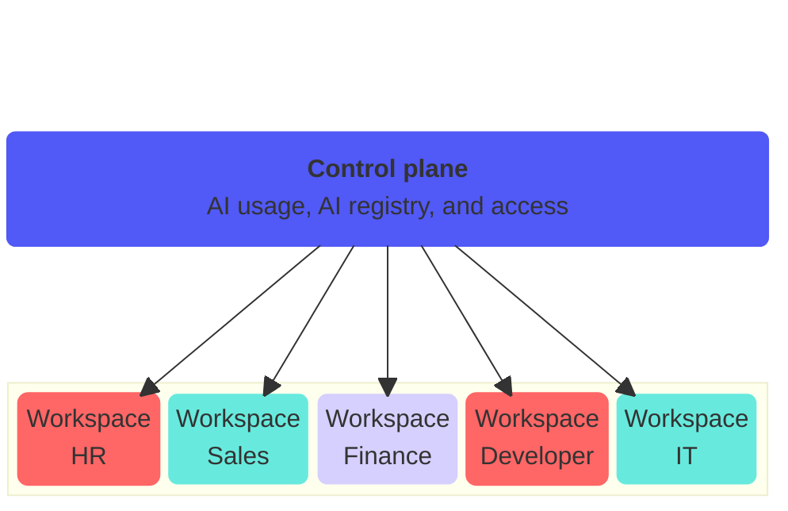

# Control plane

Control plane is a central place to govern your organization's AI. It gives you a single catalog of AI assets, one set of policies that applies to them, control over who can access them, and visibility into how they're used. The governed assets include agents, MCP servers, and Model Gateway routes. Governance applies whether you build assets in Workato or route external AI clients through [Model Gateway](/en/ai-gateway).

> **FEATURE AVAILABILITY**
> 
> Control plane is available to select customers. Contact your Customer Success Representative to confirm whether it is available to you.

## What Control plane does

You can use Control plane to perform the following actions:

- **Catalog AI assets**: Publish agents, MCP servers, and Model Gateway routes to a central [AI registry](/en/control-plane/ai-registry). Teams discover and reuse published assets instead of rebuilding them.
- **Control who can access assets**: Organize end users into [end-user groups](/en/control-plane/user-groups) with access to `Development`, `Test`, and `Production` environments. End users access published assets through the [User portal](/en/control-plane/ai-registry#configure-user-portal-settings), and MCP-compatible clients connect through the [Registry MCP](/en/control-plane/ai-registry#access-registry-mcp) endpoint.
- **Authenticate through your identity provider (IdP)**: Require collaborators to sign in with SAML-based SSO and provision users with SCIM, JIT, or manual provisioning. Configure SAML identity providers for end-user groups and [share them with linked workspaces](/en/control-plane/user-groups#user-group-authentication).
- **Enforce policies and guardrails**: Define policies once in Control plane and enforce them at Model Gateway, MCP Gateway, and Agent Gateway. Policies cover PII protection, content guardrails, and request, token, and cost limits. Attach a policy to your organization, a workspace, an environment, or an individual asset. When multiple policies apply, the most restrictive one wins. Refer to [Gateways](/en/ai-gateway/gateways) for more information.
- **Track usage**: View AI token and request activity by workspace, model, route, identity, and consumer in [AI usage](/en/control-plane/ai-usage).
- **Audit governance activity**: Review sign-ins, collaborator changes, workspace link requests, and SAML SSO and SCIM changes in [Activity audit](/en/control-plane/activity-audit), and export them as CSV or JSON.

## How Control plane works

Control plane separates governance from execution. Your workspaces build and run recipes, genies, and MCP servers. Control plane holds the registry, policies, access settings, usage data, and activity audit for those assets. Policy changes propagate to the gateways without changes to the assets they govern.

> **CONTROL PLANE ISN'T A WORKSPACE**
> 
> Control plane isn't a workspace. Control plane doesn't provide the configuration or tools for teams to collaborate, build recipes, and deploy recipes for a department, level of business, or organization unit.

## Get started

Refer to [Get started with Control plane](/en/control-plane/get-started) for the key components of Control plane and the steps to configure your subdomain, connect your IdP, link workspaces, and add collaborators and end users.

---
