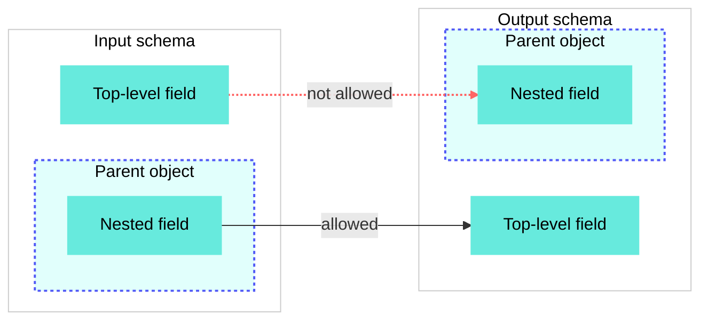

# Create a transformation map

Open the **Projects** view and select **Create > Transformation map** to create a new transformation map. Refer to the following sections to configure and test a map:

## Define the input and output schemas

Select one of the following methods in the editor to define the input and output schemas for a transformation map:

**Use JSON or XML**

1. Use one of the following methods to open the JSON editor:
   
   - Click **Use JSON** if the schema is empty.
   - Click **...** (ellipsis), then **Add schema from JSON** or **Add schema from XML** to extend the schema without changing the existing inputs.
   - Click **...** (ellipsis), then **Edit schema** to modify the existing schema.
   
   _Click **...** to view the input schema menu_
   
2. Enter a JSON or XML sample to define the schema. Workato converts the sample to a Workato schema representation, then generates the schema from it. Transformation maps support the following data types:
   
   - `String`
   - `Number`
   - `Integer`
   - `Date`
   - `Time`
   - `Boolean`
   - `List`
   - `Object`
   
   Workato removes unsupported fields from imported schemas.
   
   You can't declare an array at the root of a schema. Nest every array under an object key.
   
3. Review the sample tree if you selected **Use JSON**, **Add schema from JSON**, or **Add schema from XML**.
   
   _Provide a sample to generate a schema_
   
4. Click **Generate schema** or **Update** to apply the changes.
   

**Add fields manually**

1. Click **add fields manually**.
   
2. Enter a **Name** for the field.
   
   _Add a field manually_
   
3. Optional. Enter a **Label** for the field.
   
4. Use the **Data type** drop-down menu to select the data type. Options include the following data types:
   
   - `String`
   - `Number`
   - `Integer`
   - `Date`
   - `Time`
   - `Boolean`
   - `List`
   - `Object`
5. Use the **Optional** drop-down menu to select whether the field is optional.
   
6. Optional. Use the **Nest under** drop-down menu to select whether the field is nested within another field.
   
7. Optional. Enter a description of the field or expected input in the **Hint** field.
   
8. Click **Add field**.
   

## Map and transform fields

You can map schema values in the transformation map editor in the following ways:

- Connect an input field directly to an output field to pass the value without transformation.
- Click **Add formula** on a connection or an input field to transform a field's value using a formula. Workato stores formula nodes in the transformation area between the input and output schemas. Refer to [Formula transformations](#formula-transformations) for configuration steps.
- Click **Set value** on an output field to configure its value using a static expression that doesn't dependent on other fields. Refer to [Set a static value](#set-a-static-value) for configuration steps.

_Map fields_

### Mapping patterns

Most maps combine the following patterns:

- **One-to-one**: Connect a single input field directly to a single output field when the value requires no change.
- **Many-to-one**: Combine several input fields into one output field. Click **Add formula** and reference each input in the formula. For example, concatenate `first_name` and `last_name` into a single `full_name` field, or sum line items into a total. The formula's result feeds the output field. Refer to [Reshape a list](/en/features/transformation-maps/map-examples#reshape-a-list) for an example.
- **One-to-many**: Connect a single input field or formula output to more than one output field. For example, use the same `full_name` result to populate both a `full_name` and a `display_name` field.

### Delete nodes and connections

Hover over a formula node or connection to open its toolbar.

- **Connection toolbar**: Includes **Add formula** and an option to delete the connection. You must delete each connection in a [chain](#chain-formulas) individually.
- **Node toolbar**: Includes **Edit formula** (pencil icon) and an option to delete the node.

_The connection toolbar_

### Formula transformations

Complete the following steps to add a formula node that transforms a field's value using [Workato Expression Language (WEL)](/en/wel):

> **CONNECT BEFORE YOU REFERENCE**
> 
> Formulas can only access the inputs you connect to them. The node's **Available inputs** section lists these inputs. You must connect input fields to the node before you can reference them in a formula.

1. Click **Add formula** on a connection or an input field. The **Apply formula** modal opens.
   
   _The **Apply formula** modal_
   
2. Enter a unique **Formula name**. Downstream nodes reference this node's output using a normalized form of the name. Refer to [Formula name and reference rules](#formula-name-and-reference-rules) for how Workato builds references.
   
3. Enter a formula in the **Formula editor**. You can click a field in the **Available inputs** section or drag and drop it into the formula editor to insert a reference. Formulas refer to fields by their reference rather than their display name. For example, the reference for `first_name` is `_.first_name`.
   
   > **REFERENCE NESTED VALUES**
   > 
   > Formulas can only directly reference top-level elements, which are the scalars, objects, and arrays you connect to the node. Nested elements, such as the keys inside an object or array, still appear in **Available inputs** so you can review the schema, but you must access them through their parent.
   
   _Insert an input_
   
4. Optional. Use the **Output schema** section to define output fields for the formula node. Refer to [Define the input and output schemas](#define-the-input-and-output-schemas) for configuration steps, and [When to define an output schema](#when-to-define-an-output-schema) to determine whether this formula requires an output definition.
   
   A formula with a defined output schema must return a hash with keys that exactly match the output field names. A formula that produces a list must return that list under a named key rather than as a bare array, because a schema can't declare an array at its root.
   
5. Click **Apply** to complete the setup.
   

### Chain formulas

Formula nodes don't have to connect directly to an input or output field. Connect multiple nodes to break complex logic into readable stages instead of a single large expression. The upstream node's [output schema](#when-to-define-an-output-schema) appears in the downstream node's **Available inputs** list, prefixed with the upstream node's formula name so references don't clash. Click or drag the field to insert the exact reference. Refer to [Chain a transformation with filter and sort](/en/features/transformation-maps/map-examples#chain-a-transformation-with-filter-and-sort) for an example of chained formulas or refer to [Formula name and reference rules](#formula-name-and-reference-rules) for more information about references.

### Formula name and reference rules

Formulas refer to a value in one of two ways, depending on where the value comes from:

- **Values from a connection**: Every input field and upstream node output connected to the node appears in **Available inputs** as a single flat name, regardless of how deeply it sits in the schema. Reference an input field as `_.` followed by the field name.
  
- **Values from the formula**: After a value is bound to a name, such as a lambda parameter or a `let` binding, traverse into it with dots. Dot notation navigates a structure you already have. It doesn't cross a connection.
  

Workato prefixes references from an upstream node's output with that node's formula name so references from different nodes don't clash, even when two nodes use the same output field name. What Workato appends after the formula name depends on whether the node has a declared output schema:

- **Node with a defined output schema**: Workato appends each output field name to the formula name, so a node with several output fields produces several references.
  
- **Node with no output schema**: Workato appends `value` to the formula name instead, because a scalar formula has no output field names.
  

Workato normalizes the formula name, but not the field name. References take the formula name, replace each space with an underscore (`_`), remove all other special characters, and convert the result to lowercase. No part of the name is truncated. Workato keeps output field names exactly as you defined them, including capitalization.

| Source | Reference |
| --- | --- |
| An input field named `lines` | `_.lines` |
| Node `line totals`, with an output field named `lines` | `_.line_totals_lines` |
| Node `total`, with no output schema | `_.total_value` |
| Node `net-total`, with no output schema | `_.nettotal_value` |
| Node `Summarize By Category`, with an output field named `totalAmount` | `_.summarize_by_category_totalAmount` |
| Node `a@@@b!!@@@sasD@@!`, with no output schema | `_.absasd_value` |
| A field on the lambda parameter `l` | `l.sku` |

A node output reference concatenates the formula name and field name, so long names on both sides produce long references. Keep formula names short to keep references readable.

Click or drag the field in the **Available inputs** section to insert the exact reference rather than typing it, which avoids mistakes in the normalized form.

### When to define an output schema

Whether a formula needs an output schema depends on what it returns.

You don't need to define an output schema if a formula returns a single scalar value, such as a `String`, `Number`, `Integer`, `Date`, `Time`, or `Boolean`. Workato references a scalar result as the formula name followed by `_value`, which you can connect straight to a scalar output field. Refer to [Formula name and reference rules](#formula-name-and-reference-rules) for how references are built. Define an output schema when a formula returns a complex object or an array, or when it returns more than one named value. A declared schema lets Workato verify the structure the formula produces and expose typed fields to downstream formulas and nodes. Without it, Workato can't validate or pass on a non-scalar result.

A formula's output can feed one or more downstream targets, including other formulas. Maps don't support circular connections.

### Set a static value

Click **Set value** on an output field to set its value without connecting it to any input. Use one of the following approaches:

- Hardcode a value. For example, set a constant `source` of `signup_form`.
- Enter a [WEL](/en/wel) expression that doesn't depend on input fields. For example, generate a timestamp at runtime.

An output field holds either a static value or an incoming connection, not both. Workato clears a field's static value when you draw a connection to it.

### Ports and validation

Fields and nodes expose connection points called ports. The canvas highlights valid ports when you start a connection and blocks invalid connections, including circular connections and connections between incompatible nesting levels or data types.

**Incompatible data types**: A formula with no declared output schema returns a single scalar value, so it can't connect to an object or array target. Refer to [When to define an output schema](#when-to-define-an-output-schema) for more information.

**Incompatible nesting levels**: Access for non-scalar fields such as objects and arrays starts at the top level and works inward, so a connection can only run from nested to top-level, not the reverse. Flatten the structure in a formula first to use values from an array nested inside another array. Refer to [Iterate over an inner array](#iterate-over-an-inner-array) for how to flatten it.

You can save a transformation map with incomplete or invalid states, such as hanging, disconnected, or missing formula nodes, or an output schema that doesn't match what a formula returns. Workato flags these states with a warning instead of blocking the save, which enables you to save work in progress and return to it later. [Delete hanging or disconnected nodes](#delete-nodes-and-connections) and ensure each node's output matches its defined schema to keep a map valid.

Runtime errors surface in the recipe's job history rather than at save time.

### Arrays

A connection that carries a list appears as a double line to show that it carries an array. For example, the following connection between **Lines** lists is in array context:

_The connection between **Lines** lists is in array context_

#### Iterate over an inner array

An inner array is an array nested inside another array, such as a `units` list on each element of a `lines` list. Access [starts at the top level and works inward](#ports-and-validation), so you can't connect or reference an inner array directly, and you can't connect an outer array to an inner one.

Connect the outer array to a node, then flatten from the root down to the inner elements within a formula. The node receives the outer array, walks each element, walks that element's inner array, and flattens the result into a single list. Read any values you need from the outer element while you process the inner one, because a flattened list retains nothing about its parent otherwise. Refer to [Flatten a nested array](/en/features/transformation-maps/map-examples#flatten-a-nested-array) for an example.

Flattening produces one row for each inner element, which changes the shape of the data.

## Test the map

The **Test** tab provides a live preview. Enter sample input and Workato displays the output immediately, without requiring you to leave the editor or save the map first. This enables you to verify the mapping as you build.

Complete the following steps to test the transformation map:

1. Click the **Test** tab.
   
2. Enter sample input JSON.
   
   _Test tab_
   
3. Review the results in the **Output** panel. The panel displays the output values or an error message if the mapping fails.

---
