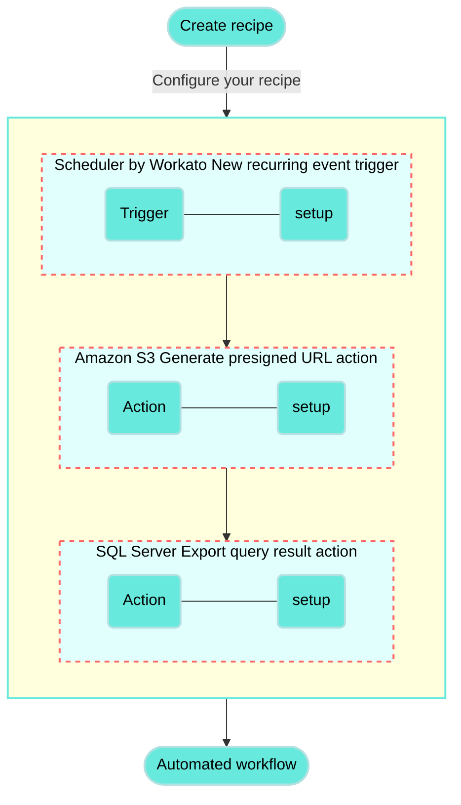
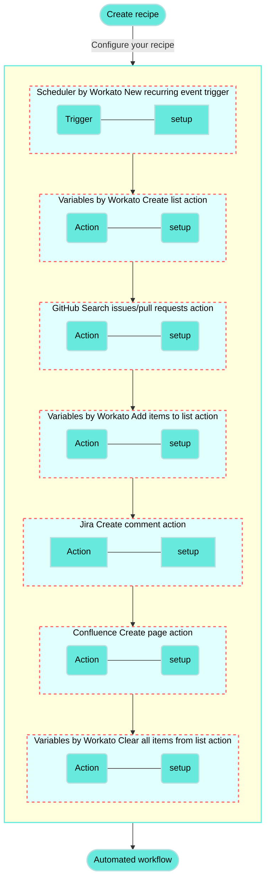
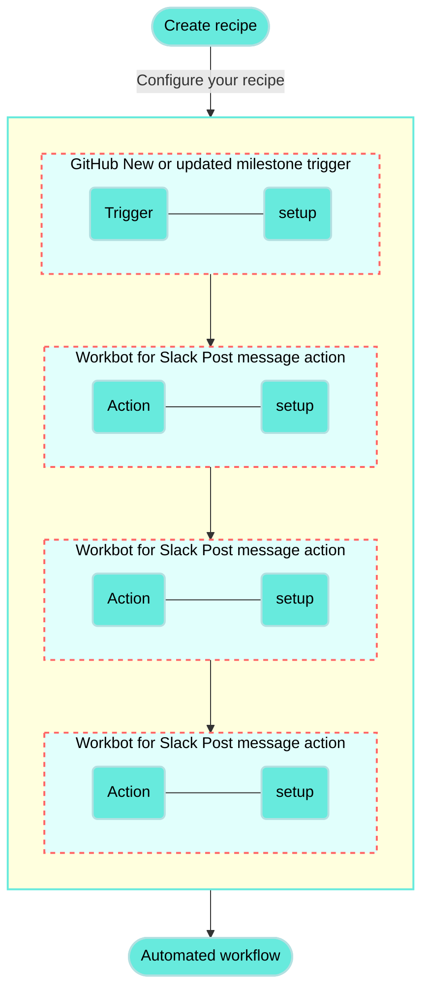
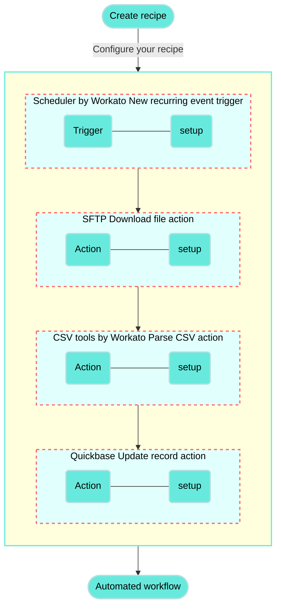

# Sync data between Amazon S3 and SQL Server recipe

This use case guides you through connecting [Amazon S3](/en/connectors/s3) and [SQL Server](/en/connectors/mssql/introduction) to create a powerful automation.

## What does this recipe do?

This recipe runs on a schedule to sync data between Amazon S3 and SQL Server.



## Create your recipe

Complete the following steps to create a recipe that runs on a schedule to sync data between Amazon S3 and SQL Server:

> **USE CASES ARE INTENDED AS EXAMPLES ONLY**
> 
> This use case serves as an example. Modifications to triggers, actions, or conditional logic may be necessary to adapt this recipe to your workflow.

1. Sign in to Workato.
   
2. Select the project where you plan to create the recipe.
   
3. Create connections for Amazon S3 and SQL Server:
   
   Create an Amazon S3 connection.
   
   ### Create an Amazon S3 connection
   
   This step creates a connection between Workato and your Amazon S3 account.
   
   1. Click **Create > Connection** or press C twice.
      
   2. Search for and select `Amazon S3` on the **New connection** page.
      
   3. Enter a name for your connection in the **Connection name** field.
      
      _Connect to Amazon S3_
      
   4. Use the **Location** drop-down menu to select the project where you plan to store the connection.
      
   5. Use the **Authorization type** drop-down menu to select **IAM role**.
      
   6. Fill in the **IAM role ARN** field. Workato generates a unique external ID for every Workato user, such as `workato-user-84762`. You must provide this external ID when creating an IAM role in Amazon S3.
      
   7. Use the **Restrict to bucket** drop-down menu to select which bucket this connection is restricted to. This is required when the user has only limited [s3:ListBucket](https://docs.aws.amazon.com/AmazonS3/latest/userguide/using-with-s3-actions.html#using-with-s3-actions-related-to-buckets) access.
      
   8. Enter the region of your Amazon S3 account in the **Region** field. You can locate this value in your Amazon S3 account URL. For example, if your account URL is `https://eu-west-1.console.s3.amazon.com`, your region is `eu-west-1`.
      
   9. Specify the download threads in the **Download threads** field. This field is used to boost download speed. The default is `1`, and the maximum is `20`.
      
   10. Click **Connect**.
       
   
   Create a SQL Server connection.
   
   ### Create a SQL Server connection
   
   This step creates a connection between Workato and your SQL Server account.
   
   1. Click **Create > Connection** or press C twice.
      
   2. Search for and select `SQL Server` on the **New connection** page.
      
   3. Enter a name for your connection in the **Connection name** field.
      
      _Connect to SQL Server_
      
   4. Use the **Location** drop-down menu to select the project where you plan to store the connection.
      
   5. Use the **Connection type** drop-down menu to specify if your connection is cloud-based or uses an [on-prem group](/en/on-prem/agents/connection).
      
   6. Enter the URL of your hosted server in the **Host** field.
      
   7. Enter the port number your server runs on in the **Port** field. The default is `1433`.
      
   8. Enter the username used to connect to SQL Server in the **Username** field.
      
   9. Enter the password used to connect to SQL Server in the **Password** field.
      
   10. Enter the name of the database you plan to access in the **Database** field.
       
   11. Optional. Use the **Azure SQL** drop-down menu to specify if you're connecting to Azure SQL.
       
   12. Optional. Expand **Advanced settings** to configure additional datetime settings.
       
   13. Click **Connect**.
       
   
4. Go back to your project and click **Create > Recipe** or press C+R.
   
   _Create a new recipe_
   
5. Enter a name for your recipe in the **Name** field.
   
6. Use the **Location** drop-down menu to select the project where you plan to store the recipe.
   
7. Click **Start building**.
   
   _Start building your recipe_
   
8. Click **Pick a starting point** and select **Run on a schedule**. This creates a new recipe with the Scheduler by Workato [New recurring event trigger](/en/features/scheduler/triggers/new-recurring-event). This trigger doesn't require you to establish a connection.
   
9. Set up your Scheduler by Workato New recurring event trigger.
   
   ### Set up Scheduler by Workato New recurring event trigger
   
   This trigger sets the interval for how frequently the recipe runs.
   
   1. Click the trigger in the recipe editor.
      
      _Click the trigger_
      
   2. Use the **Time unit** drop-down menu to specify how frequently to run the recipe. This recipe selects **Minutes**.
      
      - Available options include **Minutes**, **Hours**, **Days**, **Weeks**, **Months**, or **Custom schedule**.
   3. Enter a whole number in the **Trigger every** field. This example uses `5` to run the recipe every five minutes.
      
      _Configure the New recurring event trigger_
      
   
10. Click **\+ Add step** and select **Action in app**.
    
    _Click **Add step > Add action in app**_
    
11. Set up your Amazon S3 Generate presigned URL action.
    
    ### Set up Amazon S3 Generate presigned URL action
    
    This step creates a temporary authenticated URL to an object in your Amazon S3 bucket. A third party can use this URL to upload and modify this object for the specified duration.
    
    1. Search for `Amazon S3` and select it as your app.
       
       _Choose Amazon S3_
       
    2. Select the **Generate presigned URL** action.
       
       _Select the Generate presigned URL action. [What's a presigned URL?](https://docs.aws.amazon.com/AmazonS3/latest/userguide/ShareObjectPreSignedURL.html)_
       
    3. Select the Amazon S3 connection you created in the previous steps.
       
    4. Select the bucket to monitor from the **Bucket name** drop-down menu.
       
    5. Enter the folder path of the object in the **Object name** field. For example, enter `orders.csv` if the file is located at the root of your bucket.
       
       Ensure the folder path is accurate, as object and file names are case-sensitive. Refer to the [AWS prefix documentation](https://docs.aws.amazon.com/AmazonS3/latest/userguide/using-prefixes.html) for more information.
       
    6. Use the **HTTP Method** drop-down menu to select **PUT**.
       
       _Configure the Generate presigned URL action_
       
    
12. Click **\+ Add step** and select **Action in app**.
    
13. Set up your SQL Server Export query result action.
    
    ### Set up SQL Server Export query result action
    
    This step executes the SQL query to retrieve all rows and columns from your specified table, exports the results as a CSV file, and uploads the file to your designated Amazon S3 object location.
    
    1. Search for `SQL Server` and select it as your app.
       
       _Choose SQL Server_
       
    2. Select the **Export query result** action.
       
       _Select the Export query result action_
       
    3. Select the SQL Server connection you created in the previous steps.
       
    4. Enter the following query in the **SQL** field. Replace `{YOUR_TABLE}` with the name of your table, and update the schema:
       
       ```sql
       SELECT * FROM {YOUR_SCHEMA}.{YOUR_TABLE};
       ```
       
       This query retrieves all rows and columns from the specified table. For example, if your table is named `Orders` and resides in the default schema `dbo`, your query would look as follows:
       
       ```sql
       SELECT * FROM dbo.Orders;
       ```
       
    5. Use the **Column delimiter** drop-down menu to specify the delimiter character that separates each column in the CSV file. For example, select **comma**.
       
    6. Map the Presigned object URL (Step 2) datapill to the **Upload URL** field.
       
       _Configure the Upload URL field_
       
    
14. Click **Save**.
    

Your **Sync data between Amazon S3 and SQL Server** recipe is ready to test and implement.

Example recipe configuration.

_**Sync data between Amazon S3 and SQL Server** recipe_

---

---
url: >-
  https://docs.workato.com/en/getting-started/use-cases/github-jira-confluence.md
description: >-
  Build a recipe that creates weekly Confluence release notes and Jira comments
  from closed GitHub issues.
---

# Create summarized Confluence notes and Jira comments from closed GitHub PRs recipe

This use case guides you through connecting [GitHub](/en/connectors/github), [Jira](/en/connectors/jira), and [Confluence](/en/connectors/confluence) to create a powerful automation.

## What does this recipe do?

This recipe generates weekly release notes in Confluence based on closed issues from a GitHub repository.

The recipe searches for closed issues, compiles them into a list, and creates a Confluence page with the closed issues. Additionally, if a GitHub issue references a specific Jira ticket in its body, the recipe adds a comment to the corresponding Jira ticket.



## Create your recipe

Complete the following steps to create a recipe that searches for closed issues in a GitHub repository, adds them to a list, and then creates a Confluence page summarizing the issues while also adding comments to related Jira tickets.

> **USE CASES ARE INTENDED AS EXAMPLES ONLY**
> 
> This use case serves as an example. Modifications to triggers, actions, or conditional logic may be necessary to adapt this recipe to your workflow.

1. Sign in to Workato.
   
2. Select the project where you plan to create the recipe.
   
3. Create connections for GitHub, Jira, and Confluence:
   
   Create a GitHub connection.
   
   ### Create a GitHub connection
   
   This step creates a connection between Workato and your GitHub account.
   
   1. Click **Create > Connection** or press C twice.
      
   2. Search for and select `GitHub` on the **New connection** page.
      
   3. Provide a name for your connection in the **Connection name** field.
      
      _GitHub connection setup_
      
   4. Use the **Location** drop-down menu to select the project where you plan to store the connection.
      
   5. Use the **Connection type** drop-down menu to select the connection method you plan to use. You can select your [on-prem group](/en/on-prem/groups) name or select **Cloud** to use a direct connection.
      
   6. Select either [**OAuth App**](/en/connectors/github#traditional-oauth), [**GitHub App**](/en/connectors/github#github-app-authentication), or **Personal Access Token** in the **Authentication type** drop-down menu.
      
      **If you selected GitHub App**:
      
      1. Provide your app ID in the **GitHub App ID** field.
         
      2. Enter the private key in the **GitHub App Private key** field.
         
      3. Fill in the **Installation ID** field.
         
      4. Optional. Expand **Advanced configuration** to provide the **API Root URL**, which is applicable when using GitHub Enterprise Server.
         
      
      **If you selected Personal Access Token**:
      
      1. Enter your personal access token in the **Personal Access Token** field.
         
   7. Click **Connect**.
      
   
   Create a Jira connection.
   
   ### Create a Jira connection
   
   This step creates a connection between Workato and your Jira account.
   
   1. Click **Create > Connection** or press C twice.
      
   2. Search for and select `Jira` on the **New connection** page.
      
   3. Enter a name for your Jira connection in the **Connection name** field.
      
      _Jira connection setup_
      
   4. Use the **Location** drop-down menu to select the project where you plan to store the connection.
      
   5. Select your **Connection type**.
      
   6. Use the **Auth type** drop-down menu to select your authentication method. Supported options include [Basic](/en/connectors/jira#basic-authentication-with-password), [API token](/en/connectors/jira#api-tokens), [OAuth 2.0](/en/connectors/jira#oauth2-0), and [Personal access token](/en/connectors/jira#personal-access-tokens).
      
   7. Provide your **Host name**. For example, if your Jira URL is `https://acme.atlassian.net`, your host name is `acme.atlassian.net`.
      
   8. Click **Connect**.
      
   
   Create a Confluence connection.
   
   ### Create a Confluence connection
   
   This step creates a connection between Workato and your Confluence account.
   
   1. Click **Create > Connection** or press C twice.
      
   2. Search for and select `Confluence` on the **New connection** page.
      
   3. Provide a name for your connection in the **Connection name** field.
      
      _Confluence connection setup_
      
   4. Use the **Location** drop-down menu to select the project where you plan to store the connection.
      
   5. Use the **Connection type** drop-down menu to select the connection method you plan to use. You can select your [on-prem group](/en/on-prem/groups) name or select **Cloud** to use a direct connection.
      
   6. Use the **Auth type** drop-down menu to select your authentication method. Options include **Basic**, **API token**, and **OAuth 2.0**.
      
   7. Provide your connection information.
      
      - **If using a cloud connection**: Enter your Confluence subdomain in the **Confluence subdomain field**.
      - **If using an on-prem connection**: Enter the root URI (includes protocol, optional port, and hostname) of your Confluence host in the **Confluence root URI** field.
   8. Provide your authentication information.
      
      **If you selected Basic authentication**:
      
      1. Enter your username (not email) in the **Username** field.
         
      2. Enter your password in the **Password** field.
         
      
      **If you selected API token**:
      
      1. Enter your email in the **Email** field.
         
      2. Enter your API token in the **API token** field. You can create one by going to your Atlassian account and selecting **[Security](https://id.atlassian.com/manage/api-tokens) > API tokens > Create API token**.
         
      
      **If you selected OAuth 2.0**:
      
      1. Enter your client ID in the **Client ID** field.
         
      2. Enter your client secret in the **Client secret** field.
         
      3. Optional. Expand **Advanced settings** to select scopes to request for this connection. The following scopes are selected by default:
         
         - `read:confluence-groups`
         - `read:confluence-content.summary`
         - `write:confluence-content`
         - `search:confluence`
   9. Click **Connect**.
      
   
4. Go back to your project and click **Create > Recipe** or press C+R.
   
   _Create a new recipe_
   
5. Enter a name for your recipe in the **Name** field.
   
6. Select the project where you plan to store the recipe from the **Location** drop-down menu.
   
7. Click **Start building**.
   
   _Start building your recipe_
   
8. Click **Pick a starting point**, then select **Run on a schedule**. This creates a new recipe with the Scheduler by Workato [New recurring event trigger](/en/features/scheduler/triggers/new-recurring-event). This trigger doesn't require you to establish a connection.
   
9. Set up your Scheduler by Workato New recurring event trigger.
   
   ### Set up Scheduler by Workato New recurring event trigger
   
   This trigger sets the interval for how frequently the recipe runs. The Scheduler by Workato trigger doesn't require a connection.
   
   1. Click the trigger in the recipe editor.
      
      _Click the trigger_
      
   2. Select **Weeks** in the **Time unit** field.
      
      - Available options include **Minutes**, **Hours**, **Days**, **Weeks**, **Months**, or **Custom schedule**.
   3. Enter `1` in the **Trigger every** field to run the recipe weekly.
      
   4. Choose the days the recipe should run in the **Days of the week** field. For example, select **Monday**.
      
   5. Specify the time for the recipe to run in the **Trigger at** field. For example, enter `9:00 AM`.
      
   6. Optional. Select the timezone in the **Timezone** field. If left blank, the default is **America/Los\_Angeles**.
      
   7. Optional. Set the start date and time in the **Start after** field, or leave it blank to activate the trigger immediately after you start the recipe. You can't change this value after you run or test the recipe.
      
   8. Click **Save**.
      
   
10. Click **\+ Add step** and select **Action in app**.
    
    _Click **Add step > Add action in app**_
    
11. Set up your Variables by Workato Create list action.
    
    ### Set up Variables by Workato Create list action
    
    This step creates an empty list named **Releases** that captures GitHub issues closed in the past week.
    
    1. Search for `Variables by Workato` and select it as your app.
       
       _Choose Variables by Workato_
       
    2. Select the **Create list** action.
       
       _Select the Create list action_
       
    3. Type `Releases` in the **List name** field.
       
    4. Select **Add fields manually** in the **List item schema** field.
       
    5. Edit the following fields in the **Add new field** dialog:
       
       - Type `Details` in the **Name** field.
       - Ensure **String** is selected in the **Data type** field.
       - Ensure **No** is selected in the **Optional** field.
    6. Click **Add field**.
       
    7. Click **Save**.
       
    
12. Click **\+ Add step** and select **Action in app**.
    
13. Set up your GitHub Search issues/pull requests action.
    
    ### Set up GitHub Search issues/pull requests action
    
    This step searches for issues in your selected GitHub repository that were closed since the beginning of the previous week.
    
    1. Search for `GitHub` and select it as your app.
       
       _Choose GitHub_
       
    2. Select the **Search issues/pull requests** action.
       
       _Select the Search issues/pull requests action_
       
    3. Select the GitHub connection you created in the preceding steps.
       
    4. Select the **Organization** that contains the repository you plan to access.
       
    5. Select your repository in the **Repository name** field.
       
    6. Select **Issue** in the **Type** field.
       
    7. Set the **Status** to **Closed** to search for closed issues.
       
    8. Go to the **Closed after** field, switch to [formula mode](/en/formulas/formula-mode), and enter the following formula:
       
       ```ruby
       (today - 7.days).beginning_of_week
       ```
       
       This formula filters the search to retrieve only issues closed since the beginning of the previous week.
       
    9. Click **Save**.
       
    
14. Click **\+ Add step** and select **Repeat for each**.
    
    _Click **Add step > Repeat for each**_
    
    How does the Repeat for each condition work?
    
    ### GitHub Repeat for each condition example
    
    A [Repeat for each](/en/recipes/repeat-for-each) loop _repeats_ one or more actions _for each_ item in a list. The loop ends automatically when the entire list is processed.
    
    ```mermaid
    flowchart TD
      A(["Start"]) --> B("Another closed GitHub issue from the past week?")
      B -- "Yes" --> C("Add issue to Releases list") --> MoreSteps("Additional steps")
      B -- "No" --> D(["End loop"])
    classDef default fill:#67eadd,stroke:#b3e0e1,stroke-width:2px,color:#000;
    classDef WorkatoPink fill:#f3c1c2,stroke:#f3c1c2,stroke-width:1px;
    class A,D WorkatoPink
    ```
    
15. Set up your Repeat for each loop.
    
    ### Set up a Repeat for each loop
    
    This step processes each issue closed since the beginning of the past week. You can define the actions you plan for the recipe to perform for each issue after setting up the loop.
    
    1. Map the Issues (Step 3) datapill to the **Input list** field.
       
       _Map the Issues (Step 3) datapill_
       
    2. Select **One item at a time** in the **Repeat mode** field.
       
    3. Select **No** in the **Clear step output** field. Learn more about this [input field](/en/features/list-management#clear-step-output).
       
    4. Click **Save**.
       
    
16. Click **Select an app and action**.
    
17. Set up your Variables by Workato Add items to list action.
    
    ### Set up Variables by Workato Add items to list action
    
    This step appends details extracted from each issue processed in the **Repeat for each** loop to the **Releases** list, including the issue title and a hyperlink to the issue number.
    
    1. Search for `Variables by Workato` and select it as your app.
       
       _Choose Variables by Workato_
       
    2. Select the **Add items to list** action.
       
       _Select the Add items to list action_
       
    3. Select **Releases (step 2)** in the **List name** field.
       
    4. Select **End of the list** in the **Insert location** field.
       
    5. Expand the **List item** field.
       
    6. Complete the following actions in **Details** field:
       
       1. Map the Title (Step 4) datapill.
          
       2. Type `(<a href="`.
          
       3. Map the Html URL (Step 4) datapill.
          
       4. Type `">#`.
          
       5. Map the Number (Step 4) datapill.
          
       6. Type `</a>)`.
          
       
       Your configuration should look as follows:
       
       ```plaintext
       TITLE_STEP_4 (<a href="HTML_URL_STEP_4">#NUMBER_STEP_4</a>)
       ```
       
       _List item details configuration_
       
    7. Click **Save**.
       
    
18. Click **\+ Add step** and select **IF condition**.
    
    _Click **Add step > IF condition**_
    
    How do IF conditions work?
    
    ### Add issue IF condition example
    
    An [IF condition](/en/features/if-conditions) enables you to make decisions based on specific conditions. You can control your recipe workflow by executing different actions depending on whether a condition you specify is present or not present (true or false).
    
    ```mermaid
    flowchart TD
        A([Add issue to Releases list]) --> B("Does the issue body contain a string in the format <code>Jira:ABC-123</code>?")
        B -->|Yes| C(Add comment to the corresponding Jira issue)
        B ---->|No| E(Do nothing)

        classDef default fill:#67eadd,stroke:#b3e0e1,stroke-width:2px,color:#000;
        classDef WorkatoPink fill:#f3c1c2,stroke:#f3c1c2,stroke-width:1px;
        class E WorkatoPink
    ```
    
19. Set up your IF condition.
    
    ### Set up IF condition
    
    This step checks if the body of each issue contains a Jira ticket reference.
    
    1. Map the Body (Step 4) datapill to the **Data field**.
       
    2. Select **is present** in the **Condition** field.
       
       This condition checks that the issue body of the current issue being processed is neither empty nor null, preventing errors when applying formulas in the next step.
       
    3. Click `+` (plus) and select **AND** to add a second condition.
       
    4. Switch **Data field** to [formula mode](/en/formulas/formula-mode) and do the following:
       
       1. Map the Body (Step 4) datapill.
          
       2. Append the `.match?(/Jira:w+-\d+/)` formula.
          
          This formula checks if the `Body` of the GitHub issue contains a Jira ticket reference in the format `Jira:ABC-123`.
          
    5. Select **equals** in the **Condition** field.
       
    6. Go to the **Value** field, switch to [formula mode](/en/formulas/formula-mode), and type `true`.
       
       _IF condition configuration_
       
    7. Click **Save**.
       
    
20. Click **Select an app and action**.
    
21. Set up your Jira Create comment action.
    
    ### Set up Jira Create comment action
    
    This step creates a comment in the corresponding Jira ticket if the recipe detects a Jira reference in the issue body. The comment indicates that the issue was closed in GitHub, along with the issue number and a hyperlink to the issue.
    
    1. Search for `Jira` and select it as your app.
       
       _Choose Jira_
       
    2. Select the **Create comment** action.
       
       _Select the Create comment action_
       
    3. Switch the **Issue ID or key** field to formula mode.
       
    4. Complete the following actions in the **Issue ID or key** field:
       
       1. Map the Body (Step 4) datapill.
          
       2. Append the `.match?(/Jira:w+-\d+/)` formula.
          
          _Issue ID or key configuration_
          
    5. Complete the following actions in the **Comment text** field:
       
       1. Type `Closed by Github #`.
          
       2. Map the Number (Step 4) datapill next to the hash `#` symbol.
          
       3. Enter a new line and map the Html URL (Step 4) datapill.
          
          _Comment text configuration_
          
    6. Click **Save**.
       
    
22. Click **\+ Add step** and select **Action in app**.
    
23. Set up your Confluence Create page action.
    
    ### Set up your Confluence Create page action
    
    This step creates a Confluence page listing the GitHub issues that were closed since the beginning of the past week.
    
    1. Search for `Confluence` and select it as your app.
       
       _Choose Confluence_
       
    2. Select the **Create page** action.
       
       _Select the Create page action_
       
    3. Enter the Confluence space key in the **Space key** field. You can find this value in the URL of your Confluence space page.
       
    4. Switch the **Title** field to [formula mode](/en/formulas/formula-mode) and enter the following:
       
       ```ruby
       "Product release (" + today.beginning_of_week.strftime("%d %B %Y") +")"
       ```
       
       This sets the title of your Confluence release notes page. For example, `Product release (1 October 2024)`.
       
       _Title configuration_
       
    5. Switch the **Body** field to [formula mode](/en/formulas/formula-mode) and do the following:
       
       1. Type `"<p>" +`.
          
       2. Map the Releases (Step 2) datapill.
          
       3. Type the following formulas:
          
          ```ruby
          .pluck('Details').join("<br/><br/">)
          ```
          
       4. Type `+ "</p>`.
          
       
       This code constructs an HTML paragraph that contains the details from the **Releases** list, with each detail separated by two line breaks (`<br/><br/>`).
       
       _Body configuration_
       
    6. Click **Save**.
       
    
24. Click **\+ Add step** and select **Action in app**.
    
25. Set up your Variables by Workato Clear all items from list action.
    
    Set up Variables by Workato Clear all items from list action
    
    This step clears the items from the **Releases** list to ensure that closed issues that were previously included in the release notes page aren't included the next time the recipe runs.
    
    1. Search for `Variables by Workato` and select it as your app.
       
       _Choose Variables by Workato_
       
    2. Select the **Clear all items from list** action.
       
       _Select the Clear all items from list action_
       
    3. Go to the **List name** field and select **Releases (step 2)** to clear all items from this list at the end of the recipe run.
       
    4. Click **Save**.
       
    

Your **Create summarized Confluence notes and Jira comments from closed GitHub PRs** recipe is ready to test and implement.

Example recipe configuration.

_**Create summarized Confluence notes and Jira comments from closed GitHub PRs** recipe_

---

---
url: >-
  https://docs.workato.com/en/getting-started/use-cases/github-workbot-for-slack.md
description: >-
  Build a recipe that monitors GitHub for new or updated milestones and posts
  the details to Slack using Workbot for Slack.
---

# Post GitHub milestones with Workbot for Slack recipe

This use case guides you through connecting [GitHub](/en/connectors/github) and [Workbot for Slack](/en/workbot/workbot#workbot-for-slack) to create a powerful automation.

## What does this recipe do?

This recipe monitors GitHub for new or updated milestones and automatically posts milestone details to Slack using Workbot for Slack.



## How can I use this recipe?

You can use this recipe to track milestones in GitHub and post updates to your Slack channel in real time. You can also modify this recipe to work with real-time triggers for GitHub issues, pull requests, or issue comments.

## Create your recipe

Complete the following steps to create a recipe that monitors GitHub for new or updated milestones and automatically posts milestone details to Slack using Workbot for Slack:

> **USE CASES ARE INTENDED AS EXAMPLES ONLY**
> 
> This use case serves as an example. Modifications to triggers, actions, or conditional logic may be necessary to adapt this recipe to your workflow.

1. Sign in to Workato.
   
2. Select the project where you plan to create the recipe.
   
3. Create connections for GitHub and Workbot for Slack:
   
   Create a GitHub connection.
   
   ### Create a GitHub connection
   
   This step creates a connection between Workato and your GitHub account.
   
   1. Click **Create > Connection** or press C twice.
      
   2. Search for and select `GitHub` on the **New connection** page.
      
   3. Provide a name for your connection in the **Connection name** field.
      
      _GitHub connection setup_
      
   4. Use the **Location** drop-down menu to select the project where you plan to store the connection.
      
   5. Use the **Connection type** drop-down menu to select the connection method you plan to use. You can select your [on-prem group](/en/on-prem/groups) name or select **Cloud** to use a direct connection.
      
   6. Select either [**OAuth App**](/en/connectors/github#traditional-oauth), [**GitHub App**](/en/connectors/github#github-app-authentication), or **Personal Access Token** in the **Authentication type** drop-down menu.
      
      **If you selected GitHub App**:
      
      1. Provide your app ID in the **GitHub App ID** field.
         
      2. Enter the private key in the **GitHub App Private key** field.
         
      3. Fill in the **Installation ID** field.
         
      4. Optional. Expand **Advanced configuration** to provide the **API Root URL**, which is applicable when using GitHub Enterprise Server.
         
      
      **If you selected Personal Access Token**:
      
      1. Enter your personal access token in the **Personal Access Token** field.
         
   7. Click **Connect**.
      
   
   Create a Workbot for Slack connection.
   
   ### Create a Workbot for Slack connection
   
   This step creates a connection between Workato and your Workbot for Slack account.
   
   1. Click **Create > Connection** or press C twice.
      
   2. Search for and select `Workbot for Slack` on the **New connection** page.
      
   3. Provide a name for your connection in the **Name** field.
      
      _Workbot for Slack connection setup_
      
   4. Use the **Location** drop-down menu to select the project where you plan to store the connection.
      
   5. Optional. Select the NLU provider you plan to use, such as DialogFlow or Amazon Lex NLU. You must connect to the NLU provider for it to appear in the drop-down menu.
      
   6. Optional. Click **Advanced** to configure **Slash commands verification tokens**, **custom help** content, your **Slack app status** (classic or not), and your **Custom OAuth profile**.
      
   7. Click **Connect**, sign in to your Slack workspace when prompted, and click **Continue** to verify the connection.
      
   
4. Go back to your project and click **Create > Recipe** or press C+R.
   
   _Create a new recipe_
   
5. Enter a name for your recipe in the **Name** field.
   
6. Select the project where you plan to store the recipe from the **Location** drop-down menu.
   
7. Click **Start building**.
   
   _Start building your recipe_
   
8. Click **Pick a starting point**, then select **Trigger from an app**.
   
9. Click **Select an app and trigger event**.
   
10. Set up your GitHub New or updated milestone trigger.
    
    ### Set up GitHub New or updated milestone trigger
    
    This trigger monitors the GitHub repository you specify for new or updated milestones in real-time.
    
    1. Search for `GitHub` and select it as your app.
       
       _Choose GitHub_
       
    2. Select the **New or updated milestone** trigger.
       
       _Select the New or updated milestone real-time trigger_
       
    3. Select the GitHub connection you created in the preceding steps.
       
    4. Select the organization that contains the repository you plan to access from the **Organization** drop-down menu.
       
    5. Select your repository in the **Repository name** field.
       
    6. Select **All** from the **Action** drop-down menu to monitor all milestone statuses. Additional options include the following statuses:
       
       - **Opened milestone**
       - **Closed milestone**
       - **Created milestone**
       - **Deleted milestone**
       - **Edited milestone**
       
       _Configure the New or updated milestone trigger_
       
    7. Click **Save**.
       
    
11. Click **\+ Add step** and select **IF condition**.
    
    _Click **Add step > IF condition**_
    
    How do IF conditions work?
    
    ### GitHub and Workbot for Slack IF condition example
    
    An [IF condition](/en/features/if-conditions) enables you to make decisions based on specific conditions. You can control your recipe workflow by executing different actions depending on whether a condition you specify is true or false.
    
    ```mermaid
    flowchart TD
        A([New/updated milestone in GitHub]) --> B(New milestone?)
        B -->|Yes| C(Post New milestone message in Slack)
        B -->|No| D(Updated milestone?)
        D -->|Yes| E(Post Updated milestone message in Slack)
        D -->|No| F(Closed milestone?)
        F -->|Yes| G(Post Closed milestone message in Slack)

        classDef default fill:#67eadd,stroke:#b3e0e1,stroke-width:2px,color:#000;
    ```
    
12. Set up your IF condition.
    
    ### Set up your IF condition
    
    This step checks if the milestone is new by comparing the **Created at** and **Updated at** timestamps. The milestone is considered new if the values are identical.
    
    1. Map the GitHub Created at (Step 1) datapill to **Data field**.
       
    2. Use the **Condition** drop-down menu to select **equals**.
       
    3. Map the GitHub Updated at (Step 1) datapill to the **Value** field.
       
       _IF condition configuration_
       
    4. Click **Save**.
       
    
13. Click **Select an app and action**.
    
14. Set up your Workbot for Slack Post message action.
    
    ### Set up Workbot for Slack Post message action
    
    This step posts a message to your specified Slack channel with details about the new GitHub milestone.
    
    1. Search for `Workbot for Slack` and select it as your app.
       
       _Choose Workbot for Slack_
       
    2. Select the **Post message** action.
       
       _Select the Post message action_
       
    3. Enter the channel name where you plan for Workbot to post milestone updates in the **Channel name/DM** field, including the `#` prefix. For example, use `#general`.
       
    4. Click **Add block to message** in the **Message** field.
       
       _Click Add block to message_
       
    5. Go to the **New block** field and use the **Type** drop-down menu to select **Section with text**.
       
    6. Type `*New milestone in GitHub*` in the **Section text** field.
       
       _Fill out the Section text field_
       
    7. Click **Add block to message**.
       
    8. Go to the second **New block** field and use the **Type** drop-down menu to select **Section with fields**.
       
    9. Go to the **Section text** field and perform the following actions:
       
       1. Type `<`.
          
       2. Map the GitHub Html URL (Step 1) datapill.
          
       3. Type `|*`.
          
       4. Map the GitHub Title (Step 1) datapill.
          
       5. Type `*>`.
          
       6. Enter a new line and map the GitHub Description (Step 1) datapill.
          
       
       _Configure the Section text field_
       
    10. Go to **Attachment fields** and click **Add field**.
        
        _Click Add field_
        
    11. Go to **Field #1** and type `*ID*:` in the **Title** field.
        
    12. Map the GitHub ID (Step 1) datapill to the **Value** field.
        
    13. Click **\+ Add field**.
        
    14. Go to **Field #2** and type `*Number*:` in the **Title** field.
        
    15. Map the GitHub Number (Step 1) datapill to the **Value** field.
        
    16. Click **\+ Add field**.
        
    17. Go to **Field #3** and type `*State*:` in the **Title** field.
        
    18. Switch the **Value** field to [formula mode](/en/formulas/formula-mode), map the GitHub State (Step 1) datapill, and append the [`.capitalize` formula](/en/formulas/string-formulas#capitalize).
        
        _Map the State (Step 1) datapill and append the capitalize formula_
        
    19. Click **\+ Add field**.
        
    20. Go to **Field #4** and type `*Created at*:` in the **Title** field.
        
    21. Switch the **Value** field to [formula mode](/en/formulas/formula-mode) and perform the following actions:
        
        1. Map the GitHub Created at (Step 1) datapill.
           
        2. Append the [`.in_time_zone` formula](/en/formulas/date-formulas#in-time-zone) and specify the timezone. For example, to view times in Pacific Standard Time, type `("America/Los Angeles")`.
           
        3. Append the [`.strftime` formula](/en/formulas/date-formulas#strftime) to format the datetime string in your preferred format. You can enter the following: `("%B%e, %Y,%l:%M %p")`
           
           _Created at value configuration_
           
    22. Click **\+ Add field**.
        
    23. Go to **Field #5** and type `*Open issues*:` in the **Title** field.
        
    24. Map the GitHub Open issues (Step 1) datapill to the **Value** field.
        
    25. Click **\+ Add field**.
        
    26. Go to **Field #6** and type `*Closed issues*:` in the **Title** field.
        
    27. Map the GitHub Closed issues (Step 1) datapill to the **Value** field.
        
    28. Click **Add block to message**.
        
    29. Expand the third **New block** field and select **Divider** from the **Type** drop-down menu.
        
    30. Click **Save**.
        
    
15. Click **\+ Add step** and select **ELSE IF condition**.
    
    _Click **Add step > ELSE IF condition**_
    
    How do ELSE IF conditions work?
    
    ### GitHub and Workbot for Slack ELSE IF condition example
    
    The ELSE IF condition is evaluated if the IF condition is false. You can chain multiple ELSE IF conditions, as demonstrated by this recipe.
    
    ```mermaid
    flowchart TD
        A([New/updated milestone in GitHub]) --> B(New milestone?)
        B -->|Yes| C(Post New milestone message in Slack)
        B -->|No| D(Updated milestone?)
        D -->|Yes| E(Post Updated milestone message in Slack)
        D -->|No| F(Closed milestone?)
        F -->|Yes| G(Post Closed milestone message in Slack)

        classDef default fill:#67eadd,stroke:#b3e0e1,stroke-width:2px,color:#000;
    ```
    
    Refer to the [IF control statement](/en/features/if-conditions) documentation to learn more.
    
16. Set up your ELSE IF condition.
    
    ### Set up your ELSE IF condition
    
    This step checks if the milestone has been updated by comparing the **Created at** and **Updated at** timestamps. This ELSE IF condition also ensures the milestone is not closed by verifying that the **Closed at** field is null.
    
    1. Map the GitHub Created at (Step 1) datapill to **Data field**.
       
    2. Use the **Condition** drop-down menu to select **does not equal**.
       
    3. Map the GitHub Updated at (Step 1) datapill to the **Value** field.
       
    4. Click **+** (plus) and select **AND** to add a second condition.
       
    5. Map the GitHub Closed at (Step 1) datapill to **Data field**.
       
    6. Use the **Condition** drop-down menu to select **is not present**.
       
       _ELSE IF condition configuration_
       
    7. Click **Save**.
       
    
17. Click the **…** (ellipsis) next to Step 3 in the recipe editor and select **Copy**, or press Command+C after you select the step.
    
    _Copy step 3_
    
18. Hover over Step 5 and click **Paste**.
    
    _Paste the Post message step_
    
19. Click the **…** (ellipsis) next to the extra step in the recipe editor and select **Delete**.
    
    _Delete the extra step_
    
20. Set up your Workbot for Slack Post message action.
    
    ### Set up Workbot for Slack Post message action
    
    This step posts a message to your specified Slack channel with details about the updated GitHub milestone.
    
    1. Click the pasted Workbot for Slack **Post message** action.
       
    2. Go to **Message > Section with text > Section text** and change `*New milestone in GitHub*` to `*Updated milestone in GitHub*`.
       
       _Updated milestone in GitHub_
       
    3. Go to **Attachment fields > Field #4 > Title** and change `*Created at*:` to `*Updated at*:`.
       
    4. Replace the Created at (Step 1) datapill with the Updated at (Step 1) datapill in the **Value** field.
       
       _Map the Updated at (Step 1) datapill_
       
    
21. Click **\+ Add step** and select **ELSE IF condition**.
    
    _Click **Add step > ELSE IF condition**_
    
22. Set up your second ELSE IF condition.
    
    ### Set up your second ELSE IF condition
    
    This step checks if the milestone is closed by checking if the **Closed at** field contains a value.
    
    1. Map the GitHub Closed at (Step 1) datapill to **Data field**.
       
    2. Use the **Condition** drop-down menu to select **is present**.
       
       _ELSE IF condition configuration_
       
    3. Click **Save**.
       
    
23. Click the **`…`** (ellipsis) next to Step 3 in the recipe editor and select **Copy**, or press Command+C after you select the step.
    
    _Copy step 3_
    
24. Hover over Step 7 and click **Paste**.
    
    _Paste the Post message step_
    
25. Click the **`…`** (ellipsis) next to the extra step in the recipe editor and select **Delete**.
    
    _Delete the extra step_
    
26. Set up your Workbot for Slack Post message action.
    
    ### Set up Workbot for Slack Post message action
    
    This step posts a message to your specified Slack channel with details about the closed GitHub milestone.
    
    1. Click the pasted Workbot for Slack **Post message** action.
       
    2. Go to **Message > Section with text > Section text** and change `*New milestone in GitHub*` to `*Closed milestone in GitHub*`. _Closed milestone in GitHub_
       
    3. Go to **Attachment fields > Field #4 > Title** and change `*Created at*:` to `*Closed at*:`.
       
    4. Replace the Created at (Step 1) datapill with the Closed at (Step 1) datapill in the **Value** field.
       
       _Map the Closed at (Step 1) datapill_
       
    

Your **Post GitHub milestones with Workbot for Slack** recipe is ready to test and implement.

Example recipe configuration.

_**Post GitHub milestones with Workbot for Slack** recipe_

---

---
url: >-
  https://docs.workato.com/en/getting-started/use-cases/sftp-csv-by-workato-quickbase.md
description: >-
  Build a recipe that fetches a CSV file from SFTP, parses it with CSV tools by
  Workato, and updates records in a Quickbase table.
---

# Update Quickbase records from SFTP CSV files recipe

This use case guides you through connecting [SFTP](/en/connectors/sftp), [CSV tools by Workato](/en/features/handling-csv-files#csv-by-workato), and [Quickbase](/en/connectors/quickbase) to create a powerful automation.

## What does this recipe do?

This recipe fetches a CSV file from an SFTP server, parses the file content, and updates the corresponding records in a Quickbase table.



## How can I use this recipe?

This recipe can be applied in various ways to automate workflows, including but not limited to the following use cases:

- **Inventory tracking**: Regularly fetch inventory updates from a supplier’s SFTP server, allowing you to maintain accurate stock levels in your Quickbase database.
- **Sales data management**: Automate the import of daily sales reports from an SFTP server, ensuring that your Quickbase records are automatically up to date with the latest sales figures.
- **Order processing**: Regularly download order details from an SFTP server and update your order management system in Quickbase. This helps in streamlining order fulfillment and tracking.
- **Customer information updates**: Automatically update customer records based on new data received in a CSV file, ensuring that your team has the most current information at their fingertips.

## Create your recipe

Complete the following steps to create a recipe that fetches a CSV file from an SFTP server, parses its content, and updates records in a Quickbase table:

> **USE CASES ARE INTENDED AS EXAMPLES ONLY**
> 
> This use case serves as an example. Modifications to triggers, actions, or conditional logic may be necessary to adapt this recipe to your workflow.

1. Sign in to Workato.
   
2. Select the project where you plan to create the recipe.
   
3. Create connections for SFTP and Quickbase.
   
   > **WORKATO UTILITY CONNECTORS DON'T REQUIRE SETUP**
   > 
   > The CSV tools by Workato connector doesn't require connection setup.
   
   Create a SFTP connection.
   
   ### Create a SFTP connection
   
   This step creates an SFTP connection for your recipe.
   
   #### Using SSH keys for SFTP authentication
   
   SFTP is built on the Secure Shell Protocol (SSH), which enables you to use SSH keys in your authentication flow. SSH keys can be used with a user ID and password or independently to authenticate Workato with your SFTP server. This enhances the security of your connection by using SSH encryption for your public and private keys.
   
   #### Connection setup
   
   Complete the following steps to set up your SFTP connection:
   
   1. Click **Create > Connection** or press C twice.
      
   2. Search for and select `SFTP` on the **New connection** page.
      
   3. Provide a name for your connection in the **Connection name** field.
      
      _SFTP connection setup_
      
   4. Use the **Location** drop-down menu to select the project where you plan to store the connection.
      
   5. Use the **Connection type** drop-down menu to select the connection method you plan to use. You can select your [on-prem group](/en/on-prem/groups) name or select **Cloud** to use a direct connection.
      
   6. Select the authentication method in the **Auth type** field. Available options include the following:
      
      - **Username/password**
      - **Public/private key pair**
      - **Public/private key pair and password**
   7. Enter the username for the SFTP server you plan to connect to in the **Username** field.
      
   8. Provide additional authentication information based on your selection from the **Auth type** field:
      
      - **Username/password or Public/private key pair and password authentication**: Enter the password associated with the SFTP server username in the **Password** field.
        
      - **Public/private key or Public/private key pair and password authentication**: Enter the SSH private key for the SFTP server in the **Private key** field. The private key must be in [OpenSSH format](http://www.openssh.org/). Specify `SecureShellPrivateKeyFormat.NewOpenSecureShell` as the format parameter when saving the key. Refer to the [Private key example format](/en/connectors/sftp#private-key-example-format) section for more information.
        
   9. Enter your SFTP server address in the **Hostname** field.
      
   10. Enter the port for the SFTP server in the **Port** field. The default port for SFTP is `22`.
       
   11. Optional. Enter the hash of the SSH public key in the **Host key fingerprint** field. Workato supports SHA256 and MD5 encryption. For on-premise connections, contact your SFTP server administrator to obtain the public key in Base64 format.
       
   12. Optional. Enter the size of the buffer used for file transfers in the **Transfer buffer size** field.
       
   13. Optional. Specify whether the SSH connection should be closed at the end of each transaction in the **Force close** field. Toggle this option if your SFTP server connection becomes unresponsive. Otherwise, leave it blank.
       
   14. Optional. Set the SFTP protocol version to use in the **Explicit version** field.
       
   15. Use the **Append operations supported?** drop-down menu to specify whether your SFTP provider supports append or modify operations. The default setting is **Yes**.
       
   16. Click **Connect**.
       
   
   Create a Quickbase connection.
   
   ### Create a Quickbase connection
   
   This step creates a connection between Workato and your Quickbase account.
   
   Workato supports the following authentication methods for connecting to Quickbase:
   
   - [Create a Quickbase connection](#create-a-quickbase-connection)
   - [User-token authentication](#user-token-authentication)
   - [Username and password authentication](#username-and-password-authentication)
   
   ### User-token authentication
   
   1. Click **Create > Connection** or press C twice.
      
   2. Search for and select `Quickbase` on the **New connection** page.
      
   3. Provide a unique **Connection name** that identifies the Quickbase instance to which it is connected.
      
   4. Use the **Location** drop-down menu to select the project where you plan to store the connection.
      
   5. Enter your **Quickbase subdomain**. This is most often your company name.
      
   6. Use the **User-token authentication?** drop-down menu to select **Yes**.
      
   7. Provide your **User token**. Refer to the [Generate a user token](/en/connectors/quickbase#generate-user-token) section for more information.
      
   8. Click **Connect**.
      
   
   ### Username and password authentication
   
   1. Click **Create > Connection** or press C twice.
      
   2. Search for and select `Quickbase` on the **New connection** page.
      
   3. Provide a unique **Connection name** that identifies the Quickbase instance you plan to use.
      
      _Set up your Quickbase connection with a username and password_
      
   4. Use the **Location** drop-down menu to select the project where you plan to store the connection.
      
   5. Enter your **Quickbase subdomain**. This is most often your company name.
      
   6. Use the **User-token authentication?** drop-down menu to select **No**.
      
   7. Provide your Quickbase **username** and **password**.
      
   8. Click **Connect**.
      
   
4. Go back to your project and click **Create > Recipe** or press C+R.
   
   _Create a new recipe_
   
5. Enter a name for your recipe in the **Name** field.
   
6. Use the **Location** drop-down menu to select the project where you plan to store the recipe.
   
7. Click **Start building**.
   
   _Start building your recipe_
   
8. Click **Pick a starting point**, then select **Run on a schedule**. This creates a new recipe with the Scheduler by Workato [New recurring event trigger](/en/features/scheduler/triggers/new-recurring-event). This trigger doesn't require a connection.
   
9. Set up your Scheduler by Workato New recurring event trigger.
   
   ### Set up Scheduler by Workato New recurring event trigger
   
   This step sets the interval or custom schedule for how frequently this recipe should run.
   
   1. Click the trigger in the recipe editor.
      
      _Click the trigger_
      
   2. Choose an interval or custom schedule in the **Time unit** field. Available options include **Minutes**, **Hours**, **Days**, **Weeks**, **Months**, or **Custom schedule**.
      
   3. Specify how frequently this trigger should run. The field you configure depends on your selection in the **Time unit** field:
      
      - **If Custom schedule is not selected**: Define the repeat schedule in the **Trigger every** field. Enter whole numbers only. The minimum value accepted is five minutes.
        
      - **If Custom schedule is selected**: Enter the **Cron expression** in the following format:
        
        ```text
        [minute] [hour] [day of month] [month] [day of week]
        ```
        
   4. Optional. Select the timezone in the **Timezone** field. If left blank, **America/Los\_Angeles** is used.
      
   5. Optional. Set the start date and time in the **Start after** field, or leave the field blank to activate the trigger immediately after starting the recipe. You can't change this value after you run or test the recipe.
      
   6. Click **Save**.
      
   
10. Click **\+ Add step** and select **Action in app**.
    
    _Click **Add step > Add action in app**_
    
11. Set up your SFTP Download file action.
    
    ### Set up SFTP Download file action
    
    This action retrieves the contents of a CSV file from your SFTP server.
    
    1. Search for `SFTP` and select it as your app.
       
       _Choose SFTP as your app_
       
    2. Select the **Download file** action.
       
       _Select the Download file action_
       
    3. Select the SFTP connection you created in the preceding steps.
       
    4. Enter the full path of the CSV file, including the file extension, in the **File path** field. For example, if your file is located at `/sftp/Customer_orders.csv`, enter this value in the field.
       
    5. Optional. Choose the encoding value to set it explicitly in the **Encoding** drop-down menu.
       
    6. Optional. Use the **Download file in one go** drop-down menu to determine whether the file should be downloaded in one go if your SFTP server doesn't support multi-part downloads. The maximum size supported is 200 MB. The default value is set to **No**. Don't select this option for larger file downloads.
       
    7. Click **Save**.
       
    
12. Click **\+ Add step** and select **Action in app**.
    
13. Set up your CSV tools by Workato Parse CSV action.
    
    ### Set up CSV tools by Workato Parse CSV action
    
    This action maps the file contents from the previous step (a CSV-formatted string) and parses the content into an array of lines. This action can convert up to 50,000 lines.
    
    1. Search for **CSV tools by Workato** and select it as your app.
       
       _Choose CSV tools by Workato_
       
    2. Select the **Parse CSV** action.
       
       _Select the Parse CSV action_
       
    3. Map the File contents (Step 2) datapill to the **CSV contents** field.
       
       _Map the File contents (Step 2) datapill_
       
    4. Go to the **Column delimiter** field to select a separator or enter a custom character to define how columns are separated in the CSV contents.
       
       Available options include **comma**, **space**, **tab**, **colon**, **semicolon**, and **pipe**.
       
    5. Use the **CSV contents contain header line?** drop-down menu to specify whether the CSV contains a header line that should be excluded from parsing.
       
    6. Describe the CSV columns in the **Header schema**. You can either upload a sample CSV file to input all column names at once or manually add column names by clicking **Add column name**.
       
       This example uses the following schema:
       
       ```csv
       Order ID,Customer Name,Customer Email,Product SKU,Product Name,Quantity Ordered,Order Status,Shipping Address,Order Total,Order Date
       ```
       
    7. Optional. Specify how Workato should keep track of columns in the **Keep track of columns by** field. You can select **Column order** or **Column name**. Configure this field if your expected CSV contents have varying column order or names.
       
    8. Optional. Specify the character used to quote CSV cell values in the **Quote character** field. Available options include **Double quote**, **Single quote**, and **None**. Choose **None** if no quote character is used.
       
    9. Optional. Specify the encoding of the file in the **Encoding of the file content** field. By default, encoding is set to **UTF-8**.
       
    10. Click **Save**.
        
    
14. Click **\+ Add step** and select **Repeat for each**.
    
    _Click **Add step > Repeat for each**_
    
    How does the Repeat for each condition work?
    
    ### CSV and Quickbase repeat for each condition example
    
    A [Repeat for each](/en/recipes/repeat-for-each) loop _repeats_ one or more actions _for each_ item in a list. The loop ends automatically when the entire list is processed.
    
    ```mermaid
    flowchart TD
      A(["Start"]) --> B("Is there another line from the parsed CSV to process?")
      B -- "Yes" --> C("Update record in Quickbase")
      B -- "No" --> D(["End loop"])
      C --> B

    classDef default fill:#67eadd,stroke:#b3e0e1,stroke-width:2px,color:#000;
    classDef WorkatoPink fill:#f3c1c2,stroke:#f3c1c2,stroke-width:1px;
    class A,D WorkatoPink
    ```
    
15. Set up your CSV and Quickbase repeat for each loop.
    
    ### Set up a CSV and Quickbase repeat for each loop
    
    This step processes each line in the CSV file through a **Repeat for each** loop. After configuring the loop, you will define the action to take for each line. This recipe update records in a Quickbase table.
    
    1. Map the Lines (Step 3) datapill to the **Input list** field.
       
       _Map the Lines (Step 3) datapill_
       
    2. Ensure **One item at a time** is selected in the **Repeat mode** field.
       
    3. Ensure that **No** is selected in the **Clear step output** field.
       
    4. Click **Save**.
       
    
16. Set up your Quickbase Update record action.
    
    ### Set up Quickbase Update record action
    
    This step runs inside the **Repeat for each** loop. This action updates the corresponding record in the Quickbase table for each processed line from the parsed CSV file.
    
    1. Click **Select an app and action**.
       
    2. Search for `Quickbase` and select it as your app.
       
       _Choose Quickbase as your app_
       
    3. Select the **Update record** action.
       
       _Select the Update record action_
       
    4. Select the Quickbase connection you created in the preceding steps.
       
    5. Select an application from your Quickbase account in the **Application** drop-down menu.
       
    6. Provide the **Application token** if the app is configured to require a token for data access.
       
       Refer to the [Quickbase documentation](https://helpv2.quickbase.com/hc/en-us/articles/4570313549972-App-tokens) to learn how to retrieve your app token.
       
    7. Select a table from the list or enter the table ID in the **Table/Table ID** field.
       
    8. Use the **Record ID** field to specify the identifier or primary key of the record to be modified.
       
    9. Use the **Table field list** drop-down menu to select the table fields you plan to update. Workato supports a maximum of 150 fields from a Quickbase table.
       
    10. Map the datapills from the **Foreach (Step 4 output)** datatree to their respective fields. For example, map the Customer Name (Step 4) datapill to the **Customer Name** field, and the Customer Email (Step 4) datapill to the **Customer Email** field.
        
        _Map Repeat for each loop output_
        
    11. Click **Save**.
        
    

Your **Update Quickbase records from SFTP CSV files** recipe is ready to test and implement.

---
