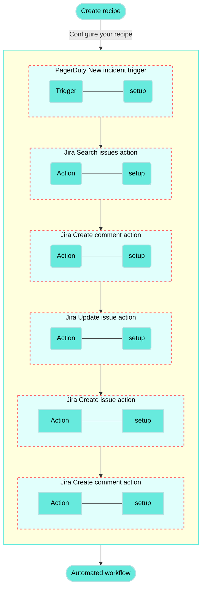
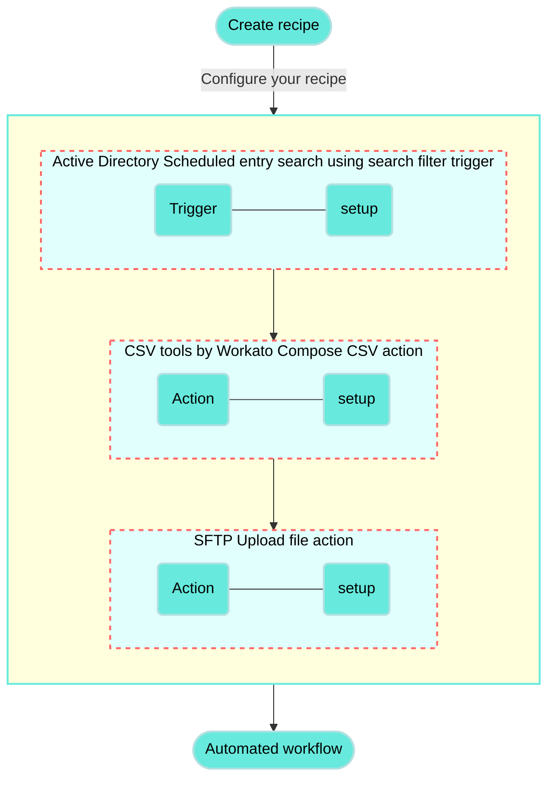

# Create or update Jira issues from new PagerDuty incidents recipe

This use case guides you through connecting [PagerDuty](/en/connectors/pagerduty) and [Jira](/en/connectors/jira) to create a powerful automation.

## What does this recipe do?

This recipe synchronizes new incidents from PagerDuty to Jira. If a matching issue exists in Jira, the recipe adds a comment with details from the PagerDuty incident. If no corresponding Jira issue is found, the recipe creates a new one.



## Create your recipe

Complete the following steps to create a recipe that synchronizes new incidents from PagerDuty to Jira:

> **USE CASES ARE INTENDED AS EXAMPLES ONLY**
> 
> This use case serves as an example. Modifications to triggers, actions, or conditional logic may be necessary to adapt this recipe to your workflow.

1. Sign in to Workato.
   
2. Select the project where you plan to create the recipe.
   
3. Create connections for PagerDuty and Jira:
   
   Create a PagerDuty connection.
   
   ### Create a PagerDuty connection
   
   This step creates a connection between Workato and your PagerDuty account.
   
   1. Click **Create > Connection** or press C twice.
      
   2. Search for and select `PagerDuty` on the **New connection** page.
      
   3. Provide a name for your connection in the **Connection name** field.
      
      _PagerDuty connection setup_
      
   4. Use the **Location** drop-down menu to select the project where you plan to store the connection.
      
   5. Enter your API key in the **API key** field.
      
      To create a new API key in PagerDuty, go to **Integrations > API Access Keys** and click **\+ Create New API Key**. Don't select the **Read-only API Key** checkbox because this connector requires both read and write permissions.
      
      Alternatively, to create an API user token that provides the same permissions as your user account, go to **My Profile > User Settings** and click **Create API User Token**.
      
   6. Click **Connect**.
      
   
   Create a Jira connection.
   
   ### Create a Jira connection
   
   This step creates a connection between Workato and your Jira account.
   
   1. Click **Create > Connection** or press C twice.
      
   2. Search for and select `Jira` on the **New connection** page.
      
   3. Enter a name for your Jira connection in the **Connection name** field.
      
      _Jira connection setup_
      
   4. Use the **Location** drop-down menu to select the project where you plan to store the connection.
      
   5. Select your **Connection type**.
      
   6. Use the **Auth type** drop-down menu to select your authentication method. Supported options include [Basic](/en/connectors/jira#basic-authentication-with-password), [API token](/en/connectors/jira#api-tokens), [OAuth 2.0](/en/connectors/jira#oauth2-0), and [Personal access token](/en/connectors/jira#personal-access-tokens).
      
   7. Provide your **Host name**. For example, if your Jira URL is `https://acme.atlassian.net`, your host name is `acme.atlassian.net`.
      
   8. Click **Connect**.
      
   
4. Go back to your project and click **Create > Recipe** or press C+R.
   
   _Create a new recipe_
   
5. Enter a name for your recipe in the **Name** field.
   
6. Select the project where you plan to store the recipe from the **Location** drop-down menu.
   
7. Click **Start building**.
   
   _Start building your recipe_
   
8. Click **Pick a starting point**, then select **Trigger from an app**.
   
9. Click **Select an app and trigger event**.
   
10. Set up your PagerDuty New incident trigger.
    
    ### Set up PagerDuty New incident trigger
    
    This trigger monitors PagerDuty for new incidents. The trigger checks for new incidents at a set interval and retrieves incidents created since the recipe started or from a specified time.
    
    1. Search for `PagerDuty` and select it as your app.
       
       _Choose PagerDuty_
       
    2. Select the **New incident** trigger.
       
       _Select the New incident trigger_
       
    3. Select the PagerDuty connection you created in the preceding steps.
       
    4. Optional. Specify how frequently the recipe should check for new events in the **Trigger poll interval** field. This field defaults to five minutes if left blank.
       
    5. Optional. Use the **When first started, this recipe should pick up events from** field to specify the date and time from which the recipe should retrieve incidents. Leave this field blank to retrieve incidents created after the recipe starts. After you run or test this recipe, you can't change this value. Refer to [Triggers](/en/recipes/triggers#since-from) to learn more about this input field.
       
       _Configure the New incident trigger_
       
    6. Click **Save**.
       
    
11. Click **\+ Add step** and select **Action in app**.
    
    _Click **Add step > Add action in app**_
    
12. Set up your Jira Search issues batch action.
    
    ### Set up Jira Search issues batch action
    
    This step searches for a Jira issue with a summary that matches the PagerDuty incident's summary.
    
    1. Search for `Jira` and select it as your app.
       
       _Choose Jira_
       
    2. Select the **Search issues** action.
       
       _Select the Search issues batch action_
       
    3. Map the PagerDuty Summary (Step 1) datapill to the **Summary** field.
       
       _Map the Summary (Step 1) datapill_
       
    4. Click **Save**.
       
    
13. Click **\+ Add step** and select **IF condition**.
    
    _Click **Add step > IF condition**_
    
    How do IF conditions work?
    
    ### PagerDuty and Jira IF condition example
    
    An [IF condition](/en/features/if-conditions) enables you to make decisions based on specific conditions. You can control your recipe workflow by executing different actions depending on whether a condition you specify is present or not present (true or false).
    
    ```mermaid
    flowchart TD
        A([Search issues in Jira]) --> B(Does a Jira issue exist for the PagerDuty incident?)
        B -->|Yes| C(Add a comment to and update the corresponding Jira issue)
        B ---->|No| E(Create new Jira issue)

        classDef default fill:#67eadd,stroke:#b3e0e1,stroke-width:2px,color:#000;
        classDef WorkatoPink fill:#f3c1c2,stroke:#f3c1c2,stroke-width:1px;
        class E WorkatoPink
    ```
    
14. Set up your Jira and PagerDuty IF condition.
    
    ### Set up a Jira and PagerDuty IF condition
    
    This step checks whether the **Search issues** action found a Jira issue with a summary matching the new PagerDuty incident.
    
    1. Map the Jira Key (Step 2) datapill to **Data field**.
       
    2. Select **is present** in the **Condition** field.
       
       _Configure your IF condition_
       
    3. Click **Save**.
       
    
15. Click **Select an app and action**.
    
16. Set up your Jira Create comment action.
    
    ### Set up Jira Create comment action
    
    This step adds a comment to the matched Jira issue with the relevant details from PagerDuty.
    
    1. Search for `Jira` and select it as your app.
       
       _Choose Jira_
       
    2. Select the **Create comment** action.
       
       _Select the Create comment action_
       
    3. Map the Jira Key (Step 2) datapill to the **Issue ID or key** field.
       
       _Map the Key (Step 2) datapill_
       
    4. Add the following text to the **Comment text** field:
       
       ```plaintext
       New incident triggered in PagerDuty for this issue
       
       Summary:
       Incident number:
       Service:
       Status:
       Urgency:
       Link to PagerDuty:
       ```
       
    5. Map the relevant PagerDuty datapills to each line in the **Comment text** field:
       
       - Summary (Step 1)
       - Incident number (Step 1)
       - Summary (Step 1) (nested under the **Service** object)
       - Status (Step 1)
       - Urgency (Step 1)
       - Html URL (Step 1)
       
       _Map datapills to the Comment text field_
       
    6. Click **Save**.
       
    
17. Click **\+ Add step** and select **Action in app**.
    
18. Set up your Jira Update issue action.
    
    ### Set up Jira Update issue action
    
    This final step in the IF condition updates the Jira issue's priority to match the PagerDuty incident. You can configure additional fields in this action to further update the issue.
    
    1. Search for `Jira` and select it as your app.
       
       _Choose Jira_
       
    2. Select the **Update issue** action.
       
       _Select the Update issue action_
       
    3. Map the Jira Key (Step 2) datapill to the **Issue ID or key** field.
       
       _Map the Key (Step 2) datapill_
       
    4. Use the **Sample project issue type** drop-down menu to select the issue type in your Jira project that you plan to update. This field retrieves custom fields specific to your project and issue type.
       
       For example, in a Jira project named `Incident Management`, select the `Incident` issue type.
       
       _Select a sample project issue type_
       
    5. Switch the **Priority name** field to [formula mode](/en/formulas/formula-mode) and perform the following actions:
       
       1. Map the PagerDuty Urgency (Step 1) datapill.
          
       2. Append the [`.capitalize` formula](/en/formulas/string-formulas#capitalize).
          
       
       _Configure the Priority name field_
       
    6. Click **Save**.
       
    
19. Click **\+ Add step** and select **ELSE IF condition**.
    
    _Click **Add step > ELSE IF condition**_
    
20. Set up your Jira and PagerDuty ELSE IF condition.
    
    ### Set up a Jira and PagerDuty ELSE IF condition
    
    This step sets up an ELSE IF condition to check if there is no matching Jira issue for the PagerDuty incident and if the incident isn't resolved. The AND condition ensures that the recipe doesn't sync resolved PagerDuty incidents to Jira as new active issues.
    
    1. Map the Jira Key (Step 2) datapill to **Data field**.
       
    2. Select **is not present** in the **Condition** field.
       
    3. Click `+` (plus) and select **AND** to add a second condition.
       
    4. Map the PagerDuty Status (Step 1) datapill to **Data field**.
       
    5. Select **does not equal** in the **Condition** field.
       
    6. Type `resolved` in the **Value** field.
       
       _Configure your ELSE IF condition_
       
    7. Click **Save**.
       
    
21. Click **Select an app and action**.
    
22. Set up your Jira Create issue action.
    
    ### Set up Jira Create issue action
    
    This step creates a new Jira issue with the incident issue type and syncs details from PagerDuty if no matching Jira issue exists for the PagerDuty incident and the incident isn't resolved.
    
    1. Search for `Jira` and select it as your app.
       
       _Choose Jira_
       
    2. Select the **Create issue** action.
       
       _Select the Create issue action_
       
    3. Use the **Project issue type** drop-down menu to select the project and issue type.
       
       For example, in a Jira project named `Incident Management`, select the `Incident` issue type.
       
    4. Map the PagerDuty Summary (Step 1) datapill to the **Summary** field.
       
    5. Add the following text to the **Description** field:
       
       ```plaintext
       Incident type:
       Status:
       Urgency:
       Last status change at:
       ```
       
    6. Map the relevant PagerDuty datapills to each line in the **Description** field:
       
       - Type (Step 1)
       - Status (Step 1)
       - Urgency (Step 1)
       - Last status change at (Step 1)
    7. Switch the **Priority name** field to [formula mode](/en/formulas/formula-mode) and perform the following actions:
       
       1. Map the PagerDuty Urgency (Step 1) datapill.
          
       2. Append the [`.capitalize` formula](/en/formulas/string-formulas#capitalize).
          
       
       _Configure the Priority name field_
       
    8. Click **Save**.
       
    
23. Click **\+ Add step** and select **Action in app**.
    
24. Set up your Jira Create comment action.
    
    ### Set up Jira Create comment action
    
    This final step in the recipe adds a comment to the new Jira issue with the relevant details from PagerDuty.
    
    1. Search for `Jira` and select it as your app.
       
       _Choose Jira_
       
    2. Select the **Create comment** action.
       
       _Select the Create comment action_
       
    3. Map the Jira Key (Step 7) datapill to the **Issue ID or key** field. This field identifies the Jira issue where the new comment should be added.
       
    4. Add the following text to the **Comment text** field:
       
       ```plaintext
       New incident triggered in PagerDuty for this issue
       
       Summary:
       Incident number:
       Service:
       Status:
       Urgency:
       Link to PagerDuty:
       ```
       
    5. Map the relevant PagerDuty datapills to each line in the **Comment text** field:
       
       - Summary (Step 1)
       - Incident number (Step 1)
       - Summary (Step 1) (nested under the **Service** object)
       - Status (Step 1)
       - Urgency (Step 1)
       - Html URL (Step 1)
    6. Click **Save**.
       
    

Your **Create or update Jira issues from new PagerDuty incidents** recipe is ready to test and implement.

Example recipe configuration.

_**Create or update Jira issues from new PagerDuty incidents** recipe_

---

---
url: >-
  https://docs.workato.com/en/getting-started/use-cases/active-directory-csv-sftp.md
description: >-
  Create a recipe that performs a daily search for specific entries in Active
  Directory, composes a CSV file from the results, and uploads the file to an
  SFTP server.
---

# Upload a CSV of Active Directory entries to an SFTP server recipe

This use case guides you through connecting [Active Directory](/en/connectors/active_directory), [CSV tools by Workato](/en/features/handling-csv-files#csv-by-workato), and [SFTP](/en/connectors/sftp) to create a powerful automation.

## What does this recipe do?

This recipe performs a daily search for specific entries in Active Directory, composes a CSV formatted string from the results, and uploads the string as a CSV file to an SFTP server.



## Create your recipe

Complete the following steps to create a recipe that performs a daily search for employees in Active Directory, composes a CSV file from the results, and uploads the file to an SFTP server:

> **USE CASES ARE INTENDED AS EXAMPLES ONLY**
> 
> This use case serves as an example. Modifications to triggers, actions, or conditional logic may be necessary to adapt this recipe to your workflow.

1. Sign in to Workato.
   
2. Select the project where you plan to create the recipe.
   
3. Create connections for Active Directory and SFTP:
   
   > **WORKATO UTILITY CONNECTORS DON'T REQUIRE SETUP**
   > 
   > The CSV tools by Workato connector doesn't require connection setup.
   
   Create an Active Directory connection.
   
   ### Create an Active Directory connection
   
   This step creates a connection between Workato and your Active Directory account.
   
   1. Click **Create > Connection** or press C twice.
      
   2. Search for and select `Active Directory` on the **New connection** page.
      
   3. Enter a name for your connection in the **Connection name** field.
      
   4. Use the **Location** drop-down menu to select the project where you plan to store the connection.
      
   5. Select an **On-prem group** if your database runs in a network that does not support direct connection. Ensure your on-prem group has an active [on-prem agent](/en/on-prem/agents).
      
   6. Provide the profile name defined in your OPA's `config.yml` file in the **On-prem LDAP connection profile** field. This option is only visible when you select an on-prem group that supports [connection profiles](/en/on-prem/agents/connection/profile).
      
   7. Provide the LDAP **URL**. Use the format `ldap://myserver.example.com:389` for non-SSL connections or `ldaps://myserver.example.com:636` for SSL connections.
      
   8. Enter the **Username** (principal), typically the distinguished name (DN) of an admin user, to authenticate with the LDAP server.
      
   9. Provide the **Password** (credentials) for LDAP server authentication.
      
   10. Provide the **Base** DN for LDAP requests. This setting ensures all DNs you use or receive in LDAP operations are relative to this LDAP path.
       
   11. Expand the **Configure SSL settings** section and configure the following fields if your connection requires SSL encryption:
       
   12. Enter the path for the PEM-encoded certificate or a trusted CA in the **Certificate** field.
       
   13. Enter the full content of a PEM-encoded client certificate in the **SSL certificate** field.
       
   14. Enter the private **SSL certificate key** for mutual SSL setup. This field is required if you specify an **SSL certificate**.
       
   15. Use the **Trust all** drop-down menu to enable or disable self-signed certificates.
       
   16. Click **Connect**. _Complete the connection fields and click **Connect**_
       
   
   Create a SFTP connection.
   
   ### Create a SFTP connection
   
   This step creates an SFTP connection for your recipe.
   
   #### Using SSH keys for SFTP authentication
   
   SFTP is built on the Secure Shell Protocol (SSH), which enables you to use SSH keys in your authentication flow. SSH keys can be used with a user ID and password or independently to authenticate Workato with your SFTP server. This enhances the security of your connection by using SSH encryption for your public and private keys.
   
   #### Connection setup
   
   Complete the following steps to set up your SFTP connection:
   
   1. Click **Create > Connection** or press C twice.
      
   2. Search for and select `SFTP` on the **New connection** page.
      
   3. Provide a name for your connection in the **Connection name** field.
      
      _SFTP connection setup_
      
   4. Use the **Location** drop-down menu to select the project where you plan to store the connection.
      
   5. Use the **Connection type** drop-down menu to select the connection method you plan to use. You can select your [on-prem group](/en/on-prem/groups) name or select **Cloud** to use a direct connection.
      
   6. Select the authentication method in the **Auth type** field. Available options include the following:
      
      - **Username/password**
      - **Public/private key pair**
      - **Public/private key pair and password**
   7. Enter the username for the SFTP server you plan to connect to in the **Username** field.
      
   8. Provide additional authentication information based on your selection from the **Auth type** field:
      
      - **Username/password or Public/private key pair and password authentication**: Enter the password associated with the SFTP server username in the **Password** field.
        
      - **Public/private key or Public/private key pair and password authentication**: Enter the SSH private key for the SFTP server in the **Private key** field. The private key must be in [OpenSSH format](http://www.openssh.org/). Specify `SecureShellPrivateKeyFormat.NewOpenSecureShell` as the format parameter when saving the key. Refer to the [Private key example format](/en/connectors/sftp#private-key-example-format) section for more information.
        
   9. Enter your SFTP server address in the **Hostname** field.
      
   10. Enter the port for the SFTP server in the **Port** field. The default port for SFTP is `22`.
       
   11. Optional. Enter the hash of the SSH public key in the **Host key fingerprint** field. Workato supports SHA256 and MD5 encryption. For on-premise connections, contact your SFTP server administrator to obtain the public key in Base64 format.
       
   12. Optional. Enter the size of the buffer used for file transfers in the **Transfer buffer size** field.
       
   13. Optional. Specify whether the SSH connection should be closed at the end of each transaction in the **Force close** field. Toggle this option if your SFTP server connection becomes unresponsive. Otherwise, leave it blank.
       
   14. Optional. Set the SFTP protocol version to use in the **Explicit version** field.
       
   15. Use the **Append operations supported?** drop-down menu to specify whether your SFTP provider supports append or modify operations. The default setting is **Yes**.
       
   16. Click **Connect**.
       
   
4. Go back to your project and click **Create > Recipe** or press C+R.
   
   _Create a new recipe_
   
5. Enter a name for your recipe in the **Name** field.
   
6. Select the project where you plan to store the recipe from the **Location** drop-down menu.
   
7. Click **Start building**.
   
   _Start building your recipe_
   
8. Click **Pick a starting point** and select **Trigger from an app**.
   
9. Click **Select an app and trigger event**.
   
10. Set up your Active Directory Scheduled entry search using search filter trigger.
    
    ### Set up Active Directory Scheduled entry search using search filter trigger
    
    This trigger performs a daily search for specific entries in Active Directory.
    
    1. Search for `Active Directory` and select it as your app.
       
       _Choose Active Directory_
       
    2. Select the **Scheduled entry search using search filter** trigger.
       
       _Select the Scheduled entry search using search filter trigger_
       
    3. Enter the [distinguished name](https://learn.microsoft.com/en-us/previous-versions/windows/desktop/ldap/distinguished-names) of a known entry in your Active Directory instance in the **Sample entry DN** field. For example, `CN=Jake Smith,OU=People`.
       
       _Example of Sample entry DN configuration_
       
       Ensure the entry you choose includes all the fields you plan to use as column names in the CSV file. Don't use formulas or datapills in this field.
       
    4. Use the **Trigger on** drop-down menu to select **Specific interval**.
       
    5. Expand the **Schedule settings** section and select **One day** from the **Every** drop-down menu.
       
    6. Enter a filter in the **Entry search filter** field to specify the Active Directory entries to search. For example, enter `objectClass=Person` to return results where `objectClass` equals `Person`.
       
    
11. Click **\+ Add step** and select **Action in app**.
    
    _Click **Add step > Add action in app**_
    
12. Set up your CSV tools by Workato Compose CSV action.
    
    ### Set up CSV tools by Workato Compose CSV action
    
    This step composes a CSV formatted string from the output of the Active Directory search.
    
    1. Search for `CSV tools by Workato` and select it as your app.
       
       _Choose CSV tools by Workato_
       
    2. Select the **Compose CSV** action.
       
       _Select the Compose CSV action_
       
    3. Enter the column names you plan to include in the CSV file in the **CSV column names** field. Workato uses these column names to generate the input fields in the **CSV data lines** section.
       
       For example, this recipe uses the following column names:
       
       ```plaintext
       employee_id
       display_name
       bad_pwd_count
       street_address
       postal_code
       mobile
       title
       employee_type
       department
       lastLogon
       ```
       
    4. Use the **Create header line** drop-down menu to specify whether to include the column names in the CSV file.
       
    5. Map the Active Directory Entries (Step 1) list datapill to the **CSV data lines source list** field.
       
    6. Map the relevant Active Directory datapills to the fields in the **CSV data lines fields** section. These fields correspond to the column names you entered in **CSV column names** and depend on the **Sample entry DN** value provided in the previous recipe step.
       
       For example, this recipe maps the Active Directory employeeID (Step 1) datapill to **employee\_id**, displayName (Step 1) to **display\_name**, and so on.
       
       _Completed configuration_
       
    
13. Click **\+ Add step** and select **Action in app**.
    
14. Set up your SFTP Upload file action.
    
    ### Set up SFTP Upload file action
    
    This step uses the CSV string and uploads it as a CSV file to a specific path in your SFTP server.
    
    1. Search for `SFTP` and select it as your app.
       
       _Choose SFTP_
       
    2. Select the **Upload file** action.
       
       _Select the Upload file action_
       
    3. Enter the full path to the file, including its name, in the **File path** field. Ensure the folders in the specified path exist before attempting to add files.
       
       For example, this recipe switches the **File path** field to [formula mode](/en/formulas/formula-mode) and uses the following file path:
       
       ```ruby
       "/sftp/employees_report_{JOB_CREATED_AT}.strftime('%Y-%m-%d')}.csv"
       ```
       
       In this example, `{JOB_CREATED_AT}` represents the Job created at (Properties) datapill. This path configuration ensures that each file is uniquely named based on the job creation date.
       
       _Example of File path configuration_
       
    4. Map the CSV contents (Step 2) datapill to the **File contents** field.
       
       _Configure the File contents field_
       
    5. Use the **Append** drop-down menu to specify whether to append or overwrite the file contents if a file with the same name already exists on the SFTP server.
       
       For example, you can set this field to **Yes** if you plan to re-run a job and add new data to an existing file.
       
    
15. Click **Save**.
    

Your **Upload a CSV of Active Directory entries to an SFTP server** recipe is ready to test and implement.

Example recipe configuration.

_Active Directory, CSV tools by Workato, and SFTP recipe_

---
