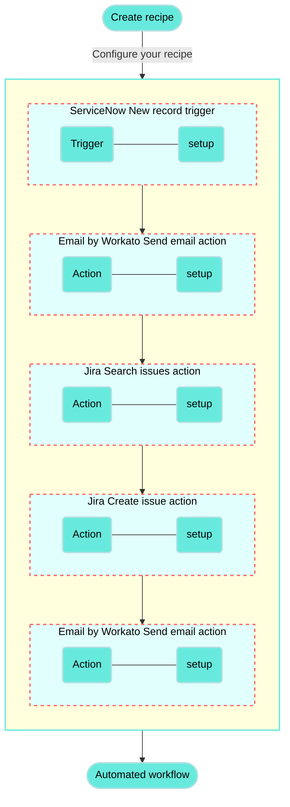
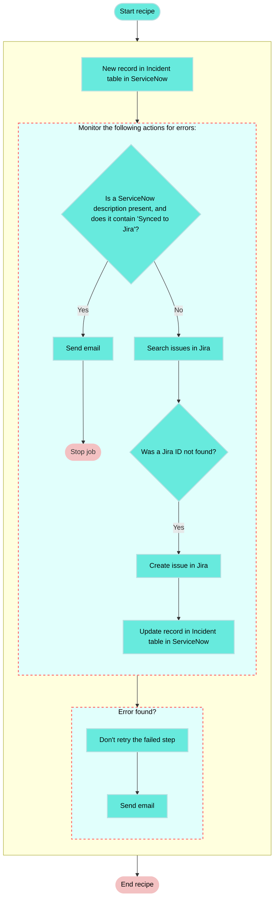
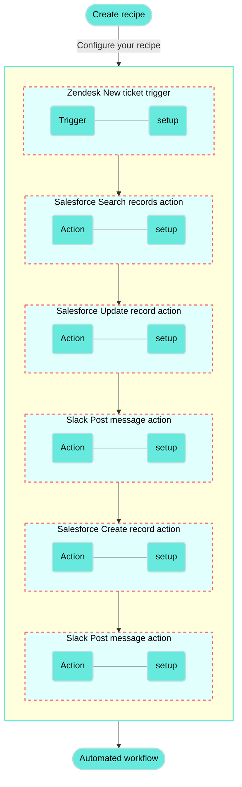
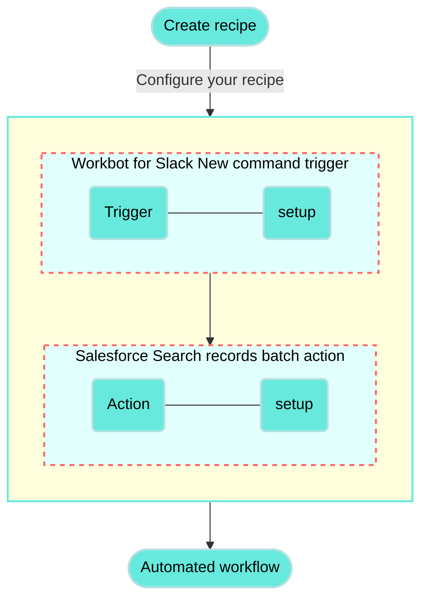
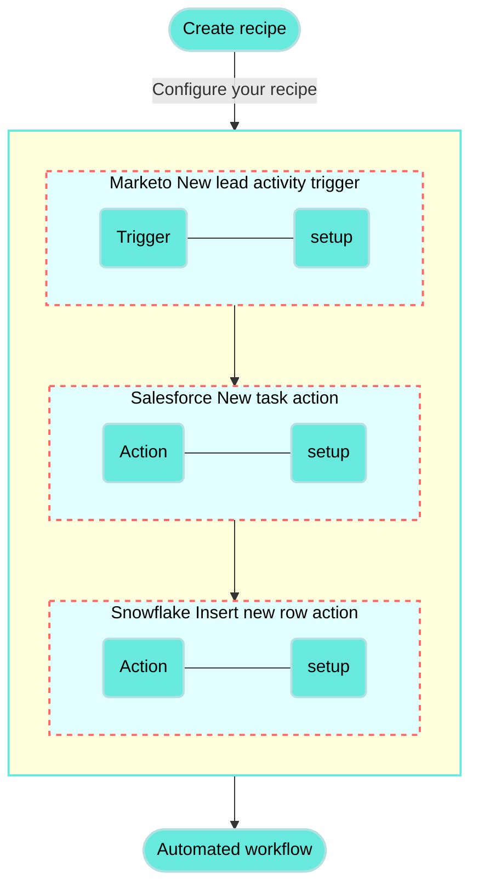
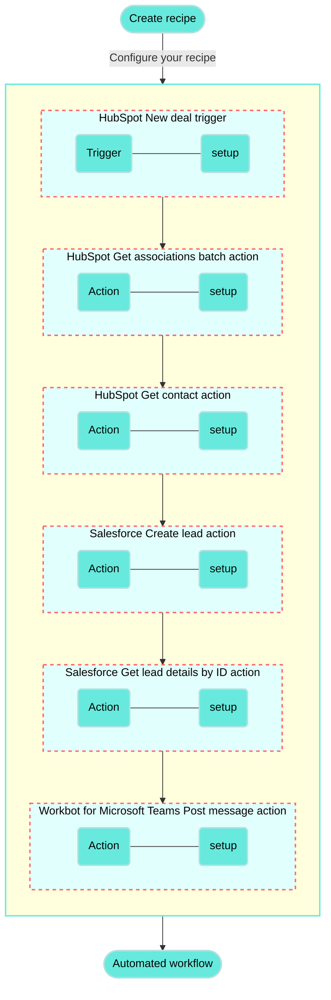

# Create Jira issues for new ServiceNow incidents recipe

This use case guides you through connecting [ServiceNow](/en/connectors/servicenow) and [Jira](/en/connectors/jira) to create a powerful automation.

## What does this recipe do?

This recipe monitors ServiceNow for new incidents and creates a corresponding issue in Jira if an existing issue doesn't already exist.

## Recipe configuration

Recipes are automated workflows that connect your apps. Each recipe contains a trigger and one or more actions. The following diagram illustrates the trigger and action configuration required for this use case:



## Create your recipe

Complete the following steps to create a recipe that monitors ServiceNow for newly created incidents and creates a corresponding issue in Jira if an existing issue doesn't already exist:

> **USE CASES ARE INTENDED AS EXAMPLES ONLY**
> 
> This use case serves as an example. Modifications to triggers, actions, or conditional logic may be necessary to adapt this recipe to your workflow.

1. Sign in to Workato.
   
2. Select the project where you plan to create the recipe.
   
3. Create connections for ServiceNow and Jira:
   
   Create a ServiceNow connection.
   
   ### Create a ServiceNow connection
   
   This step creates a connection between Workato and your ServiceNow account.
   
   1. Click **Create > Connection** or press C twice.
      
   2. Search for and select `ServiceNow` on the **New connection** page.
      
   3. Enter a name for your ServiceNow connection in the **Connection name** field.
      
      _ServiceNow connection setup_
      
   4. Use the **Location** drop-down menu to select the project where you plan to store the connection.
      
   5. Use the **Authentication type** drop-down menu to select **Username/Password**.
      
   6. Enter your ServiceNow **Instance name**. For example, if your ServiceNow URL is `https://acme.service-now.com`, the instance name is `acme`.
      
   7. Enter your ServiceNow username in the **Username** field.
      
   8. Enter your ServiceNow password in the **Password** field.
      
   9. Click **Connect**.
      
   
   The ServiceNow connector also supports [OAuth 2.0](/en/connectors/servicenow#oauth-2-0) and [Password grant](/en/connectors/servicenow#password-grant) authentication methods.
   
   Create a Jira connection.
   
   ### Create a Jira connection
   
   This step creates a connection between Workato and your Jira account.
   
   1. Click **Create > Connection** or press C twice.
      
   2. Search for and select `Jira` on the **New connection** page.
      
   3. Enter a name for your Jira connection in the **Connection name** field.
      
      _Jira connection setup_
      
   4. Use the **Location** drop-down menu to select the project where you plan to store the connection.
      
   5. Select your **Connection type**.
      
   6. Use the **Auth type** drop-down menu to select your authentication method. Supported options include [Basic](/en/connectors/jira#basic-authentication-with-password), [API token](/en/connectors/jira#api-tokens), [OAuth 2.0](/en/connectors/jira#oauth2-0), and [Personal access token](/en/connectors/jira#personal-access-tokens).
      
   7. Provide your **Host name**. For example, if your Jira URL is `https://acme.atlassian.net`, your host name is `acme.atlassian.net`.
      
   8. Click **Connect**.
      
   
4. Go back to your project and click **Create > Recipe** or press C+R.
   
   _Create a new recipe_
   
5. Enter a name for your recipe in the **Name** field.
   
6. Select the project where you plan to store the recipe from the **Location** drop-down menu.
   
7. Click **Start building**.
   
   _Start building your recipe_
   
8. Click **Pick a starting point**, then select **Trigger from an app**.
   
9. Click **Select an app and trigger event**.
   
10. Set up your ServiceNow New record trigger.
    
    ### Set up ServiceNow New record trigger
    
    This trigger monitors ServiceNow for new incidents.
    
    1. Search for `ServiceNow` and select it as your app.
       
       _Choose ServiceNow_
       
    2. Select the **New record (real-time)** trigger.
       
       _Select the New record real-time trigger_
       
    3. Select the ServiceNow connection you created in the preceding steps.
       
    4. Use the **Table** drop-down menu to select **Incident**.
       
    5. Click **Save**.
       
    
11. Click **\+ Add step** and select **Handle errors**.
    
    _Click **Add step > Handle errors**_
    
    How does the Handle errors control statement work?
    
    The [Handle errors control statement](/en/recipes/steps#handle-errors-step) allows you to monitor your recipe for errors in actions, similar to the try/catch concept in programming languages. You have the opportunity to perform the following actions if an error occurs:
    
    - Retry the sequence of actions again, in case it was a temporary error such as network issues.
      
    - Take remedial actions, such as notifying users of the error through email or error messages in the app, or to carry out a rollback. For example, you can reverse the job by deleting any created or half-created records.
      
    
    This control statement consists of two blocks: the **Monitor** block and the **Error** block. Place the actions that you plan to monitor for errors within the **Monitor** block. If all actions are successful, Workato ignores the **Error** block. However, if any action in the **Monitor** block results in an error, the actions within the **Error** block are executed.
    
    ```mermaid
    graph TD
        A(Monitor action for errors) ---> B((Error found?))
        B --> C{Yes}
        B --> D{No}
        C --> E(Define how to <br/> handle the error)
        D --> F(Continue processing <br/> the recipe)
       classDef default fill:#67eadd,stroke:#67eadd,stroke-width:2px,color:#000;
    ```
    
12. Click the **•••** (ellipsis) next to the placeholder step (step 3) in the recipe editor and select **Delete**.
    
    _Delete the placeholder_
    
13. Click **\+ Add step** and select **IF condition**. Make sure to insert the IF condition after the **Monitor** block (step 2).
    
    _Click **Add step> IF condition**_
    
    How do IF conditions work?
    
    ### ServiceNow and Jira IF condition example
    
    An [IF condition](/en/features/if-conditions) enables you to make decisions based on specific conditions. You can control your recipe workflow by executing different actions depending on whether a condition you specify is true or false.
    
    ```mermaid
    flowchart TD
        A([New ServiceNow incident]) --> B(Does the incident description contain the string 'Synced to Jira'?)
        B -->|Yes| C(Send email stating the incident is already synced, and stop the job)
        B ---->|No| E(Search issues in Jira)

        classDef default fill:#67eadd,stroke:#b3e0e1,stroke-width:2px,color:#000;
    ```
    
14. Set up your ServiceNow description is present IF condition.
    
    ### Set up a ServiceNow description is present IF condition
    
    This step checks if the new ServiceNow incident has a description that indicates the incident has been synced to Jira.
    
    1. Map the ServiceNow Description (Step 1) datapill to **Data field**.
       
    2. Use the **Condition** drop-down menu to select **is present**.
       
    3. Click **+** (plus) and select **AND** to add a second condition.
       
    4. Map the ServiceNow Description (Step 1) datapill to **Data field**.
       
    5. Use the **Condition** drop-down menu to select **contains**.
       
    6. Enter `Synced to Jira` in the **Value** field.
       
       _Configure the IF condition_
       
    7. Click **Save**.
       
    
15. Click **Select an app and action**.
    
16. Set up your Email by Workato Send email action.
    
    ### Set up Email by Workato Send email action
    
    This step sends an email to a specified recipient communicating that this ServiceNow incident is already synced to Jira.
    
    1. Search for `Email by Workato` and select it as your app. The **Send email** action is selected automatically.
       
       _Choose Email by Workato_
       
    2. Enter the recipient's email address in the **To** field. If you’re sending the email to multiple recipients, separate their addresses with commas.
       
    3. Enter the following subject in the **Subject** field:
       
       `New incident in ServiceNow creates issue in Jira - Already synced`
       
    4. Use the **Email type** drop-down menu to select **Text**.
       
    5. Enter the following message in the **Message** field:
       
       ```plaintext
       The job is synced from Jira to ServiceNow.
       Recipe ID:
       Job ID:
       Job URL:
       ```
       
    6. Map the Recipe ID (Properties), Job ID (Properties), and Job URL (Properties) datapills to their corresponding labels in the **Message** field.
       
       _Map datapills to the Message field_
       
    7. Click **Save**.
       
    
17. Click **\+ Add step** and select **Stop job**. Place this step immediately after the **Send email via Workato** action (step 4), ensuring it is within the steps executed when the IF condition evaluates to true.
    
    _Click **Add step > Stop job**_
    
    How does the Stop control statement work?
    
    ### Stop control statement example
    
    The [Stop control statement](/en/recipes/steps#stop-step) stops a single job from being processed further. Stop control statements are usually used in cases when there is an error in the business logic and further job processing is not required.
    
    The Stop statement can be configured to mark the job as failed or successful.
    
    ```mermaid
    flowchart TD
        B(Is the statement true?)
        B -->|Yes| C(An email notification is sent, the job is stopped, and the job is marked as successful)
        B ---->|No| E(The job is stopped)
        classDef default fill:#67eadd,stroke:#b3e0e1,stroke-width:2px,color:#000;
    ```
    
18. Set up your ServiceNow and Jira Stop control statement.
    
    ### Set up a ServiceNow and Jira Stop control statement
    
    This step stops the job and marks it as successful if the ServiceNow incident has already been synced with Jira.
    
    1. Use the **In job report, mark stopped job as** drop-down menu to select **Successful**.
       
    
19. Click **\+ Add step** and select **Action in app**. Place this step within the steps executed when the IF condition evaluates to false.
    
    _Click **Add step > Action in app**_
    
20. Set up your Jira Search issues batch action.
    
    ### Set up Jira Search issues batch action
    
    This step searches for Jira issues that use the specific naming pattern corresponding to a ServiceNow incident.
    
    1. Search for `Jira` and select it as your app.
       
       _Choose Jira_
       
    2. Select the **Search issues (batch)** action.
       
       _Select the Search issues batch action_
       
    3. Switch the **Summary** field to [formula mode](/en/formulas/formula-mode).
       
    4. Map the ServiceNow Number (Step 1) datapill.
       
    5. Enter `+ " - " +` to add a hyphen.
       
    6. Map the ServiceNow Short description (Step 1) datapill.
       
       _Configure the Summary field_
       
    7. Click **Save**.
       
    
21. Click **\+ Add step** and select **IF condition**.
    
    _IF condition_
    
22. Set up your Jira ID IF condition.
    
    ### Set up a Jira ID IF condition
    
    This step checks whether the result of the search returned a matching Jira issue.
    
    1. Map the Jira ID (Step 6) datapill to **Data field**.
       
    2. Use the **Condition** drop-down menu to select **is not present**.
       
       _Configure the second IF condition_
       
    3. Click **Save**.
       
    
23. Click **Select an app and action**.
    
24. Set up your Jira Create issue action.
    
    ### Set up Jira Create issue action
    
    This step creates a Jira issue that corresponds to the ServiceNow incident.
    
    1. Search for `Jira` and select it as your app.
       
       _Choose Jira_
       
    2. Select the **Create issue** action.
       
       _Select the Create issue action_
       
    3. Use the **Project issue type** drop-down menu to specify the Jira issue type. For example, **Bug**. The options in this drop-down menu depend on the issue types configured in your Jira project.
       
    4. Switch the **Summary** field to [formula mode](/en/formulas/formula-mode).
       
    5. Map the ServiceNow Number (Step 1) datapill.
       
    6. Enter `+ " - " +` to add a hyphen.
       
    7. Map the ServiceNow Short description (Step 1) datapill.
       
       _Configure the Summary field_
       
    8. Switch the **Description** field to [formula mode](/en/formulas/formula-mode).
       
    9. Map the ServiceNow Description (Step 1) datapill.
       
    10. Enter `+ "\n" + "Synced to Jira"`.
        
        _Configure the Description field_
        
    11. Switch the **Priority name** field to [formula mode](/en/formulas/formula-mode) and enter the following:
        
        ```plaintext
        { "5" => "Lowest", "4" => "Low", "3" => "Medium", "2" => "High", "1" => "Highest" }  [ PRIORITY_DP ]
        ```
        
        Replace `PRIORITY_DP` with the ServiceNow Priority (Step 1) datapill.
        
        _Configure the Priority name field_
        
    12. Map the ServiceNow Due date (Step 1) datapill to the **Due date** field.
        
    13. Click **Save**.
        
    
25. Click **\+ Add step** and select **Action in app**. Place this step immediately after the **Create issue** action (step 8), ensuring it is within the steps executed when the IF condition evaluates to true.
    
26. Set up your ServiceNow Update record action.
    
    ### Set up ServiceNow Update record action
    
    This step updates the ServiceNow incident record to confirm that the record is synced with Jira and adds the Jira issue ID to the work notes.
    
    1. Search for `ServiceNow` and select it as your app.
       
       _Choose ServiceNow_
       
    2. Select the **Update record** action.
       
       _Select the Update record action_
       
    3. Use the **Table** drop-down menu to select **Incident**.
       
    4. Map the ServiceNow Sys ID (Step 1) datapill to the **Sys ID** field.
       
    5. Expand **Update record values** and map the ServiceNow Description (Step 1) datapill to the **Description field**.
       
    6. Switch the **Work notes** field to [formula mode](/en/formulas/formula-mode).
       
    7. Map the ServiceNow Work notes (Step 1) datapill.
       
    8. Enter `+ "\n" + " Synced to Jira" + "\n" + " Jira ID: " +`.
       
    9. Map the Jira ID (Step 8) datapill.
       
       _Configure the Update record values field_
       
    10. Click **Save**.
        
    
27. Locate the **Error found?** block, and click **Select an app and action** (step 11).
    
    _Click Select an app and action_
    
28. Set up your second Email by Workato Send email action.
    
    ### Set up a second Email by Workato Send email action
    
    This step sends a failed job notification email to a specified recipient.
    
    1. Search for `Email by Workato` and select it as your app. The **Send email** action is selected automatically.
       
       _Choose Email by Workato_
       
    2. Enter the recipient's email address in the **To** field. If you’re sending the email to multiple recipients, separate the email addresses with commas.
       
    3. Enter the following subject in the **Subject** field:
       
       `New incident in ServiceNow creates issue in Jira - Failed`
       
    4. Use the **Email type** drop-down menu to select **Text**.
       
    5. Enter the following message in the **Message** field:
       
       ```plaintext
       Recipe URL:
       Job ID:
       Job URL:
       Recipe failed:
       ```
       
    6. Map the Recipe ID (Properties), Job ID (Properties), Job URL (Properties), and Error message (Step 10) datapills to the corresponding labels in the **Message** field.
       
       _Configure the Message field_
       
    7. Click **Save**.
       
    

Your **Create Jira issues for new ServiceNow incidents** recipe is ready to test and implement.

Example recipe configuration.

_**Create Jira issues for new ServiceNow incidents** recipe_



---

---
url: >-
  https://docs.workato.com/en/getting-started/use-cases/zendesk-salesforce-slack.md
description: >-
  Build a recipe that syncs new Zendesk tickets to Salesforce cases and notifies
  your team in Slack with the case details.
---

# Sync Zendesk tickets to Salesforce and notify your team in Slack

This use case guides you through connecting [Zendesk](/en/connectors/zendesk), [Salesforce](/en/connectors/salesforce), and [Slack](/en/connectors/slack) to create a powerful automation.

## What does this recipe do?

This recipe checks Zendesk for new tickets at an interval you specify. When a new ticket is found, the recipe checks if there is an existing Salesforce case. The recipe either updates the existing case or creates a new one, then posts the case details in Slack to a channel or direct message of your choice.



## Create your recipe

1. Sign in to Workato.
   
2. Select the project where you plan to create the recipe.
   
3. Create connections for Zendesk, Salesforce, and Slack using the following steps:
   
   Create a Zendesk connection.
   
   ### Create a Zendesk connection
   
   This step creates a connection between Workato and your Zendesk account. The Zendesk connector supports OAuth 2.0 authentication.
   
   > **DEPRECATED AUTHENTICATION METHODS**
   > 
   > Effective March 31, 2026, you can no longer create new Zendesk connections using Basic authentication or Custom OAuth profiles. This change is required by [Zendesk's updated Developer Terms](https://www.zendesk.com/company/agreements-and-terms/zendesk-developer-terms/).
   > 
   > Existing connections using these authentication methods will continue to work until **April 30, 2027**. On this date, Zendesk connections still using Basic authentication or a Custom OAuth profile will be terminated, and recipes relying on these connections will stop functioning.
   
   1. Click **Create > Connection** or press C twice.
      
   2. Search for and select `Zendesk` on the **New connection** page.
      
   3. Provide a name for your connection in the **Connection name** field.
      
      _Zendesk connection setup_
      
   4. Use the **Location** drop-down menu to select the project where you plan to store the connection.
      
   5. Enter the **Subdomain** for your Zendesk URL. For example, if your Zendesk URL is `https://acme.zendesk.com`, your subdomain is `acme`.
      
   6. Click **Connect**.
      
   
   Create a Salesforce connection.
   
   ### Create a Salesforce connection
   
   This step creates a connection between Workato and your Salesforce account.
   
   1. Click **Create > Connection** or press C twice.
      
   2. Search for and select `Salesforce` on the **New connection** page.
      
   3. Provide a name for your connection in the **Connection name** field.
      
      _Salesforce connection setup_
      
   4. Use the **Location** drop-down menu to select the project where you plan to store the connection.
      
   5. Use the **Auth type** drop-down menu to select the authentication method. The default is OAuth 2.0.
      
   6. Use the **Sandbox** drop-down menu to specify whether the Salesforce account is a sandbox account.
      
   7. Optional. Expand **Advanced settings** to configure advanced connection options.
      
   8. Optional. Use the **Custom OAuth profile** drop-down menu to select a custom OAuth profile for your connection.
      
      - This custom OAuth profile ensures that the connection is restricted to the same set of scopes you selected for all users with the profile, and the authentication flow uses the client app linked to the custom profile.
   9. Click **Connect**.
      
   10. Enter your Salesforce account credentials and click **Log In**.
       
       _Log in to your Salesforce account_
       
   
   Create a Slack connection.
   
   ### Create a Slack connection
   
   This step creates a connection between Workato and your Slack account.
   
   1. Click **Create > Connection** or press C twice.
      
   2. Search for and select `Slack` on the **New connection** page.
      
   3. Enter a name for your connection in the **Connection name** field.
      
      _Slack connection setup_
      
   4. Use the **Location** drop-down menu to select the project where you plan to store the connection.
      
   5. Optional. Configure **Advanced** and **Custom OAuth profile** settings if required for your account type.
      
   6. Click **Connect**.
      
   
4. Go back to your project and click **Create > Recipe** or press C+R.
   
   _Create a new recipe_
   
5. Enter a name for your recipe in the **Name** field.
   
6. Use the **Location** drop-down menu to select the project where you plan to store the recipe.
   
7. Click **Start building**.
   
   _Start building your recipe_
   
8. Click **Pick a starting point > Trigger from an app**.
   
9. Click **Select an app and trigger event**.
   
10. Set up your Zendesk New ticket trigger.
    
    ### Set up Zendesk New ticket trigger
    
    This step checks Zendesk for new tickets at an interval you specify.
    
    1. Search for `Zendesk` and select it as your app.
       
       _Search for and select `Zendesk`_
       
    2. Select the **New ticket** trigger.
       
       _Select the **New ticket** trigger_
       
    3. Select the Zendesk connection you created in the preceding steps.
       
    4. Optional. Specify how frequently the trigger checks for new events in the **Trigger poll interval** field. This field defaults to five minutes if left blank.
       
       _Configure the **Trigger poll interval**_
       
    5. Optional. Set the date and time to start picking up trigger events from in the **When first started, this recipe should pick up events from** field. This enables your recipe to capture past events. Leave this field empty to fetch events from the last hour. You can't change this value after you run or test the recipe. Refer to [Triggers](/en/recipes/triggers#since-from) to learn more about this input field.
       
    6. Click **Save**.
       
    
    _**New ticket** trigger_
    
11. Click **\+ Add step > Action in app**.
    
    _Click **\+ Add step > Add action in app**_
    
12. Set up your Salesforce Search records batch action.
    
    ### Set up Salesforce Search records batch action
    
    This step searches Salesforce for cases matching the `Salesforce Case ID` attached to the new Zendesk ticket. The action retrieves details from matching cases for each **Fields to retrieve** selection.
    
    1. Search for `Salesforce` and select it as your app.
       
       _Search for and select `Salesforce`_
       
    2. Select the **Search records** batch action.
       
       _Select the **Search records** batch action_
       
    3. Select the Salesforce connection you created in the preceding steps.
       
    4. Go to the **Search for** field and search for `Case`.
       
    5. Optional. Go to the **Related objects** field and search for `Contact` and `Account`.
       
    6. Go to the **Fields to retrieve** field and search for `Case ID` and `Content URL`.
       
    7. Optional. Use the **Limit** field to specify the maximum number of records to retrieve with each search. This field defaults to `150` and has a maximum of `2,000`.
       
    8. Map the Salesforce Case ID (Step 1) datapill to the **Case ID** field.
       
    9. Click **Save**.
       
    
    _**Search records** action_
    
13. Click **\+ Add step > IF condition**.
    
    _Click **\+ Add step > IF condition**_
    
    How do IF conditions work?
    
    ### Salesforce and Zendesk IF condition example
    
    An [IF condition](/en/features/if-conditions) enables you to make decisions based on specific conditions. You can control your recipe workflow by executing different actions depending on whether a condition you specify is present or not present (true or false).
    
    ```mermaid
    flowchart TD
        A([Search records in Salesforce]) --> B(Is there a Salesforce case matching the new Zendesk ticket?)
        B -->|IF Yes| C(Update the existing case in Salesforce.)
        B ---->|ELSE No| E(Create a new record in Salesforce)
        C ----> F(Send a Slack detailing the updated Salesforce case.)
        E ---> G(Send a Slack detailing the new Salesforce case.)

        classDef default fill:#67eadd,stroke:#b3e0e1,stroke-width:2px,color:#000;
    ```
    
14. Set up your Salesforce and Zendesk IF condition.
    
    ### Set up a Salesforce and Zendesk IF condition
    
    This step checks if the Salesforce **Search records** action found a Case ID (Step 2) that matches the Salesforce Case ID (Step 1) attached to the new Zendesk ticket.
    
    1. Map the Case ID (Step 2) datapill to the **Data field** field.
       
    2. Select **is present** in the **Condition** field to specify that the IF condition runs only when Case ID (Step 2) is not null or an empty string.
       
    3. Click **Save**.
       
    
    _IF condition_
    
15. Go to the **Yes** branch of the IF condition and click **\+ Add step > Action in app**.
    
16. Set up your Salesforce Update record action.
    
    ### Set up Salesforce Update record action
    
    This step updates the contents of the existing Salesforce ticket to match the new Zendesk ticket.
    
    1. Search for `Salesforce` and select it as your app.
       
       _Search for and select `Salesforce`_
       
    2. Select the **Update record** action.
       
       _Select the **Update record** action_
       
    3. Go to the **Object** field and search for `Case`.
       
    4. Map the Case ID (Step 2) datapill to the **Case ID** field.
       
    5. Map the Rule ID (Step 1) datapill to the **Assignment rule ID** field.
       
    6. Map the Account Name (Step 1) datapill to the **Account ID** field.
       
    7. Map the Order ID (Step 1) datapill to the **Asset ID** field.
       
    8. Map the Type (Step 1) datapill to the **Case Type** field.
       
    9. Map the Description (Step 1) datapill to the **Description** field.
       
    10. Map the Priority (Step 1) datapill to the **Priority** field.
        
    11. Map the Status (Step 1) datapill to the **Status** field.
        
    12. Map the Subject (Step 1) datapill to the **Subject** field.
        
    13. Click **Save**.
        
    
    _**Update record** action_
    
17. Click **\+ Add step > Action in app**.
    
18. Set up your Slack Post message action.
    
    ### Set up Slack Post message action
    
    This step posts a message in Slack with information about the updated Salesforce ticket.
    
    1. Search for `Slack` and select it as your app.
       
       _Search for and select `Slack`_
       
    2. Select the **Post message** action.
       
       _Select the **Post message** action_
       
    3. Go to the **Channel** field and select the channel where you plan to post the message. Alternatively, you can switch the field to **Enter channel ID/name** and specify a channel to post in with the `#` prefix or a user to direct message with the `@` prefix, for example: `#support-ticket-101` or `@johndoe`.
       
    4. Go to the **Basic text** field and enter the body text of the message, for example: `Case updated:` Salesforce Case ID (Step 1)`-`Subject (Step 1).
       
    5. Go to the **Attachment message fields** field and enter additional details you plan to share as name-value pairs, for example:
       
       `Subject:` Subject (Step 1)
       
       `Status:` Status (Step 1)
       
       `Priority:` Priority (Step 1)
       
       `Description:` Description (Step 1)
       
    6. Go to the **Attachment color** field and select **Good**.
       
    7. Map the Content URL (Step 2) datapill to the **Thumb URL** field.
       
    8. Map the Content URL (Step 2) datapill to the **Image URL** field.
       
    9. Click **Save**.
       
    
    _**Post message** action_
    
19. Go to the **No** branch of the IF condition and click **\+ Add step > ELSE**. The **Choose an app** search box opens automatically.
    
    _Click **\+ Add step > ELSE** in the **No** branch_
    
    How do ELSE conditions work?
    
    ### Salesforce and Zendesk ELSE condition example
    
    The actions in an ELSE branch run if the IF conditions are not met. The ELSE branch in this recipe runs if the Salesforce **Search records** action didn't find a Case ID (Step 2) matching the Salesforce Case ID (Step 1) from the new Zendesk ticket.
    
    ```mermaid
    flowchart TD
        A([Search records in Salesforce]) --> B(Is there a Salesforce case matching the new Zendesk ticket?)
        B -->|IF Yes| C(Update the existing case in Salesforce.)
        B ---->|ELSE No| E(Create a new record in Salesforce)
        C ----> F(Send a Slack detailing the updated Salesforce case.)
        E ---> G(Send a Slack detailing the new Salesforce case.)

        classDef default fill:#67eadd,stroke:#b3e0e1,stroke-width:2px,color:#000;
    ```
    
    Refer to the [IF control statement](/en/features/if-conditions) documentation for more information.
    
20. Set up your Salesforce Create record action.
    
    ### Set up Salesforce Create record action
    
    This step creates a new ticket in Salesforce with the contents of the new Zendesk ticket.
    
    1. Search for `Salesforce` and select it as your app.
       
       _Search for and select `Salesforce`_
       
    2. Select the **Create record** action.
       
       _Select the **Create record** action_
       
    3. Go to the **Object** field and search for `Case`.
       
    4. Map the Rule ID (Step 1) datapill to the **Assignment rule ID** field.
       
    5. Map the Account Name (Step 1) datapill to the **Account ID** field.
       
    6. Map the Order ID (Step 1) datapill to the **Asset ID** field.
       
    7. Map the Type (Step 1) datapill to the **Case Type** field.
       
    8. Map the Description (Step 1) datapill to the **Description** field.
       
    9. Map the Priority (Step 1) datapill to the **Priority** field.
       
    10. Map the Status (Step 1) datapill to the **Status** field.
        
    11. Map the Subject (Step 1) datapill to the **Subject** field.
        
    12. Click **Save**.
        
    
    _**Create record** action_
    
21. Click **\+ Add step > Action in app**.
    
22. Set up your Slack Post message action.
    
    ### Set up Slack Post message action
    
    This step posts a message in Slack with information about the new Salesforce ticket.
    
    1. Search for `Slack` and select it as your app.
       
       _Search for and select `Slack`_
       
    2. Select the **Post message** action.
       
       _Select the **Post message** action_
       
    3. Go to the **Channel** field and select the channel where you plan to post the message. Alternatively, you can switch the field to **Enter channel ID/name** and specify a channel to post in with the `#` prefix or a user to direct message with the `@` prefix, for example: `#support-ticket-101` or `@johndoe`.
       
    4. Go to the **Basic text** field and enter the body text of the message, for example: `Case updated:` Salesforce Case ID (Step 1)`-`Subject (Step 1).
       
    5. Go to the **Attachment message fields** field and enter additional details you plan to share as name-value pairs, for example:
       
       `Subject:` Subject (Step 1)
       
       `Status:` Status (Step 1)
       
       `Priority:` Priority (Step 1)
       
       `Description:` Description (Step 1)
       
    6. Go to the **Attachment color** field and select **Good**.
       
    7. Click **Save**.
       
    
    _**Post message** action_
    

Your **Sync Zendesk tickets to Salesforce and notify your team in Slack** recipe is ready to test and implement.

Example recipe configuration.

_**Sync Zendesk tickets to Salesforce and notify your team in Slack** recipe_

---

---
url: >-
  https://docs.workato.com/en/getting-started/use-cases/salesforce-workbot-slack.md
description: >-
  Build a recipe that displays Salesforce account details in Slack with Workbot,
  surfacing customer info from a Slack command.
---

# Display Salesforce account details with Workbot for Slack recipe

This use case guides you through connecting [Salesforce](/en/connectors/salesforce) and [Workbot for Slack](/en/workbot/workbot#workbot-for-slack) to Workato to create a powerful automation.

## What does this recipe do?

This recipe enables Workbot for Slack to display Salesforce customer account details directly within Slack. This automation triggers when a specific command is entered into Slack, bringing critical customer information directly to where discussions are happening without the need to switch applications or disrupt your workflow.



## Create your recipe

Complete the following steps to create a recipe that displays Salesforce account details in Slack:

> **USE CASES ARE INTENDED AS EXAMPLES ONLY**
> 
> This use case serves as an example. Modifications to triggers, actions, or conditional logic may be necessary to adapt this recipe to your workflow.

1. Sign in to Workato.
   
2. Select the project where you plan to create the recipe.
   
3. Create connections for Salesforce and Workbot for Slack:
   
   Create a Salesforce connection.
   
   ### Create a Salesforce connection
   
   This step creates a connection between Workato and your Salesforce account.
   
   1. Click **Create > Connection** or press C twice.
      
   2. Search for and select `Salesforce` on the **New connection** page.
      
   3. Provide a name for your connection in the **Connection name** field.
      
      _Salesforce connection setup_
      
   4. Use the **Location** drop-down menu to select the project where you plan to store the connection.
      
   5. Use the **Auth type** drop-down menu to select the authentication method. The default is OAuth 2.0.
      
   6. Use the **Sandbox** drop-down menu to specify whether the Salesforce account is a sandbox account.
      
   7. Optional. Expand **Advanced settings** to configure advanced connection options.
      
   8. Optional. Use the **Custom OAuth profile** drop-down menu to select a custom OAuth profile for your connection.
      
      - This custom OAuth profile ensures that the connection is restricted to the same set of scopes you selected for all users with the profile, and the authentication flow uses the client app linked to the custom profile.
   9. Click **Connect**.
      
   10. Enter your Salesforce account credentials and click **Log In**.
       
       _Log in to your Salesforce account_
       
   
   Create a Workbot for Slack connection.
   
   ### Create a Workbot for Slack connection
   
   This step creates a connection between Workato and your Workbot for Slack account.
   
   1. Click **Create > Connection** or press C twice.
      
   2. Search for and select `Workbot for Slack` on the **New connection** page.
      
   3. Provide a name for your connection in the **Name** field.
      
      _Workbot for Slack connection setup_
      
   4. Use the **Location** drop-down menu to select the project where you plan to store the connection.
      
   5. Optional. Select the NLU provider you plan to use, such as DialogFlow or Amazon Lex NLU. You must connect to the NLU provider for it to appear in the drop-down menu.
      
   6. Optional. Click **Advanced** to configure **Slash commands verification tokens**, **custom help** content, your **Slack app status** (classic or not), and your **Custom OAuth profile**.
      
   7. Click **Connect**, sign in to your Slack workspace when prompted, and click **Continue** to verify the connection.
      
   
4. Go back to your project and click **Create > Recipe** or press C+R.
   
   _Create a new recipe_
   
5. Enter a name for your recipe in the **Name** field.
   
6. Select the project where you plan to store the recipe from the **Location** drop-down menu.
   
7. Click **Start building**.
   
   _Start building your recipe_
   
8. Click **Pick a starting point**, then select **Trigger from an app**.
   
9. Click **Select an app and trigger event**.
   
10. Set up your Workbot for Slack New command trigger.
    
    ### Set up Workbot for Slack New command trigger
    
    This trigger monitors Workbot for Slack for new commands.
    
    1. Search for `Workbot for Slack` and select it as your app.
       
       _Choose Workbot for Slack as your app_
       
    2. Select the **New command** trigger.
       
    3. Click **Save**.
       
    
11. Click **\+ Add step** and select **Action in app**.
    
    _Add action_
    
12. Set up your Salesforce Search records (Account) batch action.
    
    ### Set up Salesforce Search records (Account) batch action
    
    This step searches for Salesforce records by account name.
    
    1. Search for `Salesforce` and select it as your app.
       
       _Choose Salesforce_
       
    2. Select the **Search records (Account)** batch action.
       
    3. Select `Account` from the **Search for** drop-down menu and map the Workbot for Slack Name (Step 1) datapill into the **Account name** field.
       
       _Salesforce action configuration_
       
    
13. Click **\+ Add step** and select **IF condition**.
    
    How do IF conditions work?
    
    ### Salesforce and Workbot for Slack IF condition example
    
    An [IF condition](/en/features/if-conditions) enables you to make decisions based on specific conditions. You can control your recipe workflow by executing different actions depending on whether a condition you specify is present or not present (true or false).
    
    ```mermaid
    flowchart TD
        A([Search accounts in Salesforce]) --> B(Is the account present?)
        B -->|Yes| C(Return the account details in Slack.)
        B ---->|No| E(Return a message in Slack that the account is not present in Salesforce.)
        classDef default fill:#67eadd,stroke:#b3e0e1,stroke-width:2px,color:#000;
        classDef WorkatoPink fill:#f3c1c2,stroke:#f3c1c2,stroke-width:1px;
        class E WorkatoPink
    ```
    
14. Set up your Salesforce Account ID is not present IF condition.
    
    ### Set up a Salesforce Account ID is not present IF condition
    
    This step searches for Salesforce accounts by account ID and instructs the recipe on subsequent steps based on whether the account ID isn't present.
    
    1. Select **Account ID** under **Salesforce Search Accounts (Step 2 output)** to add the Account ID (Step 2) datapill to the **Data field**.
       
       _Configure IF condition is not present_
       
    2. Use the **Condition** drop-down menu to select `is not present`.
       
    3. Click **\+ Add step** in the **Yes** statement and select **Action in app**.
       
       _Select the app and action when the condition is met_
       
    4. Search for `Workbot for Slack` and select it as your app.
       
    5. Select the **Post command reply** action.
       
    6. Click **Add block to message** and select **Section with text** from the **Type** menu.
       
    7. Map the Workbot for Slack Name (Step 1) datapill to the **Section text** field.
       
    8. Map the Workbot for Slack Name (Step 1) datapill to the **Attachment text** field.
       
       _Configure your post reply message_
       
    9. Click **\+ Add step** under the **No** statement.
       
    10. Search for `Workbot for Slack` as your app.
        
    11. Select the **Post command reply** action.
        
        _Select the app and action when the condition is met_
        
    
15. Click **\+ Add step** and select **IF condition**.
    
16. Set up your Salesforce Account ID is present IF condition.
    
    This step searches for Salesforce accounts by account ID and instructs the recipe on subsequent steps based on whether the account ID is present.
    
    1. Map the Salesforce Account ID (Step 2) datapill into the **Data field** and enter `is present` in the **Condition** field.
       
       _Configure IF condition is present_
       
    2. Click **Add block to message** and select **Section with text** from the **Type** menu.
       
    3. Enter your message in the **Section text** field.
       
       _Configure the section text_
       
    4. Expand the **Divider** section and select **Divider** from the **Type** drop-down menu.
       
    5. Map the Account ID (Step 2) and Account Name (Step 2) datapills to the **Section text** field.
       
       _Configure the divider_
       
    6. Expand the **Attachment fields** section and add the account information you plan to display in your reply. For example, enter `Name` in the **Title** field and map the Account phone (Step 2) datapill into the **Value** field.
       
    7. Click **Save**.
       
    

Your **Display Salesforce account details with Workbot for Slack** recipe is ready to test and implement.

---

---
url: >-
  https://docs.workato.com/en/getting-started/use-cases/marketo-salesforce-snowflake.md
description: >-
  Build a recipe that connects Marketo, Salesforce, and Snowflake to create
  tasks and insert rows when new lead activity is detected.
---

# Create Salesforce tasks and Snowflake rows from Marketo lead activity recipe

This use case guides you through connecting [Marketo](/en/connectors/marketo), [Salesforce](/en/connectors/salesforce), and [Snowflake](/en/connectors/snowflake) to Workato to create a powerful automation.

## What does this recipe do?

This recipe monitors Marketo for new lead activity. The recipe creates a new task in Salesforce and inserts a new row in Snowflake when new lead activity is detected in Marketo.



## Create your recipe

Complete the following steps to create a recipe that monitors Marketo for new lead activity and then creates a new task in Salesforce and inserts a new row with the lead information in Snowflake when activity is detected:

> **USE CASES ARE INTENDED AS EXAMPLES ONLY**
> 
> This use case serves as an example. Modifications to triggers, actions, or conditional logic may be necessary to adapt this recipe to your workflow.

1. Sign in to Workato.
   
2. Select the project where you plan to create the recipe.
   
3. Create connections for Marketo, Salesforce, and Snowflake:
   
   Create a Marketo connection.
   
   ### Create a Marketo connection
   
   This step creates a connection between Workato and your Marketo account.
   
   1. Click **Create > Connection** or press C twice.
      
   2. Search for and select `Marketo` on the **New connection** page.
      
   3. Provide a name for your connection in the **Connection name** field.
      
      _Marketo connection setup_
      
   4. Use the **Location** drop-down menu to select the project where you plan to store the connection.
      
   5. Enter the base URL of your Marketo instance in the **REST Endpoint** field. Refer to the [Marketo Base URL documentation](https://developers.marketo.com/rest-api/base-url/) for information on how to find your base URL.
      
   6. Enter the ID for the custom service client in the **Custom service client ID** field.
      
   7. Enter the password for the custom service client in the **Custom service client secret** field.
      
   8. Click **Connect**.
      
   
   Create a Salesforce connection.
   
   ### Create a Salesforce connection
   
   This step creates a connection between Workato and your Salesforce account.
   
   1. Click **Create > Connection** or press C twice.
      
   2. Search for and select `Salesforce` on the **New connection** page.
      
   3. Provide a name for your connection in the **Connection name** field.
      
      _Salesforce connection setup_
      
   4. Use the **Location** drop-down menu to select the project where you plan to store the connection.
      
   5. Use the **Auth type** drop-down menu to select the authentication method. The default is OAuth 2.0.
      
   6. Use the **Sandbox** drop-down menu to specify whether the Salesforce account is a sandbox account.
      
   7. Optional. Expand **Advanced settings** to configure advanced connection options.
      
   8. Optional. Use the **Custom OAuth profile** drop-down menu to select a custom OAuth profile for your connection.
      
      - This custom OAuth profile ensures that the connection is restricted to the same set of scopes you selected for all users with the profile, and the authentication flow uses the client app linked to the custom profile.
   9. Click **Connect**.
      
   10. Enter your Salesforce account credentials and click **Log In**.
       
       _Log in to your Salesforce account_
       
   
   Create a Snowflake connection.
   
   ### Create a Snowflake connection
   
   This step creates a connection between Workato and your Snowflake account.
   
   1. Click **Create > Connection** or press C twice.
      
   2. Search for and select `Snowflake` on the **New connection** page.
      
   3. Provide a name for your connection in the **Connection name** field.
      
      _Snowflake connection setup_
      
   4. Use the **Location** drop-down menu to select the project where you plan to store the connection.
      
   5. Enter your account identifier in the **Account identifier** field. Snowflake has multiple methods of identifying an account. Workato supports all methods:
      
      - Account name: `https://{org.name}-{account_name}`
      - Connection name: `https://{org.name}-{connectionname}`
      - Account locator: `https://{account.locator}.{region}.{cloud}`
      
      If you're using the account locator, note that `{region}` and `{cloud}` are only required for certain locations. For example:
      
      - If your account is hosted in AWS US West (Oregon), use `your-account-locator`.
      - If your account is hosted in AWS US East (Ohio), use `your-account-locator.us-east-2`.
      - If your account is hosted in Azure West Europe, use `your-account-locator.west-europe.azure`.
   6. Enter the full name of the warehouse where you plan to perform all operations for this connection in the **Warehouse** field. For example, `compute_wh`.
      
   7. Enter the database you plan to use in your recipe connection in the **Database name** field.
      
   8. Use the **Authentication type** drop-down menu to select your authentication type.
      
      - **Username/Password**: Enter your username and password if you select this option.
      - **OAuth 2.0**: Enter your Client ID and Client Secret if you select this option.
   9. Click **Connect**.
      
   
4. Go back to your project and click **Create > Recipe** or press C+R.
   
   _Create a new recipe_
   
5. Enter a name for your recipe in the **Name** field.
   
6. Select the project where you plan to store the recipe from the **Location** drop-down menu.
   
7. Click **Start building**.
   
   _Start building your recipe_
   
8. Click **Pick a starting point**, then select **Trigger from an app**.
   
9. Click **Select an app and trigger event**.
   
10. Set up your New lead activity in Marketo batch trigger.
    
    ### Set up New lead activity in Marketo batch trigger
    
    This trigger monitors Marketo for new lead activity.
    
    1. Search for `Marketo` and select it as your app.
       
    2. Select the **New lead activity in Marketo batch** trigger.
       
       _Select the New lead activity in Marketo batch trigger_
       
    3. Use the calendar modal to select the date from which your recipe should begin to monitor events in the **When first started, this recipe should pick up events from** field. Refer to [Triggers](/en/recipes/triggers#since-from) to learn more about this input field.
       
       _New lead activity batch trigger_
       
    4. Search for `New Lead` in the **Activity** field.
       
       _Select New lead as the activity_
       
    5. Use the **List** drop-down menu if you plan to limit lead activity monitoring to a specific list. Lead activities from all lists are included if this field is empty.
       
    6. Select an option for **Enrich lead data**:
       
       - **Yes**: The trigger output performs additional requests to supplement each activity record with the associated lead data.
         
       - **No**: Excludes lead enrichment requests to reduce the number of API requests.
         
    7. Click **Save**.
       
    
11. Click **\+ Add step** and select **Action in app**.
    
    _Select Action in app_
    
12. Set up your Salesforce Create records in batches action.
    
    ### Set up Salesforce Create records in batches action
    
    This step creates records for new lead activity.
    
    1. Search for `Salesforce` and select it as your app.
       
       _Choose Salesforce as your app_
       
    2. Select the **Create records in batches** action.
       
       _Select the Create records in batches action_
       
    3. Search for `Task` in the **Object** field.
       
    4. Go to the **Tasks** section and map the Marketo Activities (Step 1) datapill into the **Tasks source list** field.
       
       _Map the Activities (Step 1) datapill into the Tasks source list field_
       
    5. Click **Save**.
       
    
13. Click **\+ Add step** and select **Repeat for each**.
    
    _Select Repeat for each_
    
    How does the Repeat for each condition work?
    
    ### Marketo and Snowflake Repeat for each condition example
    
    A [Repeat for each](/en/recipes/repeat-for-each) loop _repeats_ one or more actions _for each_ item in a list. The loop ends automatically when the entire list is processed.
    
    ```mermaid
    flowchart TD
      A(["Start"]) --> B("New activity in Marketo?")
      B -- "Yes" --> C("Insert new row in Snowflake")
      B -- "No" --> D(["Exit loop"])
      C --> B
    classDef default fill:#67eadd,stroke:#b3e0e1,stroke-width:2px,color:#000;
    classDef WorkatoPink fill:#f3c1c2,stroke:#f3c1c2,stroke-width:1px;
    class A,D WorkatoPink

    ```
    
14. Set up your Marketo activities Repeat for each loop.
    
    ### Set up a Marketo activities Repeat for each loop
    
    This step checks each item in the Activities input list.
    
    1. Map the Marketo Activities (Step 1) datapill into the **Input list** field.
       
       _Configure Repeat for each_
       
    
15. Set up your Snowflake Insert row action.
    
    ### Set up Snowflake Insert row action
    
    This step creates a new row for the new lead activity information in the table you specify.
    
    The Snowflake action is nested within the Repeat for each condition in this use case.
    
    1. Click **Select an app and action** under the **For each** condition.
       
       _Click Select an app and action_
       
    2. Search for `Snowflake` and select it as your app.
       
       _Search for Snowflake_
       
    3. Select **Insert row** for your action.
       
       _Select Insert row_
       
    4. Use the **Table** drop-down menu to select the name of the Snowflake table in which you plan to insert rows.
       
       _Select your Snowflake table_
       
    5. Click **Save**.
       
    

Your **Create Salesforce tasks and Snowflake rows from Marketo lead activity** recipe is ready to test and implement.

---

---
url: >-
  https://docs.workato.com/en/getting-started/use-cases/hubspot-salesforce-workbot-for-teams.md
description: >-
  Build a recipe that creates new Salesforce leads from new HubSpot deals and
  posts a message in Microsoft Teams.
---

# Create Salesforce leads from new HubSpot deals recipe

This use case guides you through connecting [HubSpot](/en/connectors/hubspot), [Salesforce](/en/connectors/successfactors/successfactors), and [Workbot for Microsoft Teams](/en/workbot-for-teams/workbot) to create a powerful automation.

## What does this recipe do?

This recipe monitors HubSpot for new deals. If the deal is associated with a contact in HubSpot, the recipe creates a new lead in Salesforce, and Workbot for Microsoft Teams posts a message containing details about the new Salesforce lead.



## Create your recipe

Complete the following steps to build a recipe that creates Salesforce leads from new HubSpot deals:

> **USE CASES ARE INTENDED AS EXAMPLES ONLY**
> 
> This use case serves as an example. Modifications to triggers, actions, or conditional logic may be necessary to adapt this recipe to your workflow.

1. Sign in to Workato.
   
2. Select the project where you plan to create the recipe.
   
3. Create connections for HubSpot, Salesforce, and Workbot for Microsoft Teams:
   
   Create a HubSpot connection.
   
   ### Create a HubSpot connection
   
   This step creates a connection between Workato and your HubSpot account.
   
   1. Click **Create > Connection** or press C twice.
      
   2. Search for and select `HubSpot` on the **New connection** page.
      
   3. Provide a name for your connection in the **Connection name** field.
      
      _Connect to HubSpot_
      
   4. Use the **Location** drop-down menu to select the project where you plan to store the connection.
      
   5. Optional. Expand the **Advanced settings** section and use the **Scopes** drop-down menu to select permissions to request for the connection.
      
   6. Optional. Select the profile for the connection in the **Custom OAuth profile** drop-down menu. Alternatively, [create a new profile for HubSpot](/en/connectors/hubspot/custom-oauth).
      
   7. Click **Connect**.
      
   8. Select the HubSpot account where you plan to authorize Workato and click **Choose Account**.
      
      _Select an account_
      
   
   Create a Salesforce connection.
   
   ### Create a Salesforce connection
   
   This step creates a connection between Workato and your Salesforce account.
   
   1. Click **Create > Connection** or press C twice.
      
   2. Search for and select `Salesforce` on the **New connection** page.
      
   3. Provide a name for your connection in the **Connection name** field.
      
      _Salesforce connection setup_
      
   4. Use the **Location** drop-down menu to select the project where you plan to store the connection.
      
   5. Use the **Auth type** drop-down menu to select the authentication method. The default is OAuth 2.0.
      
   6. Use the **Sandbox** drop-down menu to specify whether the Salesforce account is a sandbox account.
      
   7. Optional. Expand **Advanced settings** to configure advanced connection options.
      
   8. Optional. Use the **Custom OAuth profile** drop-down menu to select a custom OAuth profile for your connection.
      
      - This custom OAuth profile ensures that the connection is restricted to the same set of scopes you selected for all users with the profile, and the authentication flow uses the client app linked to the custom profile.
   9. Click **Connect**.
      
   10. Enter your Salesforce account credentials and click **Log In**.
       
       _Log in to your Salesforce account_
       
   
   Create a Workbot for Microsoft Teams connection.
   
   ### Create a Workbot for Microsoft Teams connection
   
   This step creates a connection between Workato and your Workbot for Microsoft Teams account.
   
   **Note**: You must [add Workbot to Microsoft Teams](/en/workbot-for-teams/getting-started#add-workbot-to-microsoft-teams) before you can establish the connection in Workato.
   
   1. Click **Create > Connection** or press C twice.
      
   2. Search for and select `Workbot for Microsoft Teams` on the **New connection** page.
      
   3. Provide a name for your connection in the **Connection name** field.
      
      _Image caption_
      
   4. Use the **Location** drop-down menu to select the project where you plan to store the connection.
      
   5. Use the **Auth type** drop-down menu to select **OAuth 2.0**.
      
   6. Optional. Expand the **Advanced settings** section to select permissions to request for the connection.
      
   7. Optional. Select the custom OAuth profile for the connection in the **Custom OAuth profile** drop-down menu.
      
   8. Click **Sign in with Microsoft**.
      
   
4. Go back to your project and click **Create > Recipe** or press C+R.
   
   _Create a new recipe_
   
5. Select the project where you plan to store the recipe from the **Location** drop-down menu.
   
6. Click **Pick a starting point**, then select **Trigger from an app**.
   
7. Set up your HubSpot New record (deal) trigger.
   
   ### Set up HubSpot New record (deal) trigger
   
   This trigger monitors HubSpot for new deals and retrieves details about the amount and close date.
   
   1. Search for and select the HubSpot connector.
      
      _Choose HubSpot_
      
   2. Select the **New record** trigger.
      
      _Select the New record trigger_
      
   3. Select **Deal** from the **Object** drop-down menu.
      
   4. Select deal properties to retrieve from the **Properties** drop-down menu. This example selects **Amount** and **Close Date**.
      
      _Configure the New deal trigger_
      
   
8. Click **\+ Add step** and select **Action in app**.
   
   _Click **Add step > Action in app**_
   
9. Set up your HubSpot Get associations action (batch).
   
   ### Set up HubSpot Get associations action (batch)
   
   This step retrieves the contact associated with the deal that triggered the recipe.
   
   1. Search for and select the HubSpot connector.
      
      _Choose HubSpot_
      
   2. Select the **Get associations** batch action.
      
      _Select the Get associations batch action_
      
   3. Select **Deal** from the **From object** drop-down menu.
      
   4. Select **Contact** from the **To object** drop-down menu.
      
   5. Map the HubSpot ID (Step 1) datapill to the **From object ID** field.
      
      _Configure the Get associations action_
      
   
10. Click **\+ Add step** and select **IF condition**.
    
    _Click **Add step > IF condition**_
    
    How do IF conditions work?
    
    ### HubSpot and Salesforce IF condition example
    
    An [IF condition](/en/features/if-conditions) lets you to make decisions based on specific conditions. You can control your recipe workflow by executing different actions depending on whether a condition you specify is true or false.
    
    ```mermaid
    flowchart TD
        A([Get associations action]) --> B(Is the HubSpot deal associated with a contact?)
        B -->|Yes| C(Get HubSpot contact information and create Salesforce lead)
        B ---->|No| E(No action is required)

        classDef default fill:#67eadd,stroke:#b3e0e1,stroke-width:2px,color:#000;
    ```
    
11. Set up your HubSpot IF condition.
    
    ### Set up a HubSpot IF condition
    
    This step checks if a contact is associated with the new HubSpot deal.
    
    1. Map the HubSpot List size (Step 2) datapill (under the **Results** list) to **Data field**.
       
    2. Select **greater than** from the **Condition** drop-down menu.
       
    3. Enter `0` in the **Value** field.
       
       _Configure the IF condition_
       
    
12. Click **Select an app and action**.
    
13. Set up your HubSpot Get record (contact) action.
    
    ### Set up HubSpot Get record (contact) action
    
    This step retrieves information about the contact associated with the deal from HubSpot.
    
    1. Search for and select the HubSpot connector.
       
       _Choose HubSpot_
       
    2. Select the **Get record** action.
       
       _Select the Get record action_
       
    3. Select **Contact** from the **Object** drop-down menu.
       
    4. Map the HubSpot To object ID (Step 2) datapill to the **ID** field. This instructs the recipe to retrieve information about the contact associated with the new deal.
       
    5. Specify the fields you plan to retrieve in the **Fields to retrieve** field. This example selects the following fields:
       
       - **Company Name**
       - **Last Name**
       - **Annual Revenue**
       - **City**
       - **Country/Region**
       - **Email**
       - **First Name**
       - **Phone Number**
       - **State/Province**
       - **Job Title**
       
       You can select additional fields as required by your use case, or that you plan to sync when creating the lead in Salesforce.
       
       _Configure the Get contact action_
       
    
14. Click **\+ Add step** and select **Action in app**.
    
    _Click **Add step > Action in app**_
    
15. Set up your Salesforce Create record (lead) action.
    
    ### Set up Salesforce Create record (lead) action
    
    This step creates the lead in Salesforce using information about the contact from HubSpot.
    
    1. Search for and select the Salesforce connector.
       
       _Choose Salesforce_
       
    2. Select the **Create record** action.
       
       _Select the Create record action_
       
    3. Select **Lead** from the **Object** drop-down menu.
       
    4. Map datapills from the HubSpot **Get contact** action to the fields you plan to sync to the Salesforce lead. The **Company** and **Last Name** fields are required.
       
       For example, this recipe maps the following HubSpot datapills to their respective Salesforce fields:
       
       - Company Name (Step 4) to the **Company** field.
       - Last Name (Step 4) to the **Last Name** field.
       - Annual Revenue (Step 4) to the **Annual Revenue** field.
       - City (Step 4) to the **City** field.
       - Country/Region (Step 4) to the **Country** field.
       - Email (Step 4) to the **Email** field.
       - First Name (Step 4) to the **First Name** field.
       - Phone Number (Step 4) to the **Phone** field.
       - Company Name (Step 4) to the **Company** field.
       - State/Region (Step 4) to the **State/Province** field.
       - Job Title (Step 4) to the **Title** field.
    
16. Click **\+ Add step** and select **Action in app**.
    
17. Set up your Salesforce Get record details by ID action.
    
    ### Set up Salesforce Get record details by ID action
    
    This step retrieves details about the new lead created in Salesforce.
    
    1. Search for and select the Salesforce connector.
       
       _Choose Salesforce_
       
    2. Select the **Get record details by ID** action.
       
       _Select the Get record details by ID action_
       
    3. Select **Lead** from the **Object** drop-down menu.
       
    4. Map the Salesforce Object ID (Step 5) datapill to the **Object ID** field.
       
       _Configure the Get lead details by ID action_
       
    
18. Click **\+ Add step** and select **Action in app**.
    
19. Set up your Workbot for Microsoft Teams Post message action.
    
    ### Set up Workbot for Microsoft Teams Post message action
    
    This step posts a message in Microsoft Teams containing details about the new Salesforce lead.
    
    1. Search for and select the Workbot for Microsoft Teams connector.
       
       _Choose Workbot for Microsoft Teams_
       
    2. Select the **Post message** action.
       
       _Select the Post message action_
       
    3. Select the channel where you plan to send the message from the **Message recipient** drop-down menu.
       
    4. Locate the **Message** field and click **Add block**.
       
    5. Fill out the following fields in the first block:
       
       - **Type**: Select **Text block**.
       - **Block text**: Enter `🔔 New Salesforce Lead Created!`.
       - **Text type**: Select **Header**.
    6. Click **Add block**.
       
    7. Fill out the following fields in the second block:
       
       - **Type**: Select **Text block**.
       - **Block text**: Enter `📌 Lead Name:` and map the Salesforce Full Name (Step 6) datapill.
       - **Text type**: Select **Body text**.
    8. Click **Add block**.
       
    9. Fill out the following fields in the third block:
       
       - **Type**: Select **Text block**.
       - **Block text**: Enter `🏢 Company:` and map the Salesforce Company (Step 6) datapill.
       - **Text type**: Select **Body text**.
    10. Click **Add block**.
        
    11. Fill out the following fields in the fourth block:
        
        - **Type**: Select **Text block**.
        - **Block text**: Switch this field to [formula mode](/en/formulas/formula-mode), enter `'📞 Phone: ' +`, map the Salesforce Phone (Step 6) datapill, and append the `.to_phone(area_code: true)` formula.
        - **Text type**: Select **Body text**.
        
        _Configure the phone block_
        
    12. Click **Add block**.
        
    13. Fill out the following fields in the fifth block:
        
        - **Type**: Select **Text block**.
        - **Block text**: Enter `✉️ Email:` and map the Salesforce Email (Step 6) datapill.
        - **Text type**: Select **Body text**.
    14. Click **Add block**.
        
    15. Fill out the following fields in the sixth block:
        
        - **Type**: Select **Text block**.
        - **Block text**: Switch this field to [formula mode](/en/formulas/formula-mode), enter `'💰 Deal Amount: ' +`, map the HubSpot Amount (Step 1) datapill, and append the `.to_i.to_currency` formula.
        - **Text type**: Select **Body text**.
        
        _Configure the deal amount block_
        
    16. Click **Add block**.
        
    17. Fill out the following fields in the seventh block:
        
        - **Type**: Select **Text block**.
        - **Block text**: Switch this field to [formula mode](/en/formulas/formula-mode), enter `'📆 Close Date: ' +`, map the HubSpot Close Date (Step 1) datapill, and append the `.strftime("%m/%d/%Y")` formula.
        - **Text type**: Select **Body text**.
        
        _Configure the close date block_
        
    18. Click **Add block**.
        
    19. Fill out the following fields in the eighth and final block:
        
        - **Type**: Select **Text block**.
        - **Block text**: Enter `🎯 Lead Source: HubSpot`.
        - **Text type**: Select **Body text**.
    
    _Example message containing Salesforce lead details_
    
20. Click **Save**.
    

Your **Create Salesforce leads from new HubSpot deal** recipe is ready to test and implement.

Example recipe configuration.

_Create Salesforce leads from new HubSpot deal recipe_

---
