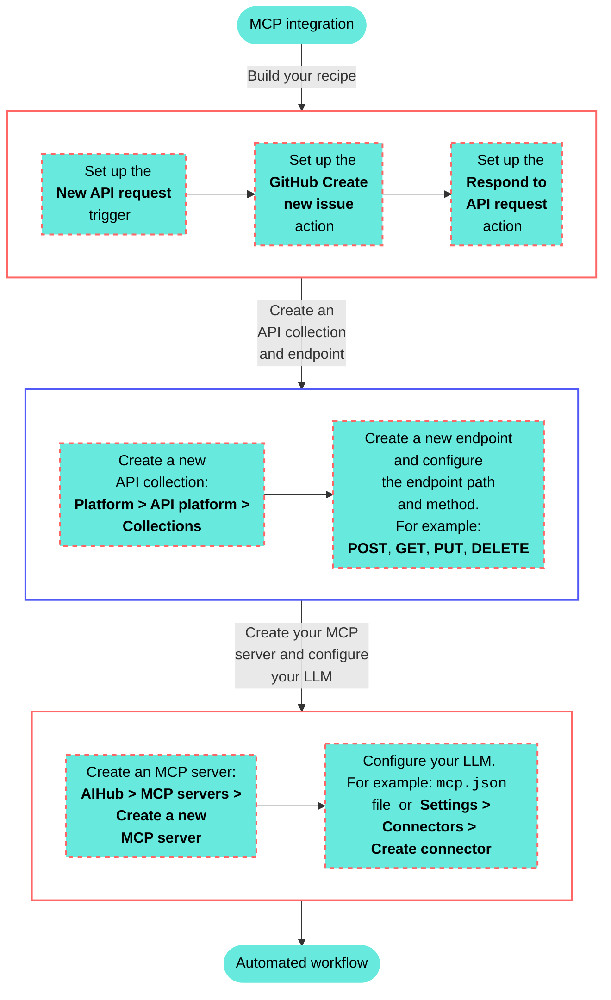
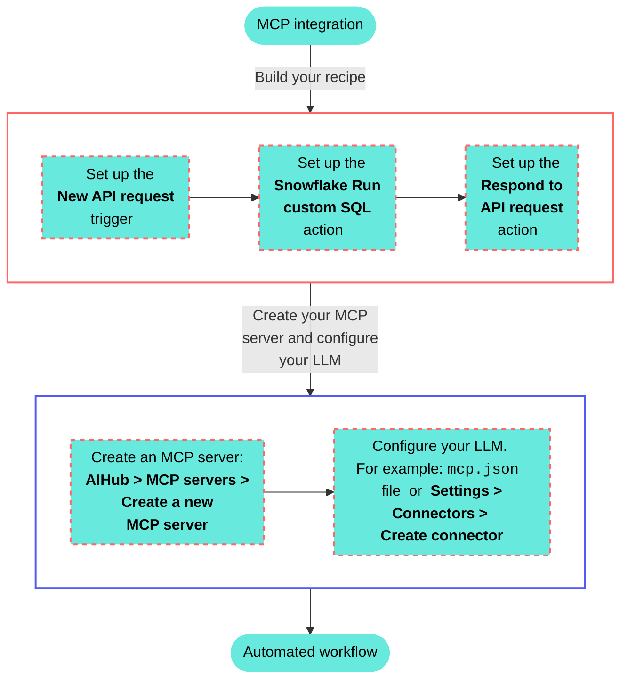

# Developer and Embedded API MCP server

The [Developer API](/en/workato-api) and [Embedded API](/en/oem/oem-api) MCP server enables AI-powered developer environments like Claude Desktop and Cursor to programmatically access your Workato workspace. You can manage assets and projects programmatically with Workato Developer and Embedded APIs exposed as a remote MCP server with following authentication:

- **Developer API**: Use standard [Developer API token authentication](/en/workato-api#authentication).
- **Embedded API**: Use an API token created in an Embedded admin workspace.

You can inspect and modify assets, perform bulk operations, and call Developer or Embedded API endpoints directly from your development tools. MCP tools built with API endpoints also allow you to [pass authorization headers in API calls](#pass-authorization-headers-in-api-calls).

> **FEATURE AVAILABILITY**
> 
> MCP is available to all users in the US, EU, AU, JP, SG, IL, KR, and UK data centers. MCP servers are hosted in the US, EU, and APAC regions and respect data residency requirements where possible. MCP isn't available to workspaces in the CN data center. This reflects local regulatory requirements and Workato's commitment to data sovereignty and applies to our multi-tenant and [Virtual Private Workato (VPW)](/en/cloud-hosting-editions/hosting-editions#virtual-private-workato) offerings.
> 
> Contact your Customer Success representative if you're interested in using MCP or require additional information.

Your MCP server respects all Developer API and Embedded API permissions and project scopes configured in your [API client role](/en/workato-api/api-clients#create-a-client-role). This means you can restrict access to specific projects or endpoints by configuring your API client settings in **Workspace admin > API clients**.

> **MCP URL AND API TOKEN INTEGRATION**
> 
> You can manage Developer APIs and Embedded APIs with both remote and [local MCP servers](/en/mcp/mcp-local-servers) with the following configuration:
> 
> ```json
> "YOUR-API-REMOTE-NAME": {
>       "url": "https://app.workato.com/mcp",
>       "headers": {
>         "Authorization": "Bearer <YOUR_API_TOKEN>"
>       }
>     }
> ```

## Configure Developer APIs and Embedded APIs as an MCP server

Complete the following steps to use your Developer API or Embedded API endpoints as an MCP server with your LLM:

1. Sign in to Workato.
   
2. Go to **Workspace admin > API clients** to view your API client role that defines which tools you have access to or [Create a client role](/en/workato-api/api-clients#create-a-client-role) with the tools you plan to use. For example, enable **List folders**, **Create project or folder**, and **Update folder** if these are tools you plan to use in your LLM.
   
   > **EMBEDDED API CLIENT AND TOKEN REQUIREMENT**
   > 
   > You must use a token created in an Embedded admin workspace to manage Embedded APIs through the MCP server.
   
   _LLM tool availability is defined in the client role_
   
3. Obtain your API client token or [Create an API client](/en/workato-api/api-clients#create-an-api-client) and copy and store the generated API token.
   
4. Configure your LLM to use the endpoints defined in your API client role:
   
   **Claude Desktop**
   
   ### Claude Desktop remote configuration
   
   1. Open Claude Desktop.
      
   2. Go to **Settings > Developer**.
      
   3. Click **Edit Config** to open the `claude_desktop_config.json` file.
      
   4. Add the following configuration to convert your API client role endpoints into an MCP server, replacing `YOUR-API-REMOTE-NAME` and `YOUR_API_TOKEN` with your values:
      
      ```json
      {
        "mcpServers": {
          "YOUR-API-REMOTE-NAME": {
            "command": "npx",
            "args": [
              "mcp-remote",
              "https://app.workato.com/mcp",
              "--header",
              "Authorization: Bearer <YOUR_API_TOKEN>"
            ]
          }
        }
      }
      ```
      
   5. Save your changes.
      
   6. Restart Claude Desktop and start a new chat to use the tools you added.
      
   
   **Cursor**
   
   ### Cursor remote configuration
   
   1. Sign in to Cursor.
      
   2. Go to **Settings > Cursor settings**.
      
   3. Click **MCP & Integrations** in the sidebar.
      
   4. Click **\+ New MCP Server** to open the `mcp.json` file.
      
      _Click **\+ New MCP Server**_
      
   5. Add the following configuration to convert your API client role endpoints into an MCP server, replacing `YOUR-API-REMOTE-NAME` and `YOUR_API_TOKEN` with your values:
      
      ```json
      {
        "mcpServers": {
          "YOUR-API-REMOTE-NAME": {
            "url": "https://app.workato.com/mcp",
            "headers": {
              "Authorization": "Bearer <YOUR_API_TOKEN>"
            }
          }
        }
      }
      ```
      
   6. Save your changes.
      
   7. Create a new chat with your Cursor agent to use the tools you added.
      
      You must start a new chat with your agent. Cursor agents only have access to the tools and capabilities available when a chat begins. Agents can't detect or use new MCP configurations, servers, or tools added after starting a chat.
      
   
   **Local configuration**
   
   ### Local configuration
   
   1. Replace `YOUR_API_TOKEN` and `YOUR-API-LOCAL-NAME` with your specific values.
      
      Example configuration:
      
      ```json
      "YOUR-API-LOCAL-NAME": {
            "url": "https://app.workato.com/mcp",
            "headers": {
              "Authorization": "Bearer <YOUR_API_TOKEN>"
            }
          }
      ```
      
   

## Manage Developer APIs and Embedded APIs through your MCP

You can manage the Developer API and Embedded API endpoints enabled in your API client role after you configure your MCP JSON file.

Complete the following steps to manage your Developer API or Embedded API project and assets through your LLM:

1. Start a new chat with your LLM and enter a prompt.
   
   **Example prompt for project and asset management**
   
   1. Enter the following prompt:
      
      ```plaintext
      
      Propose a maximum of 3 tags based on my workspace activity.
      ```
      
      _Create tags from your LLM_
      
   2. Review the suggestions and ask your LLM to create the proposed tags.
      
   3. Go to **Workspace admin > Settings > Tags** and click **Manage tags** to view the tags created by your LLM.
      
      _Tags created by your LLM_
      
2. Use more natural language prompts to manage your projects and assets, for example:
   
   - `Move folder 12345 to parent folder 67890.`
   - `List all folders in my Acme test project.`
   - `Start analyzing recipe health for recipe 68000123.`
   - `List all connections and group by active and inactive status.`
   - `List jobs from recipe 68000123.`

## Pass authorization headers in API calls

You can call APIs with authorization headers within Workato recipe actions. You must use the header X-Wkt-Ext-Authorization datapill in your Workato recipe for APIM-collection-based MCP servers.

Complete the following steps to pass authorization headers in your API calls:

1. Go to a project and click **Create > Recipe** or press C+R.
   
   _Create a new recipe_
   
2. Enter a name for your recipe in the **Name** field.
   
3. Use the **Location** drop-down menu to select the project where you plan to store the recipe.
   
4. Click **Start building**.
   
   _Start building your recipe_
   
5. Click **Pick a starting point** and select **Trigger from an app**.
   
6. Click **Select an app and trigger event**.
   
7. Search for and select `API platform by Workato`.
   
8. Select the **New API request** trigger. The **New API request** trigger in this use case doesn't require you to establish a connection.
   
   _**New API request** trigger_
   
9. Complete the following steps to configure your request schema:
   
   1. Go to the **Request headers** section and click **Add header**.
      
   2. Enter the following name in the **Name** field:
      
      ```bash
      X-Wkt-Ext-Authorization
      ```
      
   3. Optional. Provide a descriptive label for your header in the **Label** field.
      
   4. Click **Add field**. Your header value is now accessible as a datapill under the **New API request** step output.
      
   5. Map the X-Wkt-Ext-Authorization (Step 1) datapill to the field where you plan to pass the header authorization.
      
      _Map the X-Wkt-Ext-Authorization (Step 1) datapill_
      
   6. Save your changes.
      
10. Go to **AI Hub > Enterprise MCP > Custom servers** and select the MCP server that uses the recipe you created in the preceding steps.
    
11. Go to **Settings > End user access** and verify that **Access Method** is set to **Token-based access**.
    
12. Copy the **Developer MCP Token** URL that includes the `wkt_token`.
    
    _Copy the **Developer MCP Token** URL_
    
13. Return to the **Request schema** section and click **\+ Add Field**.
    
14. Enter `description` in the **Name** and **Label** fields.
    
15. Use the **Data type** drop-down menu to select **String**.
    
16. Use the **Optional** drop-down menu to select **No**.
    
17. Use the **Nest under** drop-down menu to select **payload**.
    
18. Click **Save**.
    
19. Return to the **Request schema** section and click **\+ Add Field**.
    
20. Enter `title` in the **Name** and **Label** fields.
    
21. Use the **Data type** drop-down menu to select **String**.
    
22. Use the **Optional** drop-down menu to select **No**.
    
23. Use the **Nest under** drop-down menu to select **payload**.
    
24. Click **Save**.
    
    _Request schema_
    

## Limitations

Workato Developer API and Embedded API MCP servers have the following limitations:

### Unsupported endpoints

The following Developer API and Embedded API endpoints aren't supported:

**Developer API**

- [Event streams](/en/workato-api/event-streams)
- [Lookup tables](/en/workato-api/lookup-tables)

**Embedded API**

- [Lookup tables](/en/oem/oem-api/lookup-tables)

---

---
url: >-
  https://docs.workato.com/en/getting-started/use-cases/mcp/github-developer-api-llm.md
description: >-
  Create an MCP integration that enables your LLM to create new issues in GitHub
  using the Workato Developer API.
---

# LLM, GitHub, and Workato Developer API

This use case provides step-by-step instructions to create a custom MCP integration between an LLM and GitHub using the Workato Developer API. A custom MCP connection provides the following benefits over prebuilt connectors:

- Complete control over data access, filtering, and logging.
- Ability to implement your organization's specific business rules, approval workflows, or data processing logic directly into the AI's capabilities.
- Flexibility to evolve with your needs and remain under your control rather than depend on a provider's roadmap that may not support new features you require.

## What does this MCP server integration do?

This MCP server integration enables you to create new GitHub issues using natural language commands in your LLM, such as ChatGPT, Claude, or Cursor.



## Create your MCP integration

Complete the following steps to build an integration that enables you to create new GitHub issues from your ChatGPT, Claude, or Cursor agent chat with natural language commands.

> **USE CASES ARE INTENDED AS EXAMPLES ONLY**
> 
> This use case serves as an example. Modifications to API requests, actions, API responses, or conditional logic may be necessary to adapt this recipe to your workflow. This use case has been tested with ChatGPT, Claude, and Cursor. Configuration and usage may vary with other LLMs.

1. Sign in to Workato.
   
2. Select the project where you plan to create the API request recipe.
   
3. Create a GitHub connection.
   
   ### GitHub connection setup
   
   This step connects your GitHub account to your Workato account.
   
   1. Click **Create > Connection** or press C twice.
      
   2. Search for and select `GitHub` on the **New connection** page.
      
   3. Provide a name for your connection in the **Connection name** field.
      
      _GitHub connection setup_
      
   4. Use the **Location** drop-down menu to select the project where you plan to store the connection.
      
   5. Use the **Connection type** drop-down menu to select the connection method you plan to use. You can select your [on-prem group](/en/on-prem/groups) name or select **Cloud** to use a direct connection.
      
   6. Select either [**OAuth App**](/en/connectors/github#traditional-oauth), [**GitHub App**](/en/connectors/github#github-app-authentication), or **Personal Access Token** in the **Authentication type** drop-down menu.
      
      **If you selected GitHub App**:
      
      1. Provide your app ID in the **GitHub App ID** field.
         
      2. Enter the private key in the **GitHub App Private key** field.
         
      3. Fill in the **Installation ID** field.
         
      4. Optional. Expand **Advanced configuration** to provide the **API Root URL**, which is applicable when using GitHub Enterprise Server.
         
      
      **If you selected Personal Access Token**:
      
      1. Enter your personal access token in the **Personal Access Token** field.
         
   7. Click **Connect**.
      
   
4. Go to project and click **Create > Recipe** or press C+R.
   
   _Create a new recipe_
   
5. Enter a name for your recipe in the **Name** field.
   
6. Use the **Location** drop-down menu to select the project where you plan to store the recipe.
   
7. Click **Start building**.
   
   _Start building your recipe_
   
8. Click **Pick a starting point** and select **Trigger from an app**. The trigger in this use case doesn't require you to establish a connection.
   
9. Click **Select an app and trigger event**.
   
10. Set up your New API request trigger.
    
    ### New API request trigger setup
    
    This step creates an API request and response that enables your LLM agent to process and respond to your request with the correct title and description information.
    
    1. Search for `API platform by Workato` and select it as your app.
       
    2. Select the **New API request** trigger.
       
       _**New API request** trigger_
       
    3. Complete the following steps to configure your request schema:
       
       1. Go to the **Request schema** section and click **\+ Add Field**.
          
       2. Enter `reason` in the **Name** and **Label** fields.
          
       3. Use the **Data type** drop-down menu to select **String**.
          
       4. Use the **Optional** drop-down menu to select **No**.
          
          _Reason field_
          
       5. Click **Save**.
          
       6. Return to the **Request schema** section and click **\+ Add Field**.
          
       7. Enter `payload` in the **Name** and **Label** fields.
          
       8. Use the **Data type** drop-down menu to select **Object**.
          
       9. Use the **Optional** drop-down menu to select **No**.
          
       10. Click **Save**.
           
       11. Return to the **Request schema** section and click **\+ Add Field**.
           
       12. Enter `description` in the **Name** and **Label** fields.
           
       13. Use the **Data type** drop-down menu to select **String**.
           
       14. Use the **Optional** drop-down menu to select **No**.
           
       15. Use the **Nest under** drop-down menu to select **payload**.
           
       16. Click **Save**.
           
       17. Return to the **Request schema** section and click **\+ Add Field**.
           
       18. Enter `title` in the **Name** and **Label** fields.
           
       19. Use the **Data type** drop-down menu to select **String**.
           
       20. Use the **Optional** drop-down menu to select **No**.
           
       21. Use the **Nest under** drop-down menu to select **payload**.
           
       22. Click **Save**.
           
           _Request schema_
           
    4. Complete the following steps to configure your request responses:
       
       1. Go to the **Responses** section and click **Add response**.
          
          _Click **Add response**_
          
       2. Enter `200` in the **Name** field.
          
       3. Use the **HTTPS status code standard response** drop-down menu to select `200 - OK`.
          
       4. Go to the **Response schema** section and click **add fields manually**.
          
       5. Enter `response` in the **Name** and **Label** fields.
          
       6. Use the **Data type** drop-down menu to select **String**.
          
       7. Use the **Optional** drop-down menu to select **No**.
          
       8. Click **Save**.
          
          _Response schema_
          
    
11. Click **\+ Add step** and select **Action in app**.
    
    _Click **Add step > Add action in app**_
    
12. Set up your Create issue in GitHub action.
    
    ### Create issue in GitHub action setup
    
    This step creates a new GitHub issue with the title and description you provide in your LLM agent chat.
    
    1. Search for `GitHub` and select it as your app.
       
    2. Select the **Create issue** action.
       
    3. Go to **Organization** and ensure that **Select organization** is selected.
       
    4. Use the **Select organization** drop-down menu to select the GitHub organization you plan to use.
       
    5. Go to **Repository name** and use the drop-down menu or manually enter the GitHub repository you plan to use.
       
    6. Map the title (Step 1) datapill to the **Issue title** field.
       
    7. Map the description (Step 2) datapill to the **Body** field.
       
       _Map the description (Step 2) datapill to the **Body** field_
       
    8. Click **Save**.
       
    
13. Click **\+ Add step** and select **Action in app**.
    
14. Set up your Respond to API request action.
    
    ### Respond to API request action setup
    
    This step instructs your LLM agent to respond with the **200** response you configured in the **New API request** trigger response schema. It also tells the LLM to include the newly created issue URL in the response.
    
    1. Search for `API platform by Workato` and select it as your app.
       
    2. Select the **Respond to API request** action.
       
    3. Use the **Response** drop-down menu to select **200**. This is the response you configured in the **New API request** trigger setup.
       
    4. Expand the **Response body** section.
       
    5. Map the GitHub URL (Step 2) datapill to the **Response** field. This instructs your LLM to provide the URL link to the new issue in your chat.
       
       _Respond to API request_
       
    6. Click **Save**.
       
    
15. Create an API collection.
    
    ### Create an API collection
    
    This step creates a new API collection where you can store endpoints that you plan to use as MCP tools.
    
    1. Go to **Platform > API platform**.
       
    2. Click the **API collections** tab.
       
    3. Click **\+ Create new collection**.
       
    4. Ensure that **API recipe collection** is selected and then click **Next**.
       
    5. Ensure that **Use existing recipes** is selected.
       
    6. Use the **Recipe folder** drop-down menu to select the folder where you plan to store the API collection.
       
    7. Deselect all endpoints.
       
    8. Enter a name in the **Collection name** field.
       
    9. Enter a version number for your collection. For example: `v1`.
       
    10. Optional. Provide a description for the collection in the **Description** field.
        
    11. Click **Create collection**.
        
        _Click **Create collection**_
        
    
16. Create a new endpoint.
    
    ### Create an endpoint
    
    This step creates a new endpoint based on your API request recipe and stores it in your API collection.
    
    1. Go to **Platform > API platform**.
       
    2. Click the **API collections** tab.
       
    3. Select the API collection you created in the preceding steps.
       
    4. Click **Create new endpoint**.
       
    5. Use the **Recipe** drop-down menu to select the API request recipe you created in the preceding steps.
       
    6. Use the **HTTP method** drop-down menu to select **POST**.
       
    7. Enter a name for your endpoint in the **Endpoint name** field.
       
    8. Define a path for your endpoint in the **Endpoint path** field. Your endpoint path can include parameters. This use case uses the following endpoint path and parameters: `post-github-issue/title/description`. Don't include a `\` in your endpoint path. This is automatically appended after you create the endpoint.
       
       _Define a path for your endpoint_
       
    9. Optional. Provide a description in the **Endpoint description** field.
       
    10. Optional. Set a timeout value in the **Request timeout** field. The default value is `30` seconds and the maximum value is `240` seconds.
        
    11. Click **Add endpoint**.
        
    
17. Create an MCP server.
    
    ### Create an MCP server
    
    This step creates a new MCP server and add your endpoint to it. Endpoints you add to the MCP server become tools you can use in your LLM.
    
    1. Go to **AI Hub > Enterprise MCP > Custom servers** and click **\+ Create an MCP server**. Alternatively, you can create an MCP server from the **Projects** page by clicking **Create > MCP server** or pressing C+M.
       
    2. Select **New MCP server**.
       
    3. Enter a name for your MCP server in the **Server name** field. For example: `GitHub MCP tool`.
       
    4. Optional. Provide a description of the MCP server in the **Describe how this MCP server will be used** field.
       
    5. Use the **Location** drop-down menu to select the project that contains the API recipe.
       
    6. Select **API collection** as your asset type.
       
    7. Select the API collection you created in the preceding steps.
       
    8. Click **Start building**. Your MCP server information displays in the **Details** tab.
       
    9. Click **Settings > End user access**.
       
    10. Go to the **Developer MCP Token** section and click the **Copy** button to copy your MCP server URL and token for use in later steps.
        
        _Copy the MCP URL_
        
    
18. Go to the LLM where you plan to create an MCP integration and complete the following configuration steps:
    
    > **TESTED LLMS**
    > 
    > This use case has been tested with ChatGPT, Claude, and Cursor. Configuration and usage may vary with other LLMs.
    
    Configure your MCP integration in ChatGPT.
    
    ### ChatGPT MCP configuration
    
    This step configures a new MCP server connector in your OpenAI account that enables you to use natural language commands in ChatGPT to create a new GitHub issue.
    
    1. Go to your ChatGPT account.
       
    2. Go to **Settings > Apps & Connectors > Advanced settings** and enable the **Developer mode** toggle.
       
    3. Go to **Settings > Apps & Connectors**.
       
    4. Click **Create**. This button is only visible when the **Developer mode** toggle is enabled.
       
    5. Enter a name for your MCP connector in the **Name** field.
       
       _Configure your ChatGPT MCP connector_
       
    6. Paste your MCP URL and token in the **URL field**.
       
    7. Optional. Enter a description in the **Description** field.
       
    8. Use the **Authentication** drop-down menu to select **No Auth**.
       
    9. Select the checkbox to accept the risk of adding a custom MCP server.
       
    10. Click **Create**.
        
    11. Create a new chat in ChatGPT to use your MCP tools.
        
    
    Configure your MCP integration for Claude.
    
    ### Claude MCP configuration
    
    This step configures a new MCP server connector in your Anthropic account that enables you to use natural language commands in Claude to create a new GitHub issue.
    
    1. Go to **Settings > Connectors**.
       
    2. Click **\+ Add new connector**.
       
    3. Enter a name for your MCP connector in the **Name** field.
       
       _Configure your Claude MCP connector_
       
    4. Paste your MCP URL and token into the **Remote MCP server URL** field.
       
    5. Click **Add**. The newly created MCP connector appears in the list of connectors.
       
    6. Click **Configure**.
       
    7. Use the permissions drop-down menu to select **Always ask permission** or **Allow unsupervised**. **Always ask permission** is selected by default.
       
    8. Create a new chat in Claude to use your MCP tools.
       
    
    Configure your MCP integration for Cursor.
    
    ### Cursor MCP configuration
    
    This step configures a new MCP server connector in your Cursor account that enables you to use natural language commands in your Cursor agent chat to create a new GitHub issue. This process authenticates with an MCP URL and authentication token. Refer to [Cursor MCP remote server configuration with Workato Identity authentication](/en/mcp/developer-api-mcp#cursor-mcp-remote-server-configuration-with-workato-identity-authentication) if you plan to authenticate with [Workato Identity](/en/workato-identity).
    
    1. Go to **Settings > Cursor settings**.
       
    2. Click **MCP & Integrations** in the sidebar.
       
    3. Click **\+ New MCP Server** to open the `mcp.json` file.
       
       _Click **\+ New MCP Server**_
       
    4. Update the configuration to use the MCP URL and token you copied in the preceding steps. For example:
       
       ```json
       
       {
         "mcpServers": {
           "snowflake-tools": {
             "url": "https://2255.apim.mcp.workato.com?wkt_token=YOUR_API_TOKEN"
           },
           "github-tools": {
             "url": "https://387.apim.mcp.workato.com/abc247/example-collection-name-v1?wkt_token=YOUR_API_TOKEN"
           }
         }
       }
       ```
       
    5. Save your changes.
       
    6. Create a new chat with your Cursor agent to use your MCP tools.
       
       You must start a new chat with your agent. Cursor agents only have access to the tools and capabilities available when a chat begins. Agents can't detect or use new MCP configurations, servers, or tools added after starting a chat.

---

---
url: >-
  https://docs.workato.com/en/getting-started/use-cases/mcp/snowflake-developer-api.md
description: >-
  Create an MCP integration that enables an LLM to query Snowflake data using
  natural language commands through integration with the Workato Developer API.
---

# LLM, Snowflake, and Workato Developer API

This use case provides step-by-step instructions to create a custom MCP integration between an LLM and Snowflake using the Workato Developer API. This integration transforms how teams access and analyze data by enabling natural language queries that automatically retrieve structured insights from Snowflake.

## What does this MCP server integration do?

This MCP server integration enables you to:

- Query Snowflake sales data using natural language commands in an LLM
- Filter and aggregate data by city, state, region, and sales value
- Retrieve key metrics including total sales, order counts, and product performance
- Explore data iteratively without writing SQL or switching tools
- Get contextualized insights with business narratives, not just raw numbers



## Create Your MCP Integration

Complete the following steps to build an integration that enables teams to query Snowflake data from an LLM using natural language commands.

> **USE CASES ARE INTENDED AS EXAMPLES ONLY**
> 
> This use case serves as an example. Modifications to SQL queries, request schemas, or conditional logic may be necessary to adapt this recipe to your specific Snowflake schema and business requirements.

1. Sign in to Workato.
   
2. Select the project where you plan to create the API request recipe for your MCP server.
   
3. Create a Snowflake connection.
   
   ### Snowflake connection setup
   
   This step connects your Snowflake account to your Workato account. Refer to [Snowflake authentication methods](/en/connectors/snowflake#supported-authentication-methods) for more information.
   
   Snowflake plans to deprecate single-factor password authentication for users by **November 2025**. Refer to [Snowflake's official deprecation announcement](https://www.snowflake.com/en/blog/blocking-single-factor-password-authentification/) for more information.
   
   We strongly encourage you to migrate all existing **Username/Password** connections to **OAuth 2.0** or **Key-pair authentication** before this date. Existing **Username/Password** connections will remain operational until the deprecation date.
   
   The Snowflake connector supports OAuth 2.0, private key, and username/password authentication. You must add [Workato IP addresses](/en/security/ip-allowlists) to the allowlist if your Snowflake instance has network policies that restrict access based on IP address.
   
   Complete the following steps to connect to Snowflake:
   
   1. Select **Create > Connection** or press C twice.
      
   2. Search for and select `Snowflake` on the **New connection** page.
      
   3. Provide a name for your connection in the **Connection name** field.
      
      _Snowflake connection_
      
   4. Use the **Location** drop-down menu to select the project where you plan to store the connection.
      
   5. Enter the [Account identifier](https://docs.snowflake.com/en/user-guide/admin-account-identifier) of your Snowflake instance in one of the supported formats:
      
      - **Account name**: `https://{orgname}-{account_name}`
      - **Connection name**: `https://{orgname}-{connectionname}`
      - **Account locator**: `https://{accountlocator}.{region}.{cloud}`
      
      Refer to the Snowflake [Connecting to your accounts guide](https://docs.snowflake.com/en/user-guide/organizations-connect#connecting-with-a-url) for more information.
      
      **ACCOUNT LOCATOR FORMAT**
      
      Certain locations require you to include the `{region}` and `{cloud}` in your account locator URL. For example:
      
      - **AWS US West (Oregon)**: `your-account-locator`
      - **AWS US East (Ohio)**: `your-account-locator.us-east-2`
      - **Azure West Europe**: `your-account-locator.west-europe.azure`
      
      Refer to the [Using an account locator as an identifier](https://docs.snowflake.com/en/user-guide/admin-account-identifier#using-an-account-locator-as-an-identifier) guide for more information.
      
   6. Enter the **Warehouse** name to define the compute resources for this connection. Refer to the [Warehouse considerations](/en/connectors/snowflake#warehouse-considerations) section for more information.
      
   7. Enter the **Database name** for the target Snowflake database.
      
   8. Select an **Authentication type** for your Snowflake connection. Refer to the [Snowflake connector authentication options](/en/connectors/snowflake#supported-authentication-methods) section for configuration steps.
      
   9. Optional. Specify a **Role** for authentication. This role must be an existing role assigned to the user. If left blank, Snowflake uses the default role assigned to the user.
      
   10. Optional. Enter the **Schema**. If left blank, the default schema is public.
       
   11. Optional. Set the **Use improved datetime handling (Recommended)** to **Yes** to ensure correct timezone handling for timestamps.
       
   12. Optional. Define the **Database timezone** to apply to timestamps without an assigned timezone.
       
   13. Click **Connect** to verify the connection.
       
   
4. Set up your New API request trigger.
   
   ### New API request trigger setup
   
   This trigger defines how the MCP server calls your recipe and what parameters it expects.
   
   1. Search for `API platform by Workato` and select it as your app.
      
   2. Select the **New API request** trigger.
      
      _**New API request** trigger_
      
   3. Complete the following steps to configure your request schema:
      
      1. Go to the **Request schema** section and click **\+ Add Field**.
         
      2. Enter `region` in the **Name** and **Label** fields.
         
      3. Use the **Data type** drop-down menu to select **String**.
         
      4. Use the **Optional** drop-down menu to select **Yes**.
         
      5. Click **Save**.
         
      6. Return to the **Request schema** section and click **\+ Add Field**.
         
      7. Enter `city` in the **Name** and **Label** fields.
         
      8. Use the **Data type** drop-down menu to select **String**.
         
      9. Use the **Optional** drop-down menu to select **Yes**.
         
      10. Click **Save**.
          
      11. Return to the **Request schema** section and click **\+ Add Field**.
          
      12. Enter `state` in the **Name** and **Label** fields.
          
      13. Use the **Data type** drop-down menu to select **String**.
          
      14. Use the **Optional** drop-down menu to select **Yes**.
          
      15. Click **Save**.
          
      16. Return to the **Request schema** section and click **\+ Add Field**.
          
      17. Enter `sales_value` in the **Name** and **Label** fields.
          
      18. Use the **Data type** drop-down menu to select **Number**.
          
      19. Use the **Optional** drop-down menu to select **Yes**.
          
      20. Click **Save**.
          
          _Request schema_
          
   4. Complete the following steps to configure your success request response:
      
      1. Go to the **Responses** section and click **Add response**.
         
         _Click **Add response**_
         
      2. Enter `200` in the **Name** field.
         
      3. Use the **HTTPS status code standard response** drop-down menu to select `200 - OK`.
         
      4. Go to the **Response schema** section and click **add fields manually**.
         
      5. Enter `number_of_sales_orders` in the **Name** and **Label** fields.
         
      6. Use the **Data type** drop-down menu to select **Integer**.
         
      7. Use the **Optional** drop-down menu to select **No**.
         
      8. Click **Save**.
         
      9. Return to the **Response schema** section and click **\+ Add Field**.
         
      10. Enter `total_sales` in the **Name** and **Label** fields.
          
      11. Use the **Data type** drop-down menu to select **Number**.
          
      12. Use the **Optional** drop-down menu to select **No**.
          
      13. Click **Save**.
          
      14. Return to the **Response schema** section and click **\+ Add Field**.
          
      15. Enter `most_common_product_name` in the **Name** and **Label** fields.
          
      16. Use the **Data type** drop-down menu to select **String**.
          
      17. Use the **Optional** drop-down menu to select **No**.
          
      18. Click **Save**.
          
      19. Return to the **Response schema** section and click **\+ Add Field**.
          
      20. Enter `most_common_product_type` in the **Name** and **Label** fields.
          
      21. Use the **Data type** drop-down menu to select **String**.
          
      22. Use the **Optional** drop-down menu to select **No**.
          
      23. Click **Save**.
          
      24. Return to the **Response schema** section and click **\+ Add Field**.
          
      25. Enter `most_common_product_category` in the **Name** and **Label** fields.
          
      26. Use the **Data type** drop-down menu to select **String**.
          
      27. Use the **Optional** drop-down menu to select **No**.
          
      28. Click **Save**.
          
      29. Return to the **Response schema** section and click **\+ Add Field**.
          
      30. Enter `most_common_product_manufacturer` in the **Name** and **Label** fields.
          
      31. Use the **Data type** drop-down menu to select **String**.
          
      32. Use the **Optional** drop-down menu to select **No**.
          
      33. Click **Save**.
          
      34. Return to the **Response schema** section and click **\+ Add Field**.
          
      35. Enter `most_common_brand` in the **Name** and **Label** fields.
          
      36. Use the **Data type** drop-down menu to select **String**.
          
      37. Use the **Optional** drop-down menu to select **No**.
          
      38. Click **Save**.
          
          _Success request response_
          
   5. Complete the following steps to configure your error request response:
      
      1. Return to the **Responses** section and click **Add response**.
         
      2. Enter **Error** in the **Name** field.
         
      3. Use the **HTTPS status code standard response** drop-down menu to select `400 - Bad request`.
         
      4. Go to the **Response schema** section and click **add fields manually**.
         
      5. Enter `status` in the **Name** and **Label** fields.
         
      6. Use the **Data type** drop-down menu to select **String**.
         
      7. Use the **Optional** drop-down menu to select **No**.
         
      8. Click **Save**.
         
      9. Click **+Add Field**.
         
      10. Enter `message` in the **Name** and **Label** fields.
          
      11. Use the **Data type** drop-down menu to select **String**.
          
      12. Use the **Optional** drop-down menu to select **No**.
          
      13. Click **Save**.
          
      14. Click **+Add Field**.
          
      15. Enter `error` in the **Name** and **Label** fields.
          
      16. Use the **Data type** drop-down menu to select **String**.
          
      17. Use the **Optional** drop-down menu to select **No**.
          
      18. Click **Save**.
          
          _Error request response_
          
   
5. Click **\+ Add step** and select **Action in app**.
   
   _Click **Add step > Action in app**_
   
6. Set up your Snowflake Run custom SQL action.
   
   ### Run custom SQL in Snowflake action setup
   
   This step queries Snowflake for the information you configured in the preceding steps.
   
   Complete the following steps to configure your **Run custom SQL** action:
   
   1. Search for and select Snowflake as your app.
      
   2. Select the **Run custom SQL** action.
      
   3. Go to the **SQL** field and paste the following query:
      
      ```sql
      
      SELECT
        COUNT(*) AS number_of_sales_orders,
        SUM(sales_value) AS total_sales,
        MODE() WITHIN GROUP (ORDER BY product_name) AS most_common_product_name,
        MODE() WITHIN GROUP (ORDER BY product_type) AS most_common_product_type,
        MODE() WITHIN GROUP (ORDER BY product_category) AS most_common_product_category,
        MODE() WITHIN GROUP (ORDER BY product_manufacturer) AS most_common_product_manufacturer,
        MODE() WITHIN GROUP (ORDER BY brand) AS most_common_brand
      FROM sales
      WHERE
        (:region IS NULL OR region = :region)
        AND (:city IS NULL OR city = :city)
        AND (:state IS NULL OR state = :state)
        AND (:sales_value IS NULL OR sales_value >= :sales_value);
      ```
      
      _Provide an SQL string_
      
   4. Complete the following steps to configure your output fields:
      
      1. Go to the **Output fields** section and click **\+ Add Field**.
         
      2. Enter `number_of_sales_orders` in the **Name** and **Label** fields.
         
      3. Use the **Data type** drop-down menu to select **Integer**.
         
      4. Use the **Optional** drop-down menu to select **No**.
         
      5. Click **Save**.
         
      6. Click **+Add Field**.
         
      7. Enter `total_sales` in the **Name** and **Label** fields.
         
      8. Use the **Data type** drop-down menu to select **Number**.
         
      9. Use the **Optional** drop-down menu to select **No**.
         
      10. Click **Save**.
          
      11. Click **+Add Field**.
          
      12. Enter `most_common_product_name` in the **Name** and **Label** fields.
          
      13. Use the **Data type** drop-down menu to select **String**.
          
      14. Use the **Optional** drop-down menu to select **No**.
          
      15. Click **Save**.
          
      16. Click **+Add Field**.
          
      17. Enter `most_common_product_type` in the **Name** and **Label** fields.
          
      18. Use the **Data type** drop-down menu to select **String**.
          
      19. Use the **Optional** drop-down menu to select **No**.
          
      20. Click **Save**.
          
      21. Click **+Add Field**.
          
      22. Enter `most_common_product_category` in the **Name** and **Label** fields.
          
      23. Use the **Data type** drop-down menu to select **String**.
          
      24. Use the **Optional** drop-down menu to select **No**.
          
      25. Click **Save**.
          
      26. Click **+Add Field**.
          
      27. Enter `most_common_product_manufacturer` in the **Name** and **Label** fields.
          
      28. Use the **Data type** drop-down menu to select **String**.
          
      29. Use the **Optional** drop-down menu to select **No**.
          
      30. Click **Save**.
          
      31. Click **+Add Field**.
          
      32. Enter `most_common_brand` in the **Name** and **Label** fields.
          
      33. Use the **Data type** drop-down menu to select **String**.
          
      34. Use the **Optional** drop-down menu to select **No**.
          
      35. Click **Save**.
          
          _Snowflake **Output fields**_
          
   
7. Click **\+ Add step** and select **Handle errors**.
   
   _Click **Add step > Handle errors**_
   
8. Configure your ERROR FOUND? block.
   
   ### Configure an ERROR FOUND? block
   
   This step tells your recipe monitor the **Run custom SQL** action for errors. It instructs your LLM agent to respond with the **200** response or the **Error** response you configured in the **New API request** trigger response schema.
   
   Complete the following steps to configure your **ERROR FOUND?** block:
   
   1. Go to the **Yes** branch and ensure that **Retry actions in Monitor block?** is set to **DO NOT RETRY**.
      
   2. Click **\+ Add step** under **DO NOT RETRY**.
      
   3. Click **Select an app and action**. Search for and select `API platform by Workato` as your app.
      
   4. Select **Respond to API request** as your action.
      
   5. Use the **Response** drop-down menu to select **Error**.
      
   6. Expand the **Response body** section.
      
   7. Map the Errored action (Step 5) datapill to the **Status** field.
      
   8. Map the Error message (Step 5) datapill to the **Message** field.
      
   9. Map the Error type ID (Step 5) datapill to the **Error** field.
      
      _Configure your **ERROR FOUND?** block_
      
   10. Click **Save**.
       
   11. Go to the **No** branch and click **Select an app and action**.
       
   12. Search for and select `API platform by Workato` as your app.
       
   13. Select **Respond to API request** as your action.
       
   14. Use the **Response** drop-down menu to select **200**.
       
   15. Expand the **Response body** section.
       
   16. Map the Snowflake number\_of\_sales\_orders (Step 4) datapill to the **number\_of\_sales\_orders** field.
       
   17. Map the Snowflake total\_sales (Step 4) datapill to the **total\_sales** field.
       
   18. Map the Snowflake most\_common\_product\_name (Step 4) datapill to the **most\_common\_product\_name** field.
       
   19. Map the Snowflake most\_common\_product\_type (Step 4) datapill to the **most\_common\_product\_type** field.
       
   20. Map the Snowflake most\_common\_product\_category (Step 4) datapill to the **most\_common\_product\_category** field.
       
       _`200` success response body_
       
   21. Map the Snowflake most\_common\_product\_manufacturer (Step 4) datapill to the **most\_common\_product\_manufacturer** field.
       
   22. Map the Snowflake most\_common\_brand (Step 4) datapill to the **most\_common\_brand** field.
       
   23. Click **Save**.
       
   
9. Create an MCP server.
   
   ### Create an MCP server
   
   This step creates a new MCP server and adds your API request and Snowflake recipe. Recipes you add to the MCP server become tools you can use in your LLM.
   
   1. Go to **AI Hub > Enterprise MCP > Custom servers** and click **\+ Create an MCP server**. Alternatively, you can create an MCP server from the **Projects** page by clicking **Create > MCP server** or pressing C+M.
      
   2. Provide a name for your MCP server in the **MCP server name** field. For example: `Snowflake analysis tool`
      
   3. Optional. Provide a description of your MCP server in the **Description** field. LLMs use this description to understand your server. The description isn't visible to end users.
      
   4. Use the **Location** drop-down menu to select a location for your MCP server.
      
   5. Go to the **Tool source** section and select **Project assets**.
      
   6. Select the checkbox for the API and Snowflake recipe you created in the preceding steps.
      
   7. Click **Start building**. Your MCP server information displays in the **Details** tab.
      
   8. Click **Settings > End user access**.
      
   9. Go to the **Developer MCP Token** section and click **Copy** to copy your MCP server URL and token for use in later steps.
      
      _Copy the MCP URL_
      
   
10. Go to the LLM where you plan to create an MCP integration and complete the following configuration steps:
    
    > **TESTED LLMS**
    > 
    > This use case has been tested with ChatGPT, Claude, and Cursor. Configuration and usage may vary with other LLMs.
    
    Configure your MCP integration in ChatGPT.
    
    ### ChatGPT MCP configuration
    
    This step configures a new MCP server connector in your OpenAI account that enables you to use natural language commands in ChatGPT to extract insights from your Snowflake data.
    
    1. Go to your ChatGPT account.
       
    2. Go to **Settings > Apps & Connectors > Advanced settings** and enable the **Developer mode** toggle.
       
    3. Go to **Settings > Apps & Connectors**.
       
    4. Click **Create**. This button is only visible when the **Developer mode** toggle is enabled.
       
    5. Enter a name for your MCP connector in the **Name** field.
       
       _Configure your ChatGPT MCP connector_
       
    6. Paste your MCP URL and token in the **URL field**.
       
    7. Optional. Enter a description in the **Description** field.
       
    8. Use the **Authentication** drop-down menu to select **No Auth**.
       
    9. Select the checkbox to accept the risk of adding a custom MCP server.
       
    10. Click **Create**.
        
    11. Create a new chat in ChatGPT to use your MCP tools.
        
    
    Configure your MCP integration for Claude.
    
    ### Claude MCP configuration
    
    This step configures a new MCP server connector in your Anthropic account that enables you to use natural language commands in Claude to extract insights from your Snowflake data.
    
    1. Go to **Settings > Connectors**.
       
    2. Click **\+ Add new connector**.
       
    3. Enter a name for your MCP connector in the **Name** field.
       
       _Configure your Claude MCP connector_
       
    4. Paste your MCP URL and token into the **Remote MCP server URL** field.
       
    5. Click **Add**. The newly created MCP connector appears in the list of connectors.
       
    6. Click **Configure**.
       
    7. Use the permissions drop-down menu to select **Always ask permission** or **Allow unsupervised**. **Always ask permission** is selected by default.
       
    8. Create a new chat in Claude to use your MCP tools.
       
    
    Configure your MCP integration for Cursor.
    
    ### Cursor MCP configuration
    
    This step configures a new MCP server connector in your Cursor account that enables you to use natural language commands to extract insights from your Snowflake data. This process authenticates with an MCP URL and authentication token. Refer to [Cursor MCP remote server configuration with Workato Identity authentication](/en/mcp/developer-api-mcp#cursor-mcp-remote-server-configuration-with-workato-identity-authentication) if you plan to authenticate with [Workato Identity](/en/workato-identity).
    
    1. Go to **Settings > Cursor settings**.
       
    2. Click **MCP & Integrations** in the sidebar.
       
    3. Click **\+ New MCP Server** to open the `mcp.json` file.
       
       _Click **\+ New MCP Server**_
       
    4. Update the configuration to use the MCP URL and token you copied in the preceding steps. For example:
       
       ```json
       
       {
         "mcpServers": {
           "snowflake-tools": {
             "url": "https://2255.apim.mcp.workato.com?wkt_token=YOUR_API_TOKEN"
           },
           "github-tools": {
             "url": "https://387.apim.mcp.workato.com/abc247/example-collection-name-v1?wkt_token=YOUR_API_TOKEN"
           }
         }
       }
       ```
       
    5. Save your changes.
       
    6. Create a new chat with your Cursor agent to use your MCP tools.
       
       You must start a new chat with your agent. Cursor agents only have access to the tools and capabilities available when a chat begins. Agents can't detect or use new MCP configurations, servers, or tools added after starting a chat.
       
    
11. Test your MCP tool in your LLM.
    
    _Claude example chat_

---
