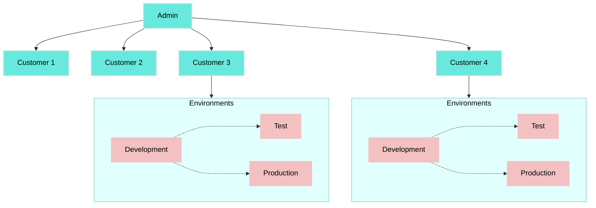
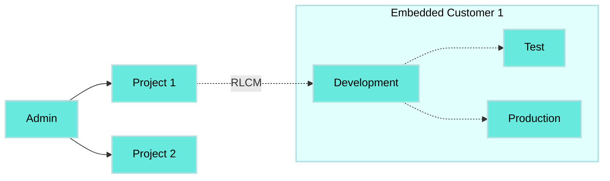

# Environments for Embedded customers

The Embedded **Environments** feature integrates dedicated environments into your Workato workspace, allowing you to access all customer environments under the same Admin workspace. Embedded Environments aggregates usage metrics for your customers.

Your customers have built-in access to **Development, Test, and Production** environments when the Environments feature is provisioned. You can define [different roles](/en/oem/embedded-environments/environment-roles) to a single collaborator in each environment. Note that each environment operates as a **separate and isolated workspace**, essential for maintaining the integrity and independence of development, testing, and production activities. Each environment includes its own set of resources, ensuring a clear distinction and operational independence between them. These resources include:

- Assets
- Members
- Projects
- Recipes
- Connections
- Lookup tables
- Other asset types

Environments for Embedded customers is compatible with [Recipe Lifecycle Management](/en/recipe-development-lifecycle) API and UI tools.

> **WHO CAN USE THIS FEATURE?**
> 
> The Embedded Environments feature is gradually being rolled out for Embedded partners. You can provision Environments for selected customers or across your entire customer base. Note that Admin workspaces are excluded from this feature. Contact your Customer Success Manager to access Environments. Embedded Environments is available at no additional cost.

## Embedded Environments architecture

The Admin workspace is the top level in the Embedded Environments architecture. Embedded Customer (EC) workspaces (with or without) Environments provisioned are nested beneath the Admin workspace.



## Environments

Customer workspaces with the Environments feature provisioned have the following environments:

| Environment | Description |
| --- | --- |
| **Development** | The Development environment serves as the primary area for the entire development process. Equipped with exclusive features, it allows for recipe development, project deployment to subsequent environments, and workspace management. The collaborators and API clients tabs are only accessible in the Development Environment, located under the workspace admin section. |
| **Test** | The Test environment is used to perform recipe testing, quality assurance reviews, and user acceptance testing. |
| **Production** | The Production environment is where automated processes are deployed after being tested, reviewed, and approved. |

## Deployment

You can deploy projects from the Development environment to the Test environment and from the Development environment to the Production environment.


We recommend that you use **Deploy entire project** when using Embedded Environments.



## Enable Environments

Explore the [benefits of using Embedded Environments](/en/oem/embedded-environments/migrate-embedded-environments#embedded-environments-benefits).

## More resources

- [Deploy a project to an environment](/en/features/environments/deploying-projects-to-an-environment#deploying-a-project-to-an-environment)
- [Environments best practices](/en/features/environments/best-practices#best-practices-for-using-environments)
- [Environments collaborator access](/en/user-accounts-and-teams/role-based-access/managing-environment-access#managing-environment-access)

---

---
url: >-
  https://docs.workato.com/en/oem/embedded-environments/migrate-embedded-environments.md
description: >-
  Adopt Embedded Environments by migrating existing customer workspaces into
  isolated Development, Test, and Production environments.
---

# Adopt the Embedded Environments feature

Embedded Environments enhance your organization's agility, reliability, and preparedness for future technological advancements.

## Migration

Contact your Customer Success Manager for more information if you plan to use Environments for your customers.

> **MIGRATION EXPERIENCE**
> 
> When you provision environments for an existing customer, their current workspace assets (recipes, connections, and projects) automatically transition to the **Production** environment without affecting active recipes. The newly provisioned **Development** and **Test** environments are empty. If this automatic setup meets your requirements, you can proceed with the update by following the steps in the [Provision Environments for existing customers](/en/oem/embedded-environments/provision-embedded-environments#provision-environments-for-existing-customers-existing-customers) section.
> 
> If you require a custom approach for asset distribution across environments, we encourage you to contact your Customer Success Manager to explore available migration options that align with your operational requirements.

## Embedded Environments benefits

The Environments feature enhances the customer experience by improving organization and testing processes. Environments also provide a structured approach to manage and test integrations, helping to meet the organizational requirements of customers and partners.

Embedded Environments eliminate confusion and prevent the creation of unnecessary isolated workspaces of the same Embedded Customer (EC).

Other benefits include:

- **CI/CD integration:** Environments streamline CI/CD processes at the EC level with a user-friendly UI that automates project deployments.
  
- **Efficient deployment mechanics:** When deploying updates, recipes in the target environment are updated with the new changes without interrupting their operation. This means that during deployment, changes in the recipe logic are detected. If there are no changes, the recipe does not overwrite the target Environment. When there are changes, the recipe in the target environment overwrites the existing logic with the new logic. Recipes don't stop during this process.
  
- **Connection authentication:** When deploying a connection to another environment, initial authentication suffices. Future deployments of the same connection will not require re-authentication. You can choose to maintain isolated connections across Development, Test, and Production environments. Alternatively, you can use a single connection across all environments based on your preference, offering both isolation and convenience in connection management.
  
- **Clarification:** Increased project organization that reduces confusion and prevents the creation of numerous isolated ECs within a single customer.
  
- **Role based access control (RBAC):** Collaborators can have different permissions for different environments using Workato's RBAC feature. This ensures Environments compatibility with the current processes your customers are using.
  
- **Unified Workspace:** The Environments UI and APIs enable users to access and manage three different isolated workspaces individually.
  
- **Enterprise requirements:** Enterprise-level ECs use staging and live environments to update recipes without overwriting those in production.
  
- **Administrative efficiency:** You can manage all Environments under a single Admin workspace to simplify administrative tasks. This allows you to avoid creating multiple Admin workspaces.
  
- **Backward compatibility:** Environments is implemented as a provisioning flag that ensures all existing workflows remain functional without disruptions, offering a safe upgrade path.
  
- **Isolation and unique identifiers:** Each environment is completely isolated and acts as a different workspace. This isolation extends to the assets within each environment, ensuring that the same recipe has different identifiers in Development, Test, and Production for accurate tracking and management.
  
- **Cost-Effective connection management:** The development (DEV), test (TEST), and production (PROD) environments are fully isolated, enabling you to set up connections within the environment workspaces with different credentials. These connections are billed as instances of the same connection if they share the same path and name. This ensures you are billed only once for a connection, even if the connection operates under different circumstances across environments.
  

## Audit log streaming

Multiple Admin workspace accounts ensure that customer data in specific customer workspaces (distinct from lifecycle stages) streams to the correct destination. This is especially important if you have an Admin workspace account with an audit log streaming configuration inherited by all customers nested under it.

After you migrate the customer to Environments, all events are sent to the Development, Test, and Production environments. The `environment_type` field identifies the environment where the event occurred.

---

---
url: >-
  https://docs.workato.com/en/oem/embedded-environments/provision-embedded-environments.md
description: >-
  Provision the Environments feature for individual Embedded customers and
  assign collaborator roles per environment in your Workato workspace.
---

# Provision Embedded Environments for customers

You must provision the Environments feature for each customer individually. You can define different roles in each environment for a single collaborator. Customer Managers have access to all environments with the same role.

> **ENVIRONMENTS PROVISIONING CANNOT BE UNDONE**
> 
> After Environments are enabled for a customer, this configuration becomes a permanent account enhancement. It is not possible to revert to a single workspace setup.

## Provision Environments for existing customers

1. Sign in to your Workato account.
   
2. Click **Manage customers** in the sidebar navigation menu.
   
3. Select the customer you plan to provision Environments for in the **Admin console** customer table.
   
4. Click **Settings > Plan**.
   
5. Click **Get started** in the **Provision environments for your customers** box. The Provision Environments pop-up box opens with an overview of the Environments feature.
   
   _Provision Environments to an existing customer_
   
6. Click **Provision environments** in the pop-up box to confirm your selection.
   

> **VERIFY ACCESS POST-ENVIRONMENT PROVISIONING**
> 
> After provisioning Environments for an existing customer, it is crucial to review and adjust Role-Based Access Control (RBAC) settings to ensure that your collaborators are granted the appropriate access across all environments (Development, Test, and Production).

After provisioning Environments for an existing customer, their pre-existing workspace becomes their **Production** workspace, which includes all running recipes. Additionally, empty **Development** and **Test** environments are created. Recipes don't stop running at any point during the process.

## Provision Environments for new customers

1. Sign in to your Workato account.
   
2. Click **Manage customers** in the sidebar navigation menu.
   
3. Click **Add customer**.
   
4. Enter a **Name** and **Notification email**, and select a **Plan** for the customer.
   
5. Ensure the **Provision environments** toggle is on.
   
6. Click **Add customer**.
   
   _Provision Environments to a new customer_
   

## Provision Environments programmatically

You can provision the Environments feature programmatically for managed customers by using the boolean parameter `provision_environments`. Set this parameter to `true` to provision the Environments feature for a managed customer.

### Sample request

```shell

curl -X POST 'https://app.workato.com/api/managed_users/:managed_user_id/' \
      -H 'Authorization: Bearer <api_token>'
```

**Body**

```shell
{
    "name":"Example managed customer",
    "notification_email": "TC@test.com",
    "provision_environments": true
}
```

### Sample response

```shell
{
    "id": 209,
    "external_id": null,
    "name": "Example managed customer",
    "environments": [
        {
            "id": 211,
            "environment_type": "prod",
            "external_id": null
        },
        {
            "id": 210,
            "environment_type": "test",
            "external_id": null
        },
        {
            "id": 209,
            "environment_type": "dev",
            "external_id": null
        }
    ],
    "notification_email": "TC@test.com",
    "full_embedding": null,
    "admin_notification_emails": "TC@test.com",
    "error_notification_emails": "TC@test.com",
    "plan_id": "wrike_integrate",
    "origin_url": null,
    "trial": false,
    "in_trial": false,
    "whitelisted_apps": [],
    "frame_ancestors": null,
    "created_at": "2024-05-17T00:48:23.454-07:00",
    "updated_at": "2024-05-17T00:48:23.454-07:00",
    "time_zone": "Pacific Time (US & Canada)",
    "auth_settings": {
        "type": "workato_auth"
    }
```

---
