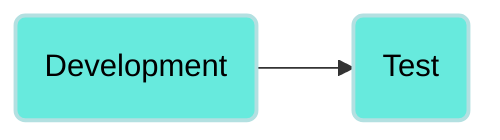
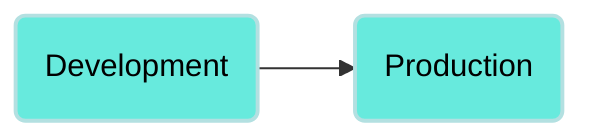
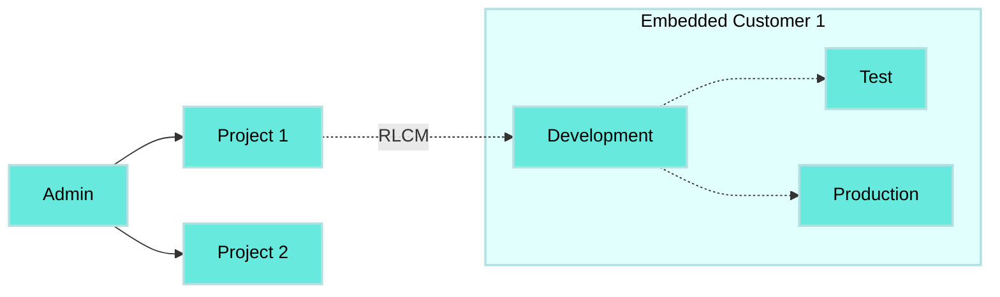

# Deploy assets

You must have deployment permission to deploy a project within an environment. Refer to [Collaborator roles and Environments](/en/oem/embedded-environments/environment-roles) for more information.

The **Deployments** tab is only visible to collaborators that have access to more than one environment _and_ deploying permissions in at least two environments. This allows collaborators to deploy and review deployment history when they click the **Deployments** tab.

_Deployments tab visible and usable_

Collaborators with access to two or more environments _without_ deploying permissions in at least two environments can see the **Deployments** tab as locked. In this case, collaborators can see a lock icon and a message that they need permission to access deployments.

Collaborators with access to only one environment cannot see the Deployments tab.

_Deployments tab not visible_

The **Deployments** tab also displays deployment history, providing a comprehensive view of all past deployments. This functionality is particularly useful for revisiting and redeploying a previous version of your project or recipe. You can revert your deployment to an earlier state by selecting the version you plan to revert to and re-deploying it.

_Deployment history_

To re-deploy a past deployment, click on the deployment you plan to re-deploy and click **Deploy**.

_Redeploy a previous deployment_

## Deployments workflow

You can only deploy from Development to Test and from Development to Production.





We recommend that you use **Deploy entire project** when using Embedded Environments.



## Deploy a project

Complete the following steps to deploy a project to an environment:

1. Log in to your Workato account, click **Resources** in the left-side navigation menu, and then click **Projects**.
   
2. Select the project you plan to deploy.
   
3. Click **Deployments > Deploy project**.
   
4. Select **Test** or **Production** as the target environment. Alternatively, you can download the package.
   
   _Deploy to Test environment_
   
5. Optional. Summarize your changes in the **Notes** field.
   
6. Click **Next**.
   
7. Select **Deploy entire project** or **Customize deployment** as the deployment type.
   
   > **DEPLOY ENTIRE PROJECT RECOMMENDATION**
   > 
   > We recommend that you select **Deploy entire project** when using Environments.
   
   _Select deployment type_
   
8. Click **Next**. Environments begins to detect changes in the deployment.
   
9. Review the changes. You can click specific changes to view a side-by-side comparison of the previous version and the new version.
   
   _Deployment comparison_
   
10. Click **Deploy**.
    

## Deploy a project build programmatically

You can deploy your project programmatically. Refer to [Understanding project deployment](/en/workato-api/projects#understanding-project-deployment) for more information.

> **PROJECT-BASED PACKAGE RECOMMENDATION**
> 
> Deployments from Embedded Partners to Embedded Customers are done through [Recipe Lifecycle Management (RLCM)](/en/recipe-development-lifecycle#recipe-lifecycle-management). We recommend that you use a project-based package.

---

---
url: >-
  https://docs.workato.com/en/oem/embedded-environments/embedded-environments-api.md
description: >-
  Use Embedded APIs with Environments by targeting the Development, Test, or
  Production workspace ID for each managed customer.
---

# Embedded Environments APIs

[Embedded APIs](/en/oem/oem-api) are fully compatible with Embedded Environments. You can continue to use the same Embedded API across all environments by targeting the appropriate workspace ID. When provisioning Environments for an existing Embedded Customer, their original workspace ID becomes the Development workspace ID, and two new IDs are generated for the TEST and PROD Environments.

## Embedded APIs with and without Environments

The base URL for all Embedded API interactions is:

`.../api/managed_users/`

Append the `managed_user_id` to this base URL to interact with a specific customer. This allows you to manage each environment for customers with Environments provisioned by pointing to each workspace ID. If the customer doesn't have Environments provisioned, you can use the URL `/api/managed_users/:managed_user_id` to interact with a specific customer.

> **WORKSPACE ID REPRESENTATION FOR PROVISIONED AND NON-PROVISIONED ENVIRONMENTS**
> 
> The `managed_user_id` represents the Workspace ID when Environments is not provisioned. The `managed_user_id` represents each environment ID (Development, Test, or Production) when Environments is provisioned. To find the `managed_user_id`: click **Workspace Admin > Settings > Workspace ID**.
> 
> Use the following API endpoints to target a specific environment within a customer's account:
> 
> - **Development environment:**`/api/managed_users/:managed_user_id_dev`
>   
> - **Test environment:** `/api/managed_users/:managed_user_id_test`
>   
> - **Production environment:** `/api/managed_users/:managed_user_id_prod`
>   
> 
> When you provision Environments for an existing customer, their original `:managed_user_id` is designated for the Development environment (`:managed_user_id_dev`). New unique identifiers are generated for the Test and Production environments (`:managed_user_id_test` and `:managed_user_id_prod`, respectively). This ensures that each environment is independently accessible and manageable through the API, providing precise control over the deployment and operation of integrations across different development stages.

## Provision Environments programmatically

You can provision the Environments feature programmatically for new and existing managed customers. Refer to the [Embedded APIs Environments](/en/oem/oem-api/managed-users#provision-environments) section for more information.

## How to get the correct ID

You can retrieve the IDs for your customers' environments using the [Get List Of Customers API](/en/oem/oem-api/managed-users#get-list-of-customer-accounts).

When listing your customers, those with Environments provisioned return the new property `environments` with the PROD and TEST environments IDs.

### Sample request

```shell
curl  -X GET https://app.workato.com/api/managed_users \
      -H 'Authorization: Bearer <api_token>'
```

### Response

```json
{
        {
            "id": 29727, //this is the used_id for a customer without ENVs
            "external_id": null,
            "name": "new",
            "environments": [],
            "notification_email": "virginia2@workato.com",
            ...
        },
        {
            "id": 29833, //this is the used_id_dev for a customer with ENVs
            "external_id": null,
            "name": "Alex",
            "environments": [
                {
                    "id": 29835, //this is the used_id_prod for a customer with ENVs
                    "environment_type": "prod"
                },
                {
                    "id": 29834, //this is the used_id_test for a customer with ENVs
                    "environment_type": "test"
                }
            ],
            "notification_email": "alex@workato.com",
           ...
        },
}
```

## External IDs for environments

You can also specify unique external IDs for each of your customers' environments. External IDs enable you to manage customers programmatically in the same way as you do for customers without Environments.

To add an external ID, you can either [Update the customer through the API](/en/oem/oem-api/managed-users#update-customer-account-member) or add it through the UI:

1. Navigate to **Manage customers**.
   
2. Click **Settings > External IDs**.
   

## Exclusive development environment access

Certain API endpoints, designed for development activities like collaborator management, are exclusively accessible within the Development environment. An error displays if you try to access these endpoints from your TEST or PROD environments.

For example:

### Sample request

```shell
curl  -X POST https://app.workato.com/api/managed_users/:managed_user_id_test \
      -H 'Authorization: Bearer <api_token>'
```

### Response

```json
{
    "message": "Not Available for Environment"
}
```

---
