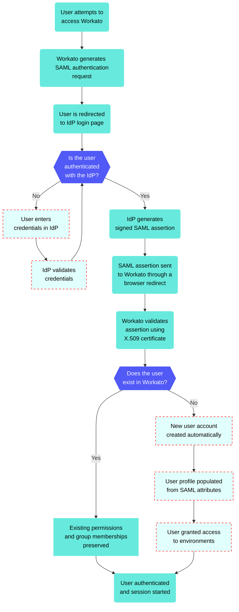

# Workato Identity SAML-based SSO

SAML-based single sign-on (SSO) authentication enhances security when accessing Workato features and improves user experience.

SAML-based SSO enables you to add an identity provider (IdP) for authentication management. This adds robust security measures and reduces the risk of password-related breaches. Your organization can enforce SAML-based authentication to comply with internal security policies and regulatory requirements to ensure that only authorized users access sensitive data.

SAML-based SSO also streamlines the user experience by allowing users to sign in once and access multiple Workato features without separate logins. Additionally, it allows centralized management of user identities and access controls through your IdP to apply access policies consistently.

## SAML-based SSO key features

Workato Identity supports SAML-based SSO to provide the following key features:

- Just-in-Time (JIT) Provisioning
  
- You can enable [JIT provisioning](/en/workato-identity/jit-provisioning) to automatically create user accounts when they first sign in through SSO. This eliminates the need for administrators to manually create accounts and keeps user information current.
  
- Customizable attributes
  
- You can configure both your [Identity Provider (IdP)](/en/workato-identity/identity-provider-user-access#configure-your-identity-provider) and Service Provider (SP) to [sync user group](/en/workato-identity/user-group-syncing) information using SAML attributes, such as group memberships.
  
- Selective enforcement
  
- Your organization can choose to enforce SAML-based authentication for all users or [add users manually](/en/workato-identity/add-end-user-manually). This option supports compliance requirements while allowing flexibility for development and testing.
  

## SAML-based SSO workflow

Your IdP and Workato Identity exchange SAML metadata to enable SAML-based SSO authentication. You must set up a SAML application in your IdP with specific values, such as the single sign-on URL and metadata URL. You can also configure [user group syncing](/en/workato-identity/user-group-syncing#enable-user-group-syncing).

SSO configuration can vary based on your specific IdP. Refer to the Enforce SAML-based SSO authentication for Okta guide to learn how to enable this capability for Okta. This guide includes instructions for enabling user groups sync, which allows you to sync group assignments between the Workflow apps portal and your IdP.

## Configure SAML-based authentication

Complete the following steps to configure SAML-based authentication in Workato Identity:

> **NOT FOR WORKFLOW APPS SAML-BASED SSO**
> 
> This documentation is specific to Workato Identity. Refer to [SAML-based single sign-on authentication](/en/workflow-apps/saml) to configure SAML authentication for [Workflow apps](/en/workflow-apps).

1. Sign in to your Workato account.
   
2. Go to **Workspace admin**. The **Access control** page displays.
   
3. Go to the **Solutions access** section and click **SAML identity providers**.
   
4. Click **\+ Set up new provider**.
   
5. Provide a name for your IdP in the **Identity provider (IdP) name** field. For example: `Okta Prod`.
   
   _Configure SAML authentication_
   
6. Use the **Enforce SAML authentication for** drop-down menu to select who is required to use SAML-based authentication.
   
7. Copy the **Specify Single sign-on URL** and **Service provider (SP) entity ID** values.
   
8. Go to the **Do you have your identity provider metadata URL?** section and select the option that applies to you.
   
   **Yes: You have your identity provider metadata URL**
   
   1. Select **Yes**.
      
      _Provide your metadata URL_
      
   2. Paste your metadata URL into the **Metadata URL** field. Workato uses this URL to automatically import your SAML configuration.
      
      You can find this URL in your IdP's SAML setup:
      
      - **Okta**: Go to your app's **Sign On** tab and scroll to **Metadata URL**. It typically follows this format: `https://{your-okta-domain}/app/{app-name}/{app-id}/sso/saml/metadata`
      - **Microsoft Entra ID**: Go to your app's **Single sign-on** settings and scroll to **SAML Certificates**. The URL is labeled **App Federation Metadata URL** and typically follows this format: `https://login.microsoftonline.com/{tenant-id}/federationmetadata/2007-06/federationmetadata.xml?appid={app-id}`
      - **Google Workspace**: Go to your app's **SSO Configuration** and scroll to **IDP metadata**. Click **Download metadata** to get the XML file, or use the URL directly if your Google admin has published it.
   
   **No: You don't have your identity provider metadata URL**
   
   1. Select **No**.
      
      _Provide your IdP information_
      
   2. Paste your IdP SSO URL into the **Identity provider single sign-on URL** field.
      
   3. Provide your IdP unique identifier in the **Identity provider issuer** field. This is the Entity ID your IdP uses to identify itself and must match exactly what your IdP is configured to send in SAML assertions.
      
      You can find this value in your IdP's SAML setup instructions:
      
      - **Okta**: Go to your app's **Sign On** tab and click **View SAML setup instructions**. The value is listed as **Identity Provider Issuer** and typically uses the following format: `http://www.okta.com/examplekey123`
      - **Microsoft Entra ID (Azure AD)**: Go to your app's **Single sign-on** settings. The value is listed as **Microsoft Entra Identifier** and typically uses the following format: `https://sts.windows.net/{tenant-id}/`
      - **Google Workspace**: Go to **Apps > Web and mobile apps**, select your app, and open **SSO Configuration**. The value is listed as **Entity ID** and typically uses the following format: `https://accounts.google.com/o/saml2?idpid={idp-id}`
   4. Paste your IdP X509 certificate, including the `-----BEGIN CERTIFICATE-----` and `-----END CERTIFICATE-----` lines in the **X.509 certificate** field. This is the public certificate Workato uses to validate that SAML responses genuinely came from your IdP.
      
      You can find your X509 certificate in your IdP app:
      
      - **Google Workspace**: Go to **Apps > Web and mobile apps**, select your app, and open **SSO Configuration**. Go to the **SSO certificate** section and click **Download certificate**. Open the downloaded `.pem` file in your text editor to copy the certificate.
      - **Microsoft Entra ID**: Go to your Microsoft Entra ID app's **Single sign-on** section. Go to the **SAML Certificates** section and download the **Certificate (Base64)** file. Open the downloaded `.cer` or `.pem` file in your text editor to copy the certificate.
      - **Okta**: Go to your Okta app's **Sign On** tab and scroll to **SAML Signing Certificates**. Click **Actions** next to the active certificate and click **Download certificate**. Open the downloaded `.cer` or `.pem` file in your text editor to copy the certificate.
      - **OneLogin**: Go to the **SSO** section and click **More Actions**. Right-click **SAML Metadata** and select **Copy link address**.
   
9. Click **Set up**.
   

## Add SAML-based authentication

You must [configure SAML-based authentication](#configure-saml-based-authentication) before you can add SAML authentication to end-user groups.

Complete the following steps to add SAML-based authentication to end-user groups:

1. Go to **Workspace admin**. The **Access control** page displays.
   
2. Go to **Authentication & Groups** in the sidebar.
   
3. Select the environment you plan to configure. The environment **End-user group** page displays by default.
   
   > **ENVIRONMENT AVAILABILITY**
   > 
   > Workspaces without [Environments](/en/features/environments) provisioned only have one environment available.
   
4. Select the **Authentication** tab.
   
5. Ensure that the **SAML-based SSO authentication** toggle is enabled.
   
6. Use the **SAML identity provider** drop-down menu to select the SAML identity provider you plan to use.
   
7. Click **Save**.
   

## Configure IdP user access

You must configure your IdP to send the required user attributes in its SAML assertions after you complete the SAML-based SSO configuration. Workato uses these attributes to populate user profiles and manage group memberships.

> **DIRECT SIGN-IN FROM IDP UNSUPPORTED**
> 
> You can't sign in to Workato directly from your IdP. Authentication is only supported when initiated through a conversation in your connected LLM.

Add the following attributes to your IdP's SAML attribute statements:

| Name | Value | Description |
| --- | --- | --- |
| `workato_end_user_name` | `user.displayName` | Maps the user's display name from your IdP to their Workato profile. |
| `workato_end_user_groups` | `appuser.workato_ end_user_groups` | Maps the user's group memberships from your IdP to Workato. Required only if you plan to enable [user group syncing](/en/workato-identity/user-group-syncing#enable-user-group-syncing). |

Refer to the following IdP guides for a step-by-step guide on how to configure SAML and SAML attribute statements:

- [Google Workspace](/en/workato-identity/google-workspace-saml-configuration)
- [Microsoft Entra ID](/en/workato-identity/microsoft-entra-id-saml-configuration)
- [Okta SAML configuration](/en/workato-identity/identity-provider-user-access)
- [OneLogin](/en/workato-identity/onelogin-saml-configuration)

## Troubleshooting

Use this section to troubleshoot errors you may encounter.

### Microsoft Entra ID

Refer to the following Microsoft Entra ID sections to troubleshoot issues:

#### Group claims

Microsoft Entra ID requires you to configure group claims in the SAML assertion. Open your Microsoft Entra ID enterprise application and enable the groups claim. Then select whether to include all groups the user belongs to or only the groups assigned to the application. Workato recommends using only assigned groups for genie deployments. This limits the assertion size and reduces the risk of mapping conflicts.

#### Group object IDs and display names

Microsoft Entra ID sends group identifiers as either object IDs (GUIDs) or display names. Workato Identity maps groups by name, not ID. You must configure Microsoft Entra ID to send group display names rather than object IDs to ensure the mapping works correctly.

#### Nest group membership

Microsoft Entra ID doesn't flatten nested group membership in SAML assertions by default. A user group structure with nested groups, such as a parent group with child groups, may not have child groups memberships included in the assertion. Flatten the relevant group memberships or configure Microsoft Entra ID to include transitive group memberships if your structure requires it.

---

---
url: >-
  https://docs.workato.com/en/workato-identity/google-workspace-saml-configuration.md
description: >-
  Configure Google Workspace as a SAML identity provider for Workato Identity,
  including attribute statements and user assignments.
---

# Google Workspace SAML configuration

This guide describes how to configure Google Workspace as a SAML identity provider (IdP) for Workato Identity.

SAML enables secure authentication between an IdP, such as Google Workspace, and a service provider like Workato. Users authenticate once through Google Workspace and gain access to Workato with a single login instead of managing separate credentials for each application.

> **PREREQUISITES**
> 
> - Workato Identity is available for [Agent Studio](/en/agentic/agent-studio), [Workato GO](/en/agentic/workato-go), [MCP](/en/mcp), and the [API developer portal](/en/api-mgmt/api-developer-portal).
>   
> - [Configure SAML-based authentication](/en/workato-identity/saml-sso#configure-saml-based-authentication) in Workato Identity before you begin. The **Specify Single sign-on URL** and **Service provider (SP) entity ID** values from that setup are required to complete the following steps.
>   
> - Make sure you have super administrator privileges in Google Workspace.
>   

## Configure SAML authentication in Google Workspace

Complete the following steps to configure SAML authentication in Google Workspace:

> **NOT FOR WORKFLOW APPS SAML-BASED SSO**
> 
> This documentation is specific to Workato Identity. Refer to [SAML-based single sign-on authentication](/en/workflow-apps/saml) to configure SAML authentication for [Workflow apps](/en/workflow-apps).

1. Sign in to your [Google Admin console](https://admin.google.com). You must be signed in as a super administrator.
   
2. Go to **Apps > Web and mobile apps**.
   
3. Click **Add App > Add custom SAML app**.
   
   _Click **Add App > Add custom SAML app**._
   
4. Enter a name for the app in the **App name** field. For example, `Workato Agentic` or `MCP Servers`.
   
5. Click **Continue**.
   
6. Go to the **Google Identity Provider details** page and download the **IDP metadata** or copy the following values for later use:
   
   - **SSO URL**
   - **Entity ID**
   - **Certificate**
   
   > **GOOGLE WORKSPACE METADATA**
   > 
   > You may need to host your metadata file or verify if your Google Workspace tier exposes a metadata endpoint to provide a metadata URL in later steps.
   
7. Click **Continue**.
   
8. Go to the **Service Provider Details** window and paste the **Single sign-on URL** from Workato into the **ACS URL** field.
   
9. Paste the **Service provider (SP) entity ID** from Workato into the **Entity ID** field.
   
10. Click **Continue**.
    
11. Go to the **Attribute Mapping** section and click **Add mapping** to add the following attributes:
    
    | Google Directory attribute | App attribute |
    | --- | --- |
    | `Basic Information > Full name` | `workato_end_user_name` |
    | `Employee Details > Department` | `workato_end_user_groups` |
    
12. Click **Finish**.
    
13. Go back to **Apps > Web and mobile apps** and select your newly created app.
    
14. Click **User access** and set the service to **On for everyone**. Alternatively, you can configure access by organizational unit or group as required.
    
15. Click **Save**.
    
16. Return to the app's settings page and copy the **Metadata URL**, or use the IDP metadata file you downloaded in the previous steps. You must use this in the **Do you have your identity provider metadata URL?** section of the **Set up a new provider** modal in Workato Identity.
    
17. Go to your app's **App Access Control** to configure the settings to prevent users from seeing or launching the app directly.
    
    > **DIRECT SIGN-IN FROM IDP UNSUPPORTED**
    > 
    > You can't sign in to Workato directly from your IdP. Authentication is only supported when initiated through a conversation in your connected LLM.

---

---
url: >-
  https://docs.workato.com/en/workato-identity/microsoft-entra-id-saml-configuration.md
description: >-
  Configure Microsoft Entra ID as a SAML identity provider for Workato Identity,
  including attribute statements and user assignments.
---

# Microsoft Entra ID SAML configuration

This guide describes how to configure Microsoft Entra ID as a SAML identity provider (IdP) for Workato Identity.

SAML enables secure authentication between an IdP, such as Microsoft Entra ID, and a service provider like Workato. Users authenticate once through Microsoft Entra ID and gain access to Workato with a single login instead of managing separate credentials for each application. Refer to Microsoft Entra ID [SAML-based authentication](https://learn.microsoft.com/en-us/power-pages/security/authentication/saml2-settings-azure-ad) documentation for more information.

> **PREREQUISITES**
> 
> - Workato Identity is available for [Agent Studio](/en/agentic/agent-studio), [Workato GO](/en/agentic/workato-go), [MCP](/en/mcp), and the [API developer portal](/en/api-mgmt/api-developer-portal).
>   
> - [Configure SAML-based authentication](/en/workato-identity/saml-sso#configure-saml-based-authentication) in Workato Identity before you begin. The **Specify Single sign-on URL** and **Service provider (SP) entity ID** values from that setup are required to complete the following steps.
>   

## Configure SAML authentication in Microsoft Entra ID

Complete the following steps to configure SAML authentication in Microsoft Entra ID:

> **NOT FOR WORKFLOW APPS SAML-BASED SSO**
> 
> This documentation is specific to Workato Identity. Refer to [SAML-based single sign-on authentication](/en/workflow-apps/saml) to configure SAML authentication for [Workflow apps](/en/workflow-apps).

1. Sign in to the [Microsoft Entra admin center](https://entra.microsoft.com) or the [Azure portal](https://portal.azure.com).
   
2. Go to **Identity > Applications > Enterprise applications** and click **New application**.
   
3. Click **Create your own application**.
   
4. Enter a name for the app in the **What's the name of your app?** field. For example, `Workato Agentic` or `MCP Servers`.
   
5. Select **Integrate any other application you don't find in the gallery (Non-gallery)** and click **Create**.
   
6. Go to **Manage > Single sign-on** and select **SAML** as the single sign-on method.
   
7. Go to the **Basic SAML Configuration** section and click **Edit**.
   
8. Paste the **Service provider (SP) entity ID** from Workato into the **Identifier (Entity ID)** field.
   
9. Paste the **Single sign-on URL** from Workato into the **Reply URL (Assertion Consumer Service URL)** field.
   
   _Paste the **Single sign-on URL** from Workato into the **Reply URL (Assertion Consumer Service URL)** field_
   
10. Click **Save**.
    
11. Go to the **Attributes & Claims** section and click **Edit**.
    
12. Click **\+ Add new claim** and add the following attribute:
    
    | Name | Source attribute |
    | --- | --- |
    | `workato_end_user_name` | `user.displayname` |
    
13. Click **Save**.
    
14. Click **\+ Add a group claim** and configure the following settings:
    
    | Setting | Value |
    | --- | --- |
    | Which groups should be returned in the claim? | **Groups assigned to the application** |
    | Source attribute | **Cloud-only group display names** |
    | Customize the name of the group claim | Enabled |
    | Name | `workato_end_user_groups` |
    | Namespace | Leave empty |
    
    _Configure the group claims settings in Microsoft Entra ID_
    
15. Click **Save**.
    
16. Go to **Manage** and select **Users and groups**.
    
17. Click **Add user/group** and add one or more users or groups that should have access to the application.
    
18. Click **Assign**.
    
19. Return to **Single sign-on** and scroll to the **SAML Certificates** section.
    
20. Copy the **App Federation Metadata URL**. You must use this URL in the **Do you have your identity provider metadata URL?** section of the **Set up a new provider** modal in Workato Identity.
    
21. Return to your Microsoft Entra ID account and go to **Properties**.
    
22. Set **Visible to users?** to **No** to prevent the app from appearing in the user's app launcher.
    
    > **DIRECT SIGN-IN FROM IDP UNSUPPORTED**
    > 
    > You can't sign in to Workato directly from your IdP. Authentication is only supported when initiated through a conversation in your connected LLM.

---
